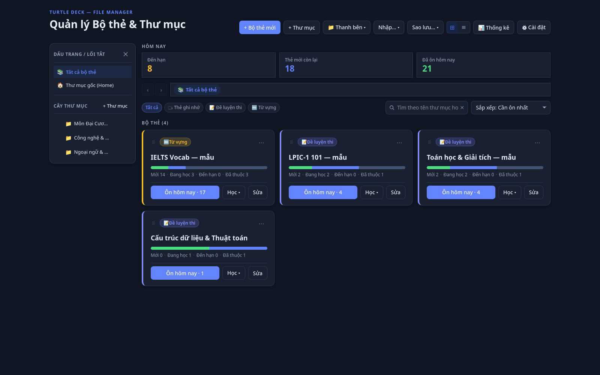
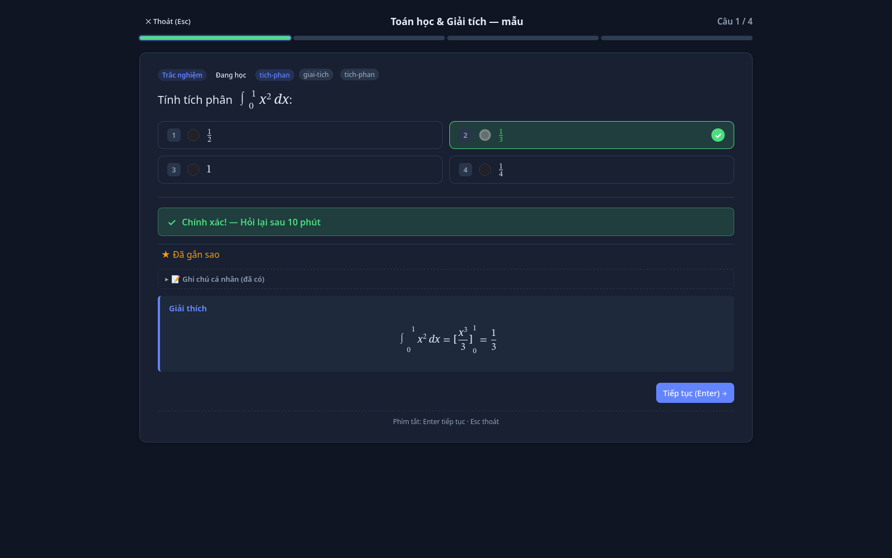
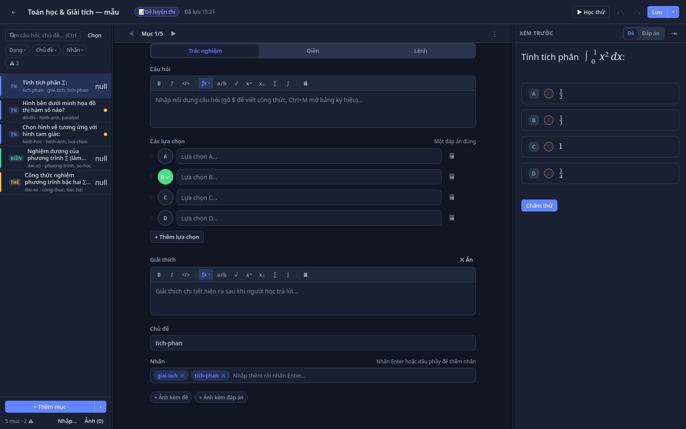
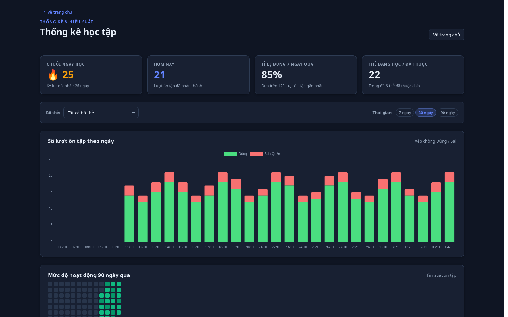
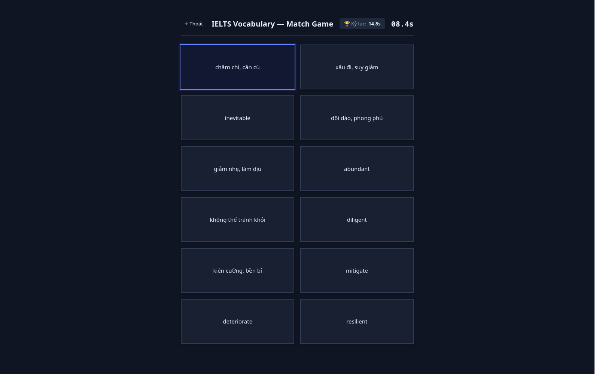
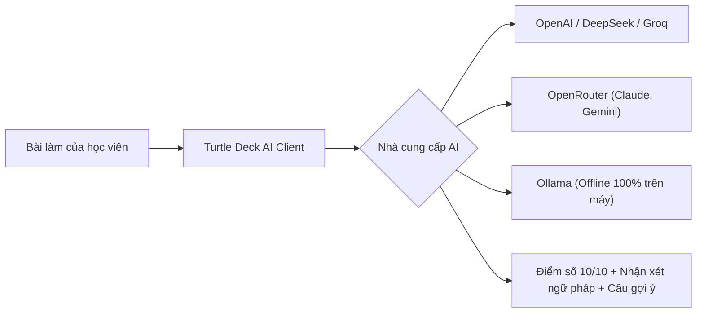
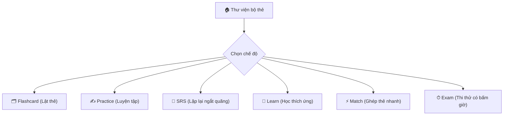

<div align="center">


# Turtle Deck 🐢

### Ứng dụng học tập Offline-First bằng Flashcard, Trắc nghiệm & Lặp lại ngắt quãng (SRS)
**Thế hệ mới tối ưu hoá bằng Tauri v2 & Rust — Siêu nhẹ, Khởi động tức thì, Tiết kiệm RAM**

[](https://github.com/viet15t12/TurtleDeck/releases)
[%20%7C%20Windows-blue?logo=linux&logoColor=white)](https://github.com/viet15t12/TurtleDeck/releases)
[](https://tauri.app/)
[](https://www.rust-lang.org/)
[](https://www.typescriptlang.org/)
[-003B57?logo=sqlite&logoColor=white)](https://github.com/rusqlite/rusqlite)
[](./test)
[](./LICENSE)

<p align="center">
  <a href="#-giao-diện-ứng-dụng-screenshots">Ảnh chụp giao diện</a> •
  <a href="#-cài-đặt--khởi-chạy">Cài đặt nhanh</a> •
  <a href="#-tính-năng-nổi-bật">Tính năng</a> •
  <a href="#-các-chế-độ-học-tập">Chế độ học</a> •
  <a href="#-bảng-phím-tắt-shortcuts">Phím tắt</a> •
  <a href="#-bộ-file-mẫu-ngoài-editor">File mẫu</a> •
  <a href="./SPECIFICATION.md">Đặc tả kỹ thuật</a>
</p>

</div>

---

## 🌟 Giới thiệu tổng quan

**Turtle Deck** là ứng dụng máy tính cá nhân (Desktop Application) được thiết kế cho việc học sâu, bền bỉ và tập trung cao độ:
- **Biểu tượng chú rùa (Turtle)**: Đại diện cho sự kiên trì, từng bước vững chắc. Ứng dụng sử dụng thuật toán lặp lại ngắt quãng (**Spaced Repetition System - SRS**) chuẩn SM-2 để tối ưu hóa khả năng ghi nhớ dài hạn mà không gây quá tải.
- **Offline-First & Bảo mật tuyệt đối**: Dữ liệu bộ thẻ và tiến trình được lưu trữ hoàn toàn cục bộ trên máy tính của bạn dưới dạng tệp gói `.sdeck` độc lập và cơ sở dữ liệu SQLite nhúng. Không cần đăng ký tài khoản, không gửi dữ liệu ra ngoài Internet, chặn hoàn toàn mã độc qua chính sách **Content Security Policy (CSP)** nghiêm ngặt.
- **Đa năng & Tự động hoá**: Hỗ trợ toàn diện từ Flashcard truyền thống, Trắc nghiệm đơn/đa lựa chọn, Điền từ khuyết, Gõ lệnh lập trình, Luyện từ vựng phát âm chuẩn (Text-To-Speech) đến Trò chơi ghép thẻ và Thi thử bấm giờ.
- **Kiến trúc Tauri v2 & Rust**: Binary thực thi chỉ vỏn vẹn **~11 MB** (so với 329 MB trước đây), chiếm dưới **60 MB RAM** khi chạy và mở cửa sổ trong chưa đầy **0.3 giây**.

---

## 📸 Giao diện ứng dụng (Screenshots)

### 1. Thư viện Bộ thẻ & Cây thư mục (Home)
Quản lý tập trung mọi bộ thẻ theo cấu trúc cây thư mục phân cấp phong cách Nautilus, thống kê nhanh số lượng thẻ cần ôn hôm nay và thanh tìm kiếm tiện lợi.



---

### 2. Phiên học Lặp lại ngắt quãng (Flashcard SRS)
Hỗ trợ đầy đủ công thức Toán học KaTeX chuẩn xác ($\int_0^1 x^2\,dx$), phản hồi tức thì đúng/sai, thanh tiến độ phân đoạn và chấm điểm theo thuật toán SM-2.



---

### 3. Trình soạn thảo bộ thẻ chuyên nghiệp (Deck Editor)
Tích hợp thanh công cụ ký hiệu toán học trực quan (phân số, căn, tích phân, ma trận...), xem trước công thức KaTeX thời gian thực, quản lý đáp án và tự động lưu nháp an toàn.



---

### 4. Báo cáo Thống kê & Phân tích tiến độ (Analytics)
Theo dõi chuỗi ngày học liên tục (Streak 🔥), biểu đồ số lượt ôn tập hàng ngày bằng Chart.js, Heatmap 90 ngày và danh sách các thẻ khó cần ôn tập lại.



---

### 5. Trò chơi Ghép thẻ phản xạ tính giờ (Match Game)
Thử thách trí nhớ và tốc độ với chế độ ghép đôi từ vựng hoặc thuật ngữ - định nghĩa tính thời gian kỷ lục cá nhân.



---

## ⚡ So sánh hiệu năng: Tauri v2 vs Electron cũ

| Tiêu chí so sánh | Electron cũ (v0.1.x) | Tauri v2 hiện tại (v0.2.x) | Mức độ cải thiện |
|---|---|---|---|
| **Dung lượng file cài đặt (RPM / AppImage)** | ~98 MiB | **~11 MiB** | **Giảm ~89%** 🚀 |
| **Dung lượng bung ra đĩa (Unpacked)** | ~329 MiB | **~28 MiB** | **Giảm ~91%** 💾 |
| **Bộ nhớ RAM tiêu thụ (Idle)** | ~180 – 250 MB | **~40 – 60 MB** | **Tiết kiệm ~75% RAM** ⚡ |
| **Thời gian khởi động ứng dụng** | ~1.8 – 2.5 giây | **≤ 0.3 giây** | **Nhanh hơn gấp 6 lần** ⏱️ |
| **Bảo mật & Mã nguồn backend** | Node.js / ASAR | **Rust native nhị phân** | Tối ưu & an toàn bộ nhớ 🛡️ |

---

## 🚀 Cài đặt & Khởi chạy

### 📦 Dành cho người dùng cuối (Linux & Windows)

Tải phiên bản mới nhất từ [GitHub Releases](https://github.com/viet15t12/TurtleDeck/releases):

#### 1. Cài đặt qua gói RPM (Khuyên dùng cho Fedora / RHEL)
```bash
sudo dnf install ./turtle-deck-0.2.3-1.x86_64.rpm
```
> [!NOTE]
> Gói RPM tự động tích hợp biểu tượng desktop, phân loại vào menu **Education**, và đăng ký MIME type `application/x-studydeck` để bạn chỉ cần nhấp đúp vào bất kỳ file `.sdeck` nào là ứng dụng sẽ mở ngay lập tức.

#### 2. Cài đặt qua gói DEB (Ubuntu / Debian / Linux Mint)
```bash
sudo dpkg -i ./turtle-deck_0.2.3_amd64.deb
```

#### 3. Chạy trực tiếp qua AppImage (Mọi bản phân phối Linux)
```bash
chmod +x "turtle-deck_0.2.3_amd64.AppImage"
./"turtle-deck_0.2.3_amd64.AppImage"
```

---

### 💻 Dành cho nhà phát triển (Build từ nguồn)

**Yêu cầu hệ thống:**
- **Node.js**: $\ge$ 20.0.0 & `npm`
- **Rust toolchain**: $\ge$ 1.80 (`rustc`, `cargo`)
- **Thư viện hệ thống (Linux)**: `webkit2gtk4.1-devel` (Fedora) hoặc `libwebkit2gtk-4.1-dev` (Ubuntu/Debian)

```bash
# 1. Cài đặt các phụ thuộc npm
npm install

# 2. Đóng gói các bộ thẻ mẫu đi kèm
npm run build:samples

# 3. Biên dịch frontend và khởi chạy chế độ phát triển Tauri
npm start
# hoặc:
npm run tauri:dev
```

#### Đóng gói bản cài đặt phân phối (Release binary):
```bash
npm run tauri:build
```
> Tệp nhị phân release và các gói cài đặt (`.rpm`, `.deb`, `.AppImage`) sẽ được sinh tự động tại `src-tauri/target/release/bundle/`.

#### Chạy kiểm thử tự động & Kiểm tra kiểu:
```bash
npm run typecheck             # TypeScript strict type checking
npm test                      # Chạy toàn bộ 193 unit & characterization tests (Node.js)
cd src-tauri && cargo test    # Chạy kiểm thử tự động backend Rust
cd src-tauri && cargo clippy  # Kiểm tra chất lượng mã nguồn Rust
```

---

## 💎 Tính năng nổi bật

### 1. Định dạng bộ thẻ độc lập `.sdeck` & Khả năng cứu dữ liệu
- **Gói đóng kín an toàn**: Một file `.sdeck` là tệp lưu trữ chuẩn ZIP chứa `deck.json` và thư mục ảnh `img/`. Ảnh được nạp và phục vụ qua giao thức bộ nhớ cô lập `asset://`, không bao giờ xả file rác ra ổ cứng.
- **Cứu dữ liệu khẩn cấp (Zero Lock-in)**: Bạn hoàn toàn sở hữu dữ liệu của mình. Nếu muốn trích xuất dữ liệu mà không cần mở app, chỉ cần **đổi đuôi `.sdeck` thành `.zip`** rồi giải nén để lấy toàn bộ `deck.json` và hình ảnh.

### 2. Trình soạn thảo Deck Editor mạnh mẽ
- **Hỗ trợ công thức Toán học LaTeX (KaTeX)**: Soạn thảo công thức mượt mà với `$inline$` và `$$block$$`, tích hợp thanh công cụ ký hiệu toán trực quan (phân số, căn, tích phân, ma trận...).
- **Quản lý đa phương tiện**: Kéo thả ảnh trực tiếp vào thẻ, hỗ trợ xem trước qua Lightbox phóng to.
- **An toàn khi soạn thảo**: Tự động lưu nháp (Auto-draft) định kỳ vào thư mục cục bộ, tự động phục hồi nếu có sự cố mất điện; đầy đủ lịch sử Hoàn tác (`Ctrl+Z`) và Làm lại (`Ctrl+Y`).

### 3. Hỗ trợ học ngoại ngữ & Từ vựng chuyên sâu
- Tự động sinh câu hỏi phong phú từ thẻ từ vựng: Trắc nghiệm 4 đáp án, Gõ từ 2 chiều, Điền khuyết theo ngữ cảnh, Nghe chính tả (Listen & Write).
- Phát âm chuẩn xác qua Web Speech API (TTS) với thuật toán tự động chọn giọng đọc chuẩn theo ngôn ngữ bộ thẻ.

### 4. Dịch câu có từ gợi ý (Key Word Transformation) & Chấm điểm phân tầng
- **Chống bắt lỗi cứng nhắc**: Thay vì so khớp chuỗi cố định gây ức chế, ứng dụng áp dụng quy trình **chấm điểm phân tầng (Layered Evaluator)**:
  1. *Tầng 1 (Anchor):* Kiểm tra sự xuất hiện của từ gợi ý theo nguyên từ, tự động nhận diện biến thể hình thái học (`prevent`, `prevented`, `preventing`, `prevents`...).
  2. *Tầng 2 (Pattern):* Kiểm tra cấu trúc ngữ pháp bắt buộc qua regex (ví dụ `prevent\s+\w+\s+from\s+\w+ing`).
  3. *Tầng 3 (So khớp câu):* Chuẩn hóa chữ thường, dấu câu, mở rộng từ co rút (`I'm` $\leftrightarrow$ `I am`, `don't` $\leftrightarrow$ `do not`, `can't` $\leftrightarrow$ `cannot`...).
  - *Fallback thông minh:* Nếu đúng từ gợi ý và đúng cấu trúc nhưng câu viết khác đáp án mẫu $\rightarrow$ Đánh dấu **"Cần xem lại" (Needs Review)** thay vì phạt sai.
- **Xuất Markdown (.md) cho Người chấm / Giáo viên**: Xuất toàn bộ bài làm theo từng Heading, điền sẵn kết quả kiểm tra tự động và chừa ô `Điểm:` / `Nhận xét:`.

---

## 🤖 Cấu hình & Sử dụng API AI để Chấm bài (Bring Your Own AI)

Turtle Deck cho phép bạn kết nối trực tiếp với **bất kỳ nhà cung cấp AI nào** (hoặc chạy AI cục bộ hoàn toàn miễn phí trên máy tính của bạn) theo chuẩn **OpenAI-Compatible Chat Completions API** để thẩm định ngữ pháp, ngữ cảnh và sắc thái câu dịch.



### 1. Bảng thông số cấu hình các dịch vụ AI phổ biến

Bạn có thể cấu hình trong màn hình **Cài đặt (Settings)** hoặc file `settings.json`:

| Nhà cung cấp | Base URL | Model khuyến nghị | Đặc điểm & Chi phí |
| :--- | :--- | :--- | :--- |
| **DeepSeek** *(Khuyên dùng)* | `https://api.deepseek.com/v1` | `deepseek-chat` | Khả năng ngôn ngữ cực mạnh, chi phí siêu rẻ (~vài đồng/câu). |
| **Groq** | `https://api.groq.com/openai/v1` | `llama-3.3-70b-versatile` | Tốc độ phản hồi tức thì (< 0.5s), có gói miễn phí hàng ngày. |
| **OpenAI** | `https://api.openai.com/v1` | `gpt-4o-mini` | Chuẩn mực, ổn định cao, chi phí rất rẻ. |
| **OpenRouter** | `https://openrouter.ai/api/v1` | `anthropic/claude-3.5-sonnet` hoặc `google/gemini-flash-1.5` | Một API Key duy nhất để gọi mọi mô hình Claude, Gemini, GPT. |
| **Ollama** *(Offline 100%)* | `http://localhost:11434/v1` | `llama3.2`, `qwen2.5` | **Chạy trực tiếp trên máy, 0 đồng, không cần internet, bảo mật tuyệt đối**. |

---

### 2. Hướng dẫn từng bước nhập API Key

#### Bước 1: Lấy API Key từ nhà cung cấp bạn chọn
* **DeepSeek:** Đăng ký tại [platform.deepseek.com](https://platform.deepseek.com/) $\rightarrow$ Chọn *API Keys* $\rightarrow$ Tạo khóa mới (`sk-...`).
* **Groq:** Đăng ký miễn phí tại [console.groq.com](https://console.groq.com/) $\rightarrow$ Tạo API Key.
* **OpenAI:** Tạo khóa tại [platform.openai.com/api-keys](https://platform.openai.com/api-keys).
* **Ollama (Nếu muốn dùng Offline miễn phí):** Cài [Ollama](https://ollama.com/), mở terminal chạy `ollama run llama3.2` (không cần API Key).

#### Bước 2: Nhập thông số vào Turtle Deck
1. Nhấn phím tắt `Ctrl + ,` (hoặc biểu tượng bánh răng) để mở **Cài đặt**.
2. Cuộn đến mục **Cấu hình AI Chấm bài (AI Grading)**:
   - **Base URL:** Điền URL theo bảng trên (ví dụ: `https://api.deepseek.com/v1`).
   - **API Key:** Dán mã khóa của bạn (được lưu an toàn cục bộ trên máy).
   - **Model Name:** Điền mã mô hình (ví dụ: `deepseek-chat`).
3. Bấm **Lưu cài đặt**.

#### Bước 3: Trải nghiệm chấm bài thông minh
Khi làm bài tập dịch câu, bấm nút **"Chấm bằng AI"**:
* AI sẽ thẩm định xem bạn có dùng đúng từ gợi ý hay không.
* Chấm điểm Ngữ pháp (Grammar Score) và Độ sát nghĩa (Meaning Score) theo thang điểm 10.
* Đưa ra nhận xét cụ thể: phân tích thì, giới từ đi kèm và câu sửa hoàn chỉnh tối ưu.
* Toàn bộ đánh giá của AI có thể tự động đính kèm khi bạn bấm **"Xuất bài làm ra Markdown (.md)"**.

---

## 🧠 Các chế độ học tập

Turtle Deck cung cấp 6 chế độ học tập đa dạng đáp ứng mọi nhu cầu ôn luyện:



| Chế độ | Mô tả chi tiết | Đối tượng phù hợp |
| :--- | :--- | :--- |
| **🗂 Flashcard** | Lật thẻ 2 chiều (Trước ↔ Sau hoặc Thuật ngữ ↔ Định nghĩa). Tự đánh giá khả năng nhớ theo 4 mức độ: `Again`, `Hard`, `Good`, `Easy`. | Ôn tập kiến thức lý thuyết, ghi nhớ nhanh. |
| **✍️ Practice** | Luyện trắc nghiệm và điền câu trả lời có chấm điểm tức thì, phản hồi đúng/sai kèm giải thích chi tiết. | Luyện đề thi, củng cố kiến thức từng bài. |
| **🔄 SRS** | Thuật toán SM-2 chuẩn hóa: tính toán khoảng cách ngày ôn tập tự động dựa trên độ khó và lịch sử phản xạ của từng thẻ. | Ghi nhớ dài hạn, duy trì phản xạ không quên. |
| **🧠 Learn** | Chu trình học thích ứng thông minh: tự động lặp lại các câu sai dưới nhiều dạng khác nhau cho đến khi nắm vững 100%. | Học từ vựng mới hoặc các nội dung khó. |
| **⚡ Match** | Trò chơi phản xạ ghép các cặp câu hỏi - đáp án hoặc từ vựng - nghĩa tính thời gian kỷ lục cá nhân. | Khởi động buổi học, giải trí có thưởng. |
| **⏱ Exam** | Mô phỏng phòng thi thật: trộn đề ngẫu nhiên, giới hạn thời gian làm bài, tính điểm % và gom các câu làm sai để ôn lại. | Đánh giá tổng kết trước kỳ thi thật. |

---

## 📥 Nhập dữ liệu không cần Editor (Bulk Import & CLI)

Bạn có thể dễ dàng nạp dữ liệu từ Excel, Google Sheets, Obsidian, Anki, Quizlet mà **không cần mở Editor**:

> [!TIP]
> Toàn bộ các file mẫu và tài liệu quy tắc chi tiết được đặt tại thư mục [`templates/`](./templates/):
> - 📄 [`templates/sample.txt`](./templates/sample.txt): Mẫu Quizlet 2 cột phân cách bằng Tab `\t`.
> - 📊 [`templates/sample.csv`](./templates/sample.csv): Mẫu bảng tính CSV chuẩn RFC 4180 có tiêu đề.
> - 📑 [`templates/sample.tsv`](./templates/sample.tsv): Mẫu bảng tính Tab-separated values.
> - 📝 [`templates/sample-quiz.md`](./templates/sample-quiz.md): Mẫu Markdown trắc nghiệm (`single`, `multi`, `fill`, `command`).
> - 📖 [`templates/sample-vocab.md`](./templates/sample-vocab.md): Mẫu Markdown từ vựng chuyên sâu (`## term | ipa | pos`).
> - 🧩 [`templates/sample.json`](./templates/sample.json): Mẫu `deck.json` chuẩn Turtle Deck đóng gói trực tiếp.
> - 🌐 [`templates/sample-translate.json`](./templates/sample-translate.json): Mẫu bài tập Dịch câu có sử dụng từ gợi ý (`translate`).
> - 📘 **Hướng dẫn quy tắc chi tiết:** [`templates/QUY_TAC_TAO_BO_THE.md`](./templates/QUY_TAC_TAO_BO_THE.md).

#### Đóng gói trực tiếp thành `.sdeck` bằng dòng lệnh (CLI):
```bash
# Đóng gói một thư mục nguồn (chứa deck.json và img/) thành file .sdeck:
node tools/sdeck.mjs pack my-source-folder/ ~/StudyDecks/my-deck.sdeck
```

---

## ⌨️ Bảng phím tắt tiện lợi (Shortcuts)

| Màn hình | Phím tắt | Chức năng thao tác |
| :--- | :--- | :--- |
| **Toàn ứng dụng** | `Ctrl + O` | Mở tệp bộ thẻ `.sdeck` từ đĩa |
| | `Ctrl + ,` | Mở màn hình Cài đặt (Settings) |
| | `Esc` | Thoát phiên học hoặc quay lại màn hình chính |
| **Phiên học (Session)** | `Space` / `Enter` | Lật mặt thẻ Flashcard hoặc nộp câu trả lời |
| | `1`, `2`, `3`, `4` | Chọn đáp án trắc nghiệm hoặc chấm điểm SRS (`Again`, `Hard`, `Good`, `Easy`) |
| | `S` | Đánh dấu sao (Star) câu hỏi để ôn tập riêng |
| | `R` | Nghe lại phát âm Text-To-Speech (thẻ từ vựng) |
| **Soạn thảo (Editor)** | `Ctrl + S` | Lưu bộ thẻ vào tệp `.sdeck` |
| | `Ctrl + N` | Thêm câu hỏi / mục mới |
| | `Ctrl + Z` | Hoàn tác thay đổi (Undo) |
| | `Ctrl + Y` / `Ctrl + Shift + Z` | Làm lại thay đổi (Redo) |
| | `Ctrl + M` | Bật/tắt thanh công cụ toán học LaTeX |

---

## 🏗️ Cấu trúc dự án

```text
studyApp/
├── build/                   # Biểu tượng ứng dụng đa kích thước & metadata desktop
├── data/                    # Các bộ thẻ mẫu nguồn (.sdeck)
├── dist/                    # Frontend đã biên dịch phục vụ cho Tauri Webview
├── docs/
│   ├── plans/               # Kế hoạch tái cấu trúc & di chuyển Tauri hoàn tất
│   ├── reports/             # Báo cáo nghiệm thu các giai đoạn 1 – 6
│   ├── screenshots/         # Ảnh chụp màn hình ứng dụng độ phân giải cao
│   ├── tauri-dev.md         # Hướng dẫn chi tiết thiết lập môi trường Tauri
│   └── tauri-visual-qa.md   # Bảng kiểm thử hiển thị WebKit/WebView2
├── src/                     # Giao diện & Core logic thuần túy (JavaScript/TypeScript)
│   ├── app.js               # Điểm vào chính của Renderer & Routing
│   ├── core/                # Logic nghiệp vụ thuần (SRS, Parser, Grader, Stats...)
│   ├── platform/            # Lớp bọc Tauri IPC API tương thích ngược (tauri-api.js)
│   ├── styles/              # CSS tokens, theme tối/sáng và kiểu dáng các màn hình
│   └── views/               # Các màn hình (Home, Deck, Session, Editor, Stats...)
├── src-tauri/               # Backend native viết bằng Rust (Tauri v2)
│   ├── Cargo.toml           # Định nghĩa crate Rust & các thư viện tối ưu
│   ├── tauri.conf.json      # Cấu hình cửa sổ, CSP, bundle và quyền truy cập
│   └── src/
│       ├── main.rs          # Entry point ứng dụng desktop
│       ├── commands/        # Toàn bộ IPC commands (deck, srs, stats, folder...)
│       ├── db/              # SQLite rusqlite, schema, triggers, migration
│       └── services/        # Package store (.sdeck zip), file watcher, asset protocol
├── templates/               # Bộ tệp mẫu (txt, csv, tsv, md, json) & tài liệu quy tắc
├── test/                    # 193 bài kiểm thử tự động (Unit & Characterization)
└── tools/                   # Bộ công cụ CLI đóng gói, build và chụp ảnh màn hình
```

---

## 📖 Tài liệu kỹ thuật chi tiết

- 📑 [`SPECIFICATION.md`](./SPECIFICATION.md) — Đặc tả kỹ thuật toàn diện về sản phẩm, nghiệp vụ lõi và thiết kế hệ thống.
- 🛠️ [`docs/tauri-dev.md`](./docs/tauri-dev.md) — Hướng dẫn cài đặt môi trường Rust, WebKitGTK và quy trình phát triển Tauri v2.
- 📋 [`docs/tauri-visual-qa.md`](./docs/tauri-visual-qa.md) — Bảng nghiệm thu hiển thị thị giác giao diện.
- 🗃️ [`docs/plans/`](./docs/plans/) — Kế hoạch thực hiện tái cấu trúc renderer và di chuyển sang Tauri v2.

---

## 📄 Giấy phép & Bản quyền

Dự án phát hành dưới giấy phép mã nguồn mở [MIT License](./LICENSE).  
Biểu trưng và thương hiệu thuộc sở hữu của dự án **Turtle Deck**.
