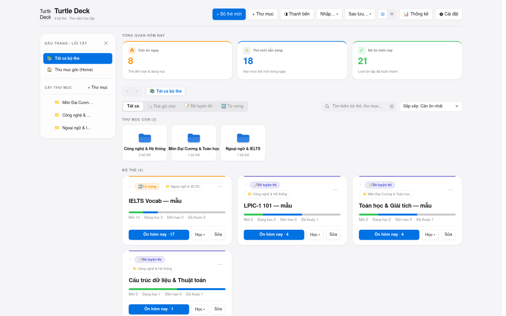
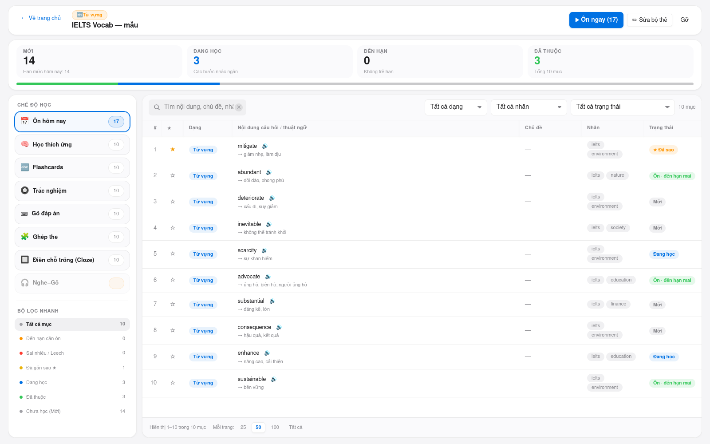
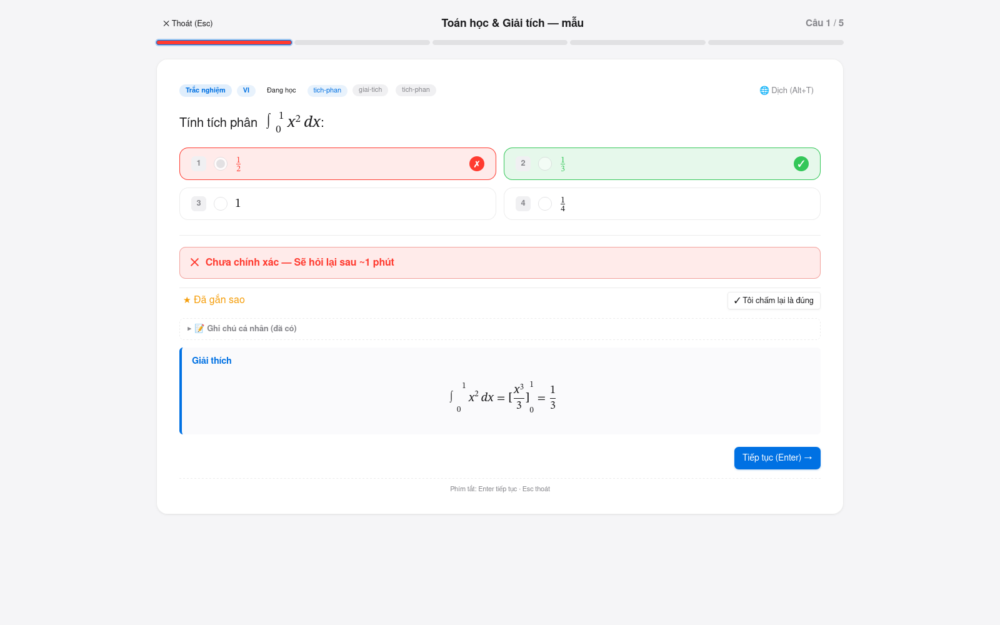
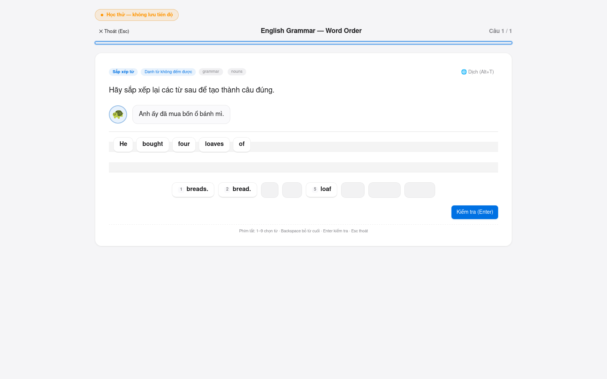
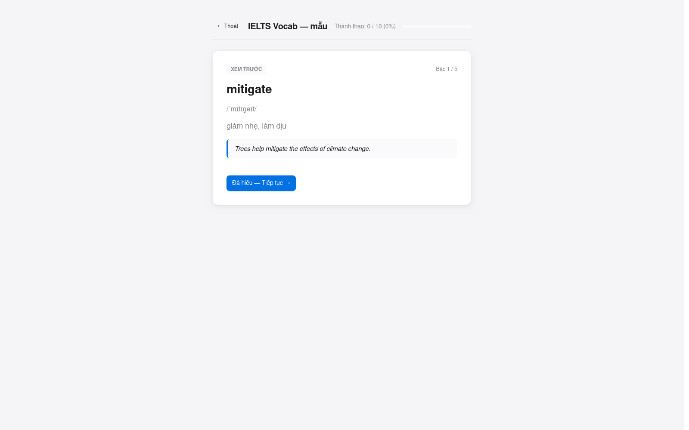
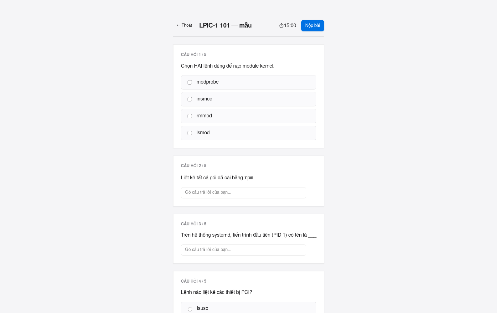
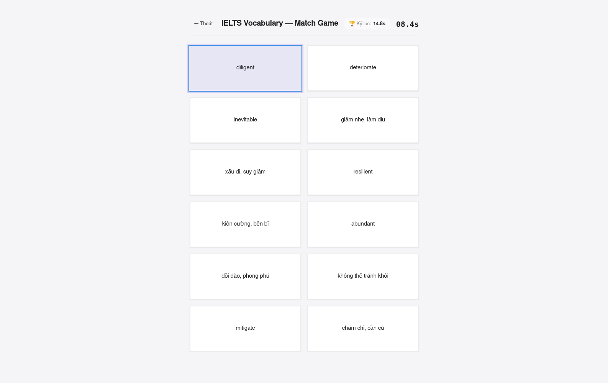
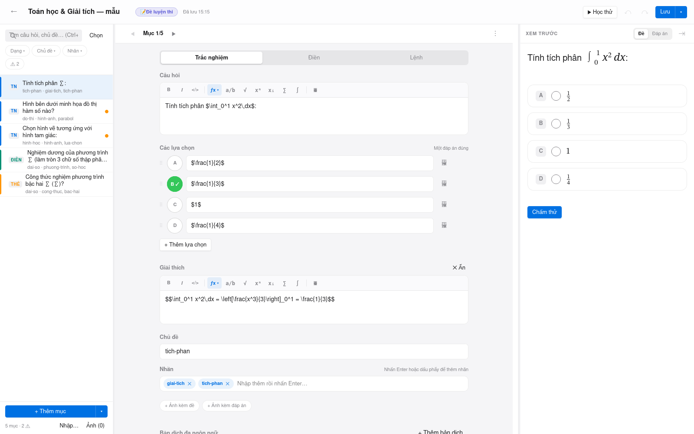
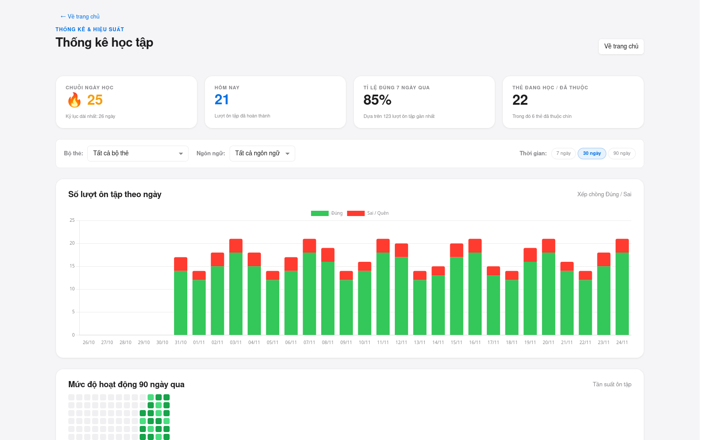
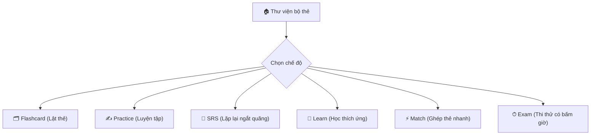

<div align="center">


# Turtle Deck

### Ứng dụng học tập Offline-First bằng Flashcard, Trắc nghiệm & Luyện ngôn ngữ

[](https://github.com/viet15t12/TurtleDeck/releases)
[%20%7C%20Windows%20(.exe)-blue?logo=linux&logoColor=white)](https://github.com/viet15t12/TurtleDeck/releases)
[](https://tauri.app/)
[](https://www.rust-lang.org/)
[](https://www.typescriptlang.org/)
[-003B57?logo=sqlite&logoColor=white)](https://github.com/rusqlite/rusqlite)
[](./test)
[](./LICENSE)

<p align="center">
  <a href="#-giao-diện-ứng-dụng-screenshots">Ảnh chụp giao diện</a> •
  <a href="#-cài-đặt--khởi-chạy">Cài đặt nhanh</a> •
  <a href="#-tính-năng-nổi-bật">Tính năng</a> •
  <a href="#-các-chế-độ-học-tập">Chế độ học</a> •
  <a href="#-bảng-phím-tắt-shortcuts">Phím tắt</a> •
  <a href="#-nhập-dữ-liệu-không-cần-editor-bulk-import--cli">File mẫu</a> •
  <a href="./SPECIFICATION.md">Đặc tả kỹ thuật</a>
</p>

</div>

---

## 🌟 Giới thiệu tổng quan

**Turtle Deck** là ứng dụng máy tính cá nhân (Desktop Application) được thiết kế cho việc học sâu, bền bỉ và tập trung cao độ:

- **Biểu tượng chú rùa (Turtle)**: Đại diện cho sự kiên trì, từng bước vững chắc. Ứng dụng sử dụng thuật toán lặp lại ngắt quãng (**Spaced Repetition System - SRS**) chuẩn SM-2 để tối ưu hóa khả năng ghi nhớ dài hạn mà không gây quá tải.
- **Offline-First & Bảo mật tuyệt đối**: Dữ liệu bộ thẻ và tiến trình được lưu trữ hoàn toàn cục bộ trên máy tính dưới dạng tệp gói `.sdeck` độc lập và cơ sở dữ liệu SQLite nhúng (`rusqlite`). Không cần tài khoản, không theo dõi người dùng, bảo vệ bằng **Content Security Policy (CSP)** nghiêm ngặt.
- **Đa dạng dạng bài học**: Hỗ trợ toàn diện từ Flashcard (`card`), Trắc nghiệm 1/nhiều đáp án (`single`, `multi`), Điền khuyết (`fill`), Gõ lệnh (`command`), Từ vựng phát âm TTS (`vocab`), Dịch câu có từ gợi ý (`translate`) và **Sắp xếp từ thành câu đúng (`word-order`)**.
- **Đa ngôn ngữ & Kết nối linh hoạt**: Hỗ trợ bộ thẻ đa ngôn ngữ (`formatVersion: 2`), dịch nhanh trong phiên học (`Alt+T`), điều khiển từ xa qua điện thoại và chấm bài dịch bằng AI (OpenAI-compatible / Ollama offline).
- **Kiến trúc Tauri v2 & Rust**: Binary thực thi gọn nhẹ (~11 MB), tiêu thụ dưới 60 MB RAM khi chạy và mở cửa sổ trong chưa đầy 0.3 giây.

---

## 📸 Giao diện ứng dụng (Screenshots)

### 1. Thư viện Bộ thẻ & Cây thư mục (Home)
Quản lý tập trung mọi bộ thẻ theo cấu trúc cây thư mục phân cấp, thống kê nhanh số lượng thẻ cần ôn hôm nay và thanh tìm kiếm tiện lợi.



---

### 2. Chi tiết Bộ thẻ & Chế độ học (Deck View)
Bố cục Split View chuẩn Apple macOS HIG: chọn nhanh chế độ học (Ôn hôm nay, Học thích ứng, Flashcards, Trắc nghiệm, Gõ đáp án, Ghép thẻ, Điền chỗ trống, Nghe–Gõ), lọc theo trạng thái và xem bảng toàn bộ thẻ.



---

### 3. Phiên học Lặp lại ngắt quãng (Session & SRS)
Hỗ trợ đầy đủ công thức Toán học KaTeX ($\int_0^1 x^2\,dx$), phản hồi tức thì đúng/sai, thanh tiến độ phân đoạn, dịch nhanh câu hỏi (`Alt+T`) và chấm điểm theo thuật toán SM-2.



---

### 4. Bài tập Sắp xếp từ thành câu đúng (Word Order)
Hiển thị gợi ý tiếng Việt qua linh vật rùa `🐢` + bong bóng thoại, vùng trả lời 2 dòng kẻ và ngân hàng từ kèm từ gây nhiễu (`distractors`) với ô xám giữ nguyên vị trí.



---

### 5. Học thích ứng (Learn Mode)
Chu trình học thích ứng thông minh qua 5 bậc thành thạo nâng dần, kết hợp xem trước, trắc nghiệm và gõ đáp án.



---

### 6. Thi thử bấm giờ (Exam Mode)
Mô phỏng phòng thi thật với đồng hồ đếm ngược, trộn đề ngẫu nhiên, chấm điểm tổng kết và tự động đưa câu sai vào SRS.



---

### 7. Trò chơi Ghép thẻ phản xạ tính giờ (Match Game)
Thử thách trí nhớ và tốc độ với chế độ ghép đôi từ vựng hoặc thuật ngữ - định nghĩa tính thời gian kỷ lục cá nhân.



---

### 8. Trình soạn thảo bộ thẻ (Deck Editor)
Tích hợp thanh công cụ ký hiệu toán học trực quan (phân số, căn, tích phân, ma trận…), xem trước theo thời gian thực, hỗ trợ mọi dạng câu hỏi và tự động lưu nháp an toàn.



---

### 9. Báo cáo Thống kê & Phân tích tiến độ (Analytics)
Theo dõi chuỗi ngày học liên tục (Streak 🔥), biểu đồ số lượt ôn tập hàng ngày bằng Chart.js, Heatmap 90 ngày và danh sách các thẻ khó cần ôn tập lại.



---

## ⚡ Hiệu năng: Tauri v2 vs Electron cũ

| Tiêu chí so sánh | Electron cũ (v0.1.x) | Tauri v2 hiện tại (v0.4.x) | Mức độ cải thiện |
|---|---|---|---|
| **Dung lượng file cài đặt (RPM / DEB / NSIS)** | ~98 MiB | **~11 MiB** | **Giảm ~89%** 🚀 |
| **Dung lượng bung ra đĩa (Unpacked)** | ~329 MiB | **~28 MiB** | **Giảm ~91%** 💾 |
| **Bộ nhớ RAM tiêu thụ (Idle)** | ~180 – 250 MB | **~40 – 60 MB** | **Tiết kiệm ~75% RAM** ⚡ |
| **Thời gian khởi động ứng dụng** | ~1.8 – 2.5 giây | **≤ 0.3 giây** | **Nhanh hơn gấp 6 lần** ⏱️ |
| **Bảo mật & Mã nguồn backend** | Node.js / ASAR | **Rust native nhị phân** | Tối ưu & an toàn bộ nhớ 🛡️ |

---

## 🚀 Cài đặt & Khởi chạy

### 📦 Dành cho người dùng cuối (Linux & Windows)

Tải gói cài đặt mới nhất cho **Linux (`.rpm`, `.deb`)** hoặc **Windows (`.exe`)** tại trang [GitHub Releases](https://github.com/viet15t12/TurtleDeck/releases):

#### 1. Cài đặt qua gói RPM (Fedora / RHEL)
```bash
sudo dnf install ./turtle-deck-0.4.1-1.x86_64.rpm
```
> [!NOTE]
> Gói RPM tự động tích hợp biểu tượng desktop, phân loại vào menu **Education**, và đăng ký MIME type `application/x-studydeck` để bạn nhấp đúp vào bất kỳ file `.sdeck` nào là ứng dụng sẽ mở ngay lập tức.

#### 2. Cài đặt qua gói DEB (Ubuntu / Debian / Linux Mint)
```bash
sudo dpkg -i ./turtle-deck_0.4.1_amd64.deb
```

#### 3. Cài đặt trên Windows
Tải tệp `turtle-deck_0.4.1_x64-setup.exe` từ [GitHub Releases](https://github.com/viet15t12/TurtleDeck/releases) và chạy trình cài đặt NSIS.

---

### 💻 Dành cho nhà phát triển (Build từ nguồn)

**Yêu cầu hệ thống:**
- **Node.js**: $\ge$ 20.0.0 & `npm`
- **Rust toolchain**: $\ge$ 1.80 (`rustc`, `cargo`)
- **Thư viện hệ thống (Linux)**: `webkit2gtk4.1-devel` (Fedora) hoặc `libwebkit2gtk-4.1-dev` (Ubuntu/Debian)

```bash
# 1. Cài đặt các phụ thuộc npm
npm install

# 2. Đóng gói các bộ thẻ mẫu đi kèm
npm run build:samples

# 3. Biên dịch frontend và khởi chạy chế độ phát triển Tauri
npm start
# hoặc:
npm run tauri:dev
```

#### Đóng gói bản cài đặt phân phối (Release binary):
```bash
npm run tauri:build
```
> Tệp nhị phân release và các gói cài đặt (`.rpm`, `.deb`, `.exe`) sẽ được sinh tự động tại `src-tauri/target/release/bundle/`.

#### Chạy kiểm thử tự động & Kiểm tra kiểu:
```bash
npm run typecheck             # TypeScript strict type checking
npm test                      # Chạy toàn bộ 209 unit & integration tests (Node.js)
cd src-tauri && cargo test    # Chạy kiểm thử tự động backend Rust
cd src-tauri && cargo clippy  # Kiểm tra chất lượng mã nguồn Rust
```

---

## 💎 Tính năng nổi bật

### 1. Định dạng bộ thẻ độc lập `.sdeck` & Khả năng cứu dữ liệu
- **Gói đóng kín an toàn**: Một file `.sdeck` là tệp lưu trữ chuẩn ZIP chứa `deck.json` và thư mục ảnh `img/`. Ảnh được nạp và phục vụ qua giao thức cô lập `asset://`, không xả file rác ra ổ cứng.
- **Cứu dữ liệu khẩn cấp (Zero Lock-in)**: Chỉ cần **đổi đuôi `.sdeck` thành `.zip`** rồi giải nén để lấy toàn bộ `deck.json` và hình ảnh.

### 2. Dạng bài Sắp xếp từ thành câu đúng (`word-order`)
- Hiển thị gợi ý tiếng Việt (`prompt_vi`) qua linh vật rùa `🐢` + bong bóng thoại (hỗ trợ kèm audio nếu có).
- Ngân hàng từ xáo trộn gồm cả từ đúng và **từ gây nhiễu (`distractors`)**; thẻ đã chọn biến thành **ô xám rỗng** tại đúng vị trí cũ để bố cục không bị xô lệch.
- Hỗ trợ bấm/kéo thả sắp xếp lại ngay trong vùng trả lời, phím số `1–9`, `Backspace`, `Enter`, đáp án thay thế (`alt_answers`) và đưa câu sai vào hàng đợi làm lại cuối phiên.

### 3. Trình soạn thảo Deck Editor & Bộ thẻ Đa ngôn ngữ
- **Công thức Toán học LaTeX (KaTeX)**: Soạn thảo công thức mượt mà với `$inline$` và `$$block$$`, tích hợp thanh công cụ ký hiệu toán trực quan.
- **Đa ngôn ngữ (`formatVersion: 2`)**: Mỗi thẻ có thể chứa bản dịch phụ trong `translations`, cho phép bật/tắt ngôn ngữ ôn tập ngay trong phiên học.
- **An toàn khi soạn thảo**: Tự động lưu nháp (Auto-draft) định kỳ, phục hồi khi mất điện; đầy đủ Hoàn tác (`Ctrl+Z`) và Làm lại (`Ctrl+Y`).

### 4. Học ngoại ngữ, Từ vựng & Dịch câu (Key Word Transformation)
- Tự động sinh câu hỏi từ thẻ từ vựng: Trắc nghiệm 4 đáp án, Gõ từ 2 chiều, Điền khuyết (`Cloze`), Nghe chính tả (`Listen & Write`) qua Web Speech API (TTS).
- **Dịch câu có từ gợi ý (`translate`)**: Chấm điểm phân tầng 3 lớp (Anchor $\rightarrow$ Pattern regex $\rightarrow$ Chuẩn hóa câu & mở rộng co rút), kèm xuất bài làm Markdown (`.md`).
- **Dịch nhanh trong phiên học**: Nhấn `Alt+T` (hoặc `T`) để dịch nhanh nội dung câu hỏi sang tiếng Việt.

---

## 🤖 Cấu hình & Sử dụng API AI để Chấm bài (Bring Your Own AI)

Turtle Deck cho phép kết nối trực tiếp với bất kỳ nhà cung cấp AI nào (hoặc chạy cục bộ qua Ollama) theo chuẩn **OpenAI-Compatible Chat Completions API** để chấm bài dịch câu:

| Nhà cung cấp | Base URL | Model khuyến nghị | Đặc điểm |
| :--- | :--- | :--- | :--- |
| **DeepSeek** *(Khuyên dùng)* | `https://api.deepseek.com/v1` | `deepseek-chat` | Ngôn ngữ mạnh, chi phí rất thấp. |
| **Groq** | `https://api.groq.com/openai/v1` | `llama-3.3-70b-versatile` | Phản hồi tức thì (< 0.5s), có gói miễn phí. |
| **OpenAI** | `https://api.openai.com/v1` | `gpt-4o-mini` | Ổn định cao, chuẩn mực. |
| **OpenRouter** | `https://openrouter.ai/api/v1` | `anthropic/claude-3.5-sonnet` / `google/gemini-flash-1.5` | Một API Key gọi nhiều mô hình. |
| **Ollama** *(Offline 100%)* | `http://localhost:11434/v1` | `llama3.2`, `qwen2.5` | Chạy trực tiếp trên máy, miễn phí, bảo mật tuyệt đối. |

---

## 🧠 Các chế độ học tập



| Chế độ | Mô tả chi tiết | Đối tượng phù hợp |
| :--- | :--- | :--- |
| **🗂 Flashcard** | Lật thẻ 2 chiều (Trước ↔ Sau hoặc Thuật ngữ ↔ Định nghĩa). Tự đánh giá 4 mức: `Again`, `Hard`, `Good`, `Easy`. | Ôn tập lý thuyết, ghi nhớ nhanh. |
| **✍️ Practice** | Luyện trắc nghiệm, điền từ, gõ lệnh, dịch câu, sắp xếp từ có chấm điểm tức thì và giải thích chi tiết. | Luyện đề, củng cố kiến thức. |
| **🔄 SRS** | Thuật toán SM-2 chuẩn hóa: tính khoảng cách ngày ôn tự động theo độ khó và lịch sử trả lời. | Ghi nhớ dài hạn. |
| **🧠 Learn** | Chu trình học thích ứng: tự động lặp lại các câu sai dưới nhiều dạng khác nhau đến khi nắm vững 100%. | Học từ vựng mới, nội dung khó. |
| **⚡ Match** | Trò chơi phản xạ ghép cặp tính thời gian kỷ lục cá nhân. | Khởi động buổi học. |
| **⏱ Exam** | Mô phỏng phòng thi thật: trộn đề, giới hạn thời gian, tính điểm % và gom câu sai vào SRS. | Đánh giá tổng kết trước kỳ thi. |

---

## 📥 Nhập dữ liệu không cần Editor (Bulk Import & CLI)

> [!TIP]
> Toàn bộ các file mẫu và tài liệu quy tắc chi tiết được đặt tại thư mục [`templates/`](./templates/):
> - 📄 [`templates/sample.txt`](./templates/sample.txt): Mẫu Quizlet 2 cột phân cách bằng Tab `\t`.
> - 📊 [`templates/sample.csv`](./templates/sample.csv): Mẫu bảng tính CSV chuẩn RFC 4180 có tiêu đề.
> - 📑 [`templates/sample.tsv`](./templates/sample.tsv): Mẫu bảng tính Tab-separated values.
> - 📝 [`templates/sample-quiz.md`](./templates/sample-quiz.md): Mẫu Markdown trắc nghiệm (`single`, `multi`, `fill`, `command`, `translate`, `word-order`).
> - 📖 [`templates/sample-vocab.md`](./templates/sample-vocab.md): Mẫu Markdown từ vựng chuyên sâu (`## term | ipa | pos`).
> - 🧩 [`templates/sample.json`](./templates/sample.json): Mẫu `deck.json` chuẩn Turtle Deck đóng gói trực tiếp.
> - 🌐 [`templates/sample-translate.json`](./templates/sample-translate.json): Mẫu bài tập Dịch câu có sử dụng từ gợi ý (`translate`).
> - 🧩 [`templates/sample-word-order.json`](./templates/sample-word-order.json): Mẫu bài tập Sắp xếp từ thành câu đúng (`word-order`).
> - 🌍 [`templates/sample-multilingual.json`](./templates/sample-multilingual.json): Mẫu bộ thẻ đa ngôn ngữ (`formatVersion: 2`).
> - 📘 **Hướng dẫn quy tắc chi tiết:** [`templates/QUY_TAC_TAO_BO_THE.md`](./templates/QUY_TAC_TAO_BO_THE.md).

```bash
# Đóng gói một thư mục nguồn (chứa deck.json và img/) thành file .sdeck:
node tools/sdeck.mjs pack my-source-folder/ ~/StudyDecks/my-deck.sdeck
```

---

## ⌨️ Bảng phím tắt tiện lợi (Shortcuts)

| Màn hình | Phím tắt | Chức năng thao tác |
| :--- | :--- | :--- |
| **Toàn ứng dụng** | `Ctrl + O` | Mở tệp bộ thẻ `.sdeck` từ đĩa |
| | `Ctrl + ,` | Mở màn hình Cài đặt (Settings) |
| | `Esc` | Thoát phiên học hoặc quay lại màn hình chính |
| **Phiên học (Session)** | `Space` / `Enter` | Lật mặt thẻ Flashcard hoặc nộp/kiểm tra câu trả lời |
| | `1` – `9` | Chọn đáp án trắc nghiệm, chọn từ (`word-order`) hoặc chấm điểm SRS (`1`–`4`) |
| | `Backspace` | Bỏ từ cuối cùng đã chọn trong dạng `word-order` |
| | `Alt + T` / `T` | Bật/tắt dịch nhanh câu hỏi sang tiếng Việt |
| | `Alt + L` | Nghe lại phát âm Text-To-Speech |
| | `S` | Đánh dấu sao (Star) câu hỏi để ôn tập riêng |
| **Soạn thảo (Editor)** | `Ctrl + S` | Lưu bộ thẻ vào tệp `.sdeck` |
| | `Ctrl + N` | Thêm câu hỏi / mục mới |
| | `Ctrl + Z` / `Ctrl + Y` | Hoàn tác / Làm lại thay đổi |
| | `Ctrl + M` | Bật/tắt thanh công cụ toán học LaTeX |

---

## 🏗️ Cấu trúc dự án

```text
TurtleDeck/
├── .github/workflows/       # GitHub Actions CI & Release (.deb, .rpm, .exe)
├── build/                   # Biểu tượng ứng dụng đa kích thước & metadata desktop
├── data/                    # Các bộ thẻ mẫu nguồn (.sdeck)
├── dist/                    # Frontend đã biên dịch phục vụ cho Tauri Webview
├── docs/
│   ├── plans/               # Kế hoạch tái cấu trúc & di chuyển Tauri
│   ├── reports/             # Báo cáo nghiệm thu các giai đoạn
│   ├── screenshots/         # Ảnh chụp màn hình ứng dụng
│   ├── remote-controller-guide.md
│   ├── translate-feature.md
│   └── tauri-dev.md         # Hướng dẫn thiết lập môi trường Tauri
├── src/                     # Giao diện & Core logic thuần túy (JavaScript/TypeScript)
│   ├── app.js               # Điểm vào chính của Renderer & Routing
│   ├── core/                # Logic nghiệp vụ thuần (SRS, Parser, Grader, WordOrder, Stats...)
│   ├── platform/            # Lớp bọc Tauri IPC API (tauri-api.js)
│   ├── styles/              # CSS tokens, theme tối/sáng và kiểu dáng các màn hình
│   └── views/               # Các màn hình (Home, Deck, Session, Editor, Stats...)
├── src-tauri/               # Backend native viết bằng Rust (Tauri v2)
│   ├── Cargo.toml           # Định nghĩa crate Rust & các thư viện tối ưu
│   ├── tauri.conf.json      # Cấu hình cửa sổ, CSP, bundle và quyền truy cập
│   └── src/                 # Entry point, IPC commands, SQLite rusqlite, .sdeck services
├── templates/               # Bộ tệp mẫu (txt, csv, tsv, md, json) & tài liệu quy tắc
├── test/                    # 209 bài kiểm thử tự động (Unit & Integration)
└── tools/                   # Bộ công cụ CLI đóng gói, build và chụp ảnh màn hình
```

---

## 📖 Tài liệu kỹ thuật chi tiết

- 📑 [`SPECIFICATION.md`](./SPECIFICATION.md) — Đặc tả kỹ thuật toàn diện về sản phẩm, nghiệp vụ lõi và thiết kế hệ thống.
- 🛠️ [`docs/tauri-dev.md`](./docs/tauri-dev.md) — Hướng dẫn cài đặt môi trường Rust, WebKitGTK và quy trình phát triển Tauri v2.
- 🌐 [`docs/translate-feature.md`](./docs/translate-feature.md) — Chi tiết kiến trúc tính năng Dịch câu & Chấm điểm phân tầng.
- 📱 [`docs/remote-controller-guide.md`](./docs/remote-controller-guide.md) — Hướng dẫn sử dụng Remote Controller từ điện thoại.
- 📋 [`docs/tauri-visual-qa.md`](./docs/tauri-visual-qa.md) — Bảng nghiệm thu hiển thị thị giác giao diện.

---

## 📄 Giấy phép & Bản quyền

Dự án phát hành dưới giấy phép mã nguồn mở [MIT License](./LICENSE).  
Biểu trưng và thương hiệu thuộc sở hữu của dự án **Turtle Deck**.
