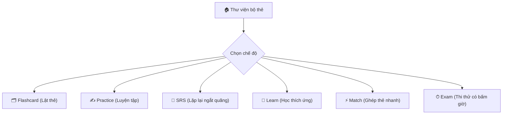

<div align="center">


# Turtle Deck 🐢

### Ứng dụng học tập Offline-First bằng Flashcard, Trắc nghiệm & Lặp lại ngắt quãng (SRS)

[-blue?logo=linux&logoColor=white)](https://github.com/viet15t12/studyApp/releases)
[](https://nodejs.org)
[](https://www.electronjs.org/)
[](https://www.typescriptlang.org/)
[-003B57?logo=sqlite&logoColor=white)](https://github.com/WiseLibs/better-sqlite3)
[](./test)
[](./package.json)

<p align="center">
  <a href="#-cài-đặt--khởi-chạy">Cài đặt nhanh</a> •
  <a href="#-tính-năng-nổi-bật">Tính năng</a> •
  <a href="#-các-chế-độ-học-tập">Chế độ học</a> •
  <a href="#-bảng-phím-tắt-shortcuts">Phím tắt</a> •
  <a href="#-bộ-file-mẫu-ngoài-editor">File mẫu</a> •
  <a href="./SPECIFICATION.md">Đặc tả kỹ thuật</a>
</p>

</div>

---

## 🌟 Giới thiệu tổng quan

**Turtle Deck** là ứng dụng máy tính cá nhân (Desktop Application) được thiết kế cho việc học sâu, bền bỉ và tập trung cao độ:
- **Biểu tượng chú rùa (Turtle)**: Đại diện cho sự kiên trì, từng bước vững chắc. Ứng dụng sử dụng thuật toán lặp lại ngắt quãng (**Spaced Repetition System - SRS**) chuẩn SM-2 để tối ưu hóa khả năng ghi nhớ dài hạn mà không gây quá tải.
- **Offline-First & Bảo mật tuyệt đối**: Dữ liệu bộ thẻ và tiến trình được lưu trữ hoàn toàn cục bộ trên máy tính của bạn dưới dạng tệp gói `.sdeck` độc lập. Không cần đăng ký tài khoản, không phụ thuộc vào kết nối mạng, chặn hoàn toàn mã độc qua chính sách **Content Security Policy (CSP)** nghiêm ngặt và thư viện **DOMPurify**.
- **Đa năng & Tự động hoá**: Hỗ trợ toàn diện từ Flashcard truyền thống, Trắc nghiệm đơn/đa lựa chọn, Điền từ khuyết, Gõ lệnh lập trình, Luyện từ vựng phát âm chuẩn (Text-To-Speech) đến Trò chơi ghép thẻ và Thi thử bấm giờ.

---

## 🚀 Cài đặt & Khởi chạy

### 📦 Dành cho người dùng cuối (Linux)

#### 1. Cài đặt qua gói RPM (Khuyên dùng cho Fedora / RHEL)
Tệp cài đặt đã được liên kết trực tiếp tại thư mục gốc hoặc trong thư mục `release/`:
```bash
sudo dnf install ./turtle-deck-0.1.0.x86_64.rpm
```
> [!NOTE]
> Gói RPM tự động tích hợp biểu tượng desktop, phân loại vào menu **Education**, và đăng ký MIME type `application/x-studydeck` để bạn chỉ cần nhấp đúp vào bất kỳ file `.sdeck` nào là ứng dụng sẽ mở ngay lập tức.

#### 2. Chạy trực tiếp qua AppImage (Linux mọi bản phân phối)
Không cần cài đặt, tải tệp và cấp quyền thực thi:
```bash
chmod +x "Turtle Deck-0.1.0.AppImage"
./"Turtle Deck-0.1.0.AppImage"
```

---

### 💻 Dành cho nhà phát triển (Build từ nguồn)

**Yêu cầu hệ thống:** Node.js `>= 20.0.0` và `npm`.

```bash
# 1. Tải về và cài đặt các phụ thuộc
npm install

# 2. Biên dịch TypeScript sang JavaScript (dist/)
npm run build

# 3. Đóng gói các bộ thẻ mẫu đi kèm
npm run build:samples

# 4. Khởi chạy ứng dụng chế độ phát triển
npm start
```

#### Đóng gói tạo bản cài đặt phân phối:
```bash
# Đóng gói AppImage và RPM vào thư mục release/
npm run dist
```

#### Chạy kiểm thử tự động & Kiểm tra kiểu nghiêm ngặt:
```bash
npm run typecheck    # TypeScript strict type checking
npm test             # Chạy toàn bộ 193 unit test và characterization test
```

---

## 💎 Tính năng nổi bật

### 1. Định dạng bộ thẻ độc lập `.sdeck` & Khả năng cứu dữ liệu
- **Gói đóng kín an toàn**: Một file `.sdeck` là tệp lưu trữ chuẩn ZIP chứa `deck.json` và thư mục ảnh `img/`. Ảnh được nạp và phục vụ qua giao thức bộ nhớ cô lập `asset://`, không bao giờ xả file rác ra ổ cứng.
- **Cứu dữ liệu khẩn cấp (Zero Lock-in)**: Bạn hoàn toàn sở hữu dữ liệu của mình. Nếu muốn trích xuất dữ liệu mà không cần mở app, chỉ cần **đổi đuôi `.sdeck` thành `.zip`** rồi giải nén để lấy toàn bộ `deck.json` và hình ảnh.

### 2. Trình soạn thảo Deck Editor mạnh mẽ
- **Hỗ trợ công thức Toán học LaTeX (KaTeX)**: Soạn thảo công thức mượt mà với `$inline$` và `$$block$$`, tích hợp thanh công cụ ký hiệu toán trực quan (phân số, căn, tích phân, ma trận...).
- **Quản lý đa phương tiện**: Kéo thả ảnh trực tiếp vào thẻ, hỗ trợ xem trước qua Lightbox phóng to.
- **An toàn khi soạn thảo**: Tự động lưu nháp (Auto-draft) mỗi 30 giây vào thư mục cục bộ, tự động phục hồi nếu có sự cố mất điện; đầy đủ lịch sử Hoàn tác (`Ctrl+Z`) và Làm lại (`Ctrl+Y`).

### 3. Hỗ trợ học ngoại ngữ & Từ vựng chuyên sâu
- Tự động sinh câu hỏi phong phú từ thẻ từ vựng: Trắc nghiệm 4 đáp án, Gõ từ 2 chiều, Điền khuyết theo ngữ cảnh, Nghe chính tả (Listen & Write).
- Phát âm chuẩn xác qua Web Speech API (TTS) với thuật toán tự động chọn giọng đọc chuẩn theo ngôn ngữ bộ thẻ.

---

## 🧠 Các chế độ học tập

Turtle Deck cung cấp 6 chế độ học tập đa dạng đáp ứng mọi nhu cầu ôn luyện:



| Chế độ | Mô tả chi tiết | Đối tượng phù hợp |
| :--- | :--- | :--- |
| **🗂 Flashcard** | Lật thẻ 2 chiều (Trước ↔ Sau hoặc Thuật ngữ ↔ Định nghĩa). Tự đánh giá khả năng nhớ theo 4 mức độ: `Again`, `Hard`, `Good`, `Easy`. | Ôn tập kiến thức lý thuyết, ghi nhớ nhanh. |
| **✍️ Practice** | Luyện trắc nghiệm và điền câu trả lời có chấm điểm tức thì, phản hồi đúng/sai kèm giải thích chi tiết. | Luyện đề thi, củng cố kiến thức từng bài. |
| **🔄 SRS** | Thuật toán SM-2 chuẩn hóa: tính toán khoảng cách ngày ôn tập tự động dựa trên độ khó và lịch sử phản xạ của từng thẻ. | Ghi nhớ dài hạn, duy trì phản xạ không quên. |
| **🧠 Learn** | Chu trình học thích ứng thông minh: tự động lặp lại các câu sai dưới nhiều dạng khác nhau cho đến khi nắm vững 100%. | Học từ vựng mới hoặc các nội dung khó. |
| **⚡ Match** | Trò chơi phản xạ ghép các cặp câu hỏi - đáp án hoặc từ vựng - nghĩa tính thời gian kỷ lục cá nhân. | Khởi động buổi học, giải trí có thưởng. |
| **⏱ Exam** | Mô phỏng phòng thi thật: trộn đề ngẫu nhiên, giới hạn thời gian làm bài, tính điểm % và gom các câu làm sai để ôn lại. | Đánh giá tổng kết trước kỳ thi thật. |

---

## 📥 Nhập dữ liệu không cần Editor (Bulk Import & CLI)

Bạn có thể dễ dàng nạp dữ liệu từ Excel, Google Sheets, Obsidian, Anki, Quizlet mà **không cần mở Editor**:

> [!TIP]
> Toàn bộ các file mẫu và tài liệu quy tắc chi tiết được đặt tại thư mục [`templates/`](./templates/):
> - 📄 [`templates/sample.txt`](./templates/sample.txt): Mẫu Quizlet 2 cột phân cách bằng Tab `\t`.
> - 📊 [`templates/sample.csv`](./templates/sample.csv): Mẫu bảng tính CSV chuẩn RFC 4180 có tiêu đề.
> - 📑 [`templates/sample.tsv`](./templates/sample.tsv): Mẫu bảng tính Tab-separated values.
> - 📝 [`templates/sample-quiz.md`](./templates/sample-quiz.md): Mẫu Markdown trắc nghiệm (`single`, `multi`, `fill`, `command`).
> - 📖 [`templates/sample-vocab.md`](./templates/sample-vocab.md): Mẫu Markdown từ vựng chuyên sâu (`## term | ipa | pos`).
> - 🧩 [`templates/sample.json`](./templates/sample.json): Mẫu `deck.json` chuẩn Turtle Deck đóng gói trực tiếp.
> - 📘 **Hướng dẫn quy tắc chi tiết:** [`templates/QUY_TAC_TAO_BO_THE.md`](./templates/QUY_TAC_TAO_BO_THE.md).

#### Đóng gói trực tiếp thành `.sdeck` bằng dòng lệnh (CLI):
```bash
# Đóng gói một thư mục nguồn (chứa deck.json và img/) thành file .sdeck:
node tools/sdeck.mjs pack my-source-folder/ ~/StudyDecks/my-deck.sdeck
```

---

## ⌨️ Bảng phím tắt tiện lợi (Shortcuts)

| Màn hình | Phím tắt | Chức năng thao tác |
| :--- | :--- | :--- |
| **Toàn ứng dụng** | `Ctrl + O` | Mở tệp bộ thẻ `.sdeck` từ đĩa |
| | `Ctrl + ,` | Mở màn hình Cài đặt (Settings) |
| | `Esc` | Thoát phiên học hoặc quay lại màn hình chính |
| **Phiên học (Session)** | `Space` / `Enter` | Lật mặt thẻ Flashcard hoặc nộp câu trả lời |
| | `1`, `2`, `3`, `4` | Chọn đáp án trắc nghiệm hoặc chấm điểm SRS (`Again`, `Hard`, `Good`, `Easy`) |
| | `S` | Đánh dấu sao (Star) câu hỏi để ôn tập riêng |
| | `R` | Nghe lại phát âm Text-To-Speech (thẻ từ vựng) |
| **Soạn thảo (Editor)** | `Ctrl + S` | Lưu bộ thẻ vào tệp `.sdeck` |
| | `Ctrl + N` | Thêm câu hỏi / mục mới |
| | `Ctrl + Z` | Hoàn tác thay đổi (Undo) |
| | `Ctrl + Y` / `Ctrl + Shift + Z` | Làm lại thay đổi (Redo) |
| | `Ctrl + M` | Bật/tắt thanh công cụ toán học LaTeX |

---

## 🏗️ Kiến trúc & Công nghệ

```text
turtleDeck/
├── build/                   # Biểu tượng ứng dụng đa kích thước & thư viện phụ trợ
├── data/samples/            # Các bộ thẻ mẫu đã đóng gói (.sdeck)
├── dist/                    # Mã nguồn đã biên dịch (ESM Main & CJS Preload)
├── release/                 # Các gói cài đặt thành phẩm (.rpm, .AppImage)
├── src/
│   ├── app.js               # Điều phối giao diện Renderer chính
│   ├── index.html           # Khung HTML & chính sách CSP nghiêm ngặt
│   ├── core/                # Logic nghiệp vụ thuần (Pure TS/ESM, không phụ thuộc DOM)
│   ├── main/                # Tiến trình Electron Main Process (SQLite, Window, IPC)
│   └── views/               # Các màn hình (Home, Deck, Session, Editor, Stats, Settings)
├── templates/               # Bộ tệp mẫu (txt, csv, tsv, md, json) & tài liệu quy tắc
├── test/                    # 193 bài kiểm thử tự động (Unit & Performance tests)
└── tools/                   # Bộ công cụ CLI đóng gói và xây dựng dự án
```

- **Frontend**: Vanilla JavaScript (Module hóa cao), KaTeX (Toán học), Chart.js (Biểu đồ thống kê), DOMPurify (Lọc mã độc).
- **Backend / Core**: Electron ESM, SQLite 3 (`better-sqlite3` tối ưu hóa ghi log & SRS), `fflate` (Nén ZIP tốc độ cao).
- **Bảo mật**: `contextIsolation: true`, `nodeIntegration: false`, chính sách CSP chặn kết nối ngoài, kiểm duyệt chặt chẽ định dạng ảnh.

---

## 📖 Tài liệu kỹ thuật chi tiết

Toàn bộ đặc tả nghiệp vụ, mô hình dữ liệu, lược đồ SQLite, thiết kế UX Editor và lịch sử các giai đoạn phát triển được tập hợp đầy đủ tại:
- 📑 [`SPECIFICATION.md`](./SPECIFICATION.md) — Tài liệu đặc tả kỹ thuật và kiến trúc toàn diện của Turtle Deck.

---

## 📄 Giấy phép & Bản quyền

Dự án phát hành dưới giấy phép mã nguồn mở [ISC License](./package.json).  
Biểu trưng và thương hiệu thuộc sở hữu của dự án **Turtle Deck**.
