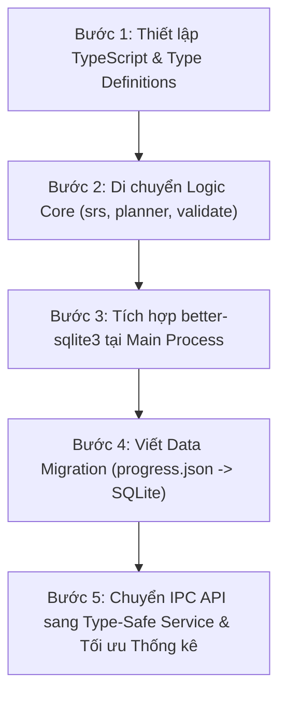

# 🐢 Turtle Deck — Toàn bộ Đặc tả Kỹ thuật, Kiến trúc & Lộ trình Triển khai

> Tài liệu này được tổng hợp từ toàn bộ các tài liệu đặc tả ban đầu (`study-app.md`), đặc tả giao diện Editor (`study-app-editor-ux.md`), thiết kế kiến trúc TypeScript & SQLite (`study-app-architecture-ts-sqlite.md`), và tài liệu các giai đoạn triển khai (`study-app-phases.md`, `study-app-phase3b.md`, `study-app-phase3c.md`, `phase-6b.md`, `phase-6c.md`).

---

## 📑 Mục lục
1. [Phần 1: Đặc tả Sản phẩm & Nghiệp vụ Lõi (study-app.md)](#phần-1-đặc-tả-sản-phẩm--nghiệp-vụ-lõi)
2. [Phần 2: Thiết kế Giao diện Deck Editor UX v2 (study-app-editor-ux.md)](#phần-2-thiết-kế-giao-diện-deck-editor-ux-v2)
3. [Phần 3: Kiến trúc Hệ thống: TypeScript & SQLite (study-app-architecture-ts-sqlite.md)](#phần-3-kiến-trúc-hệ-thống-typescript--sqlite)
4. [Phần 4: Lộ trình Triển khai các Giai đoạn (study-app-phases.md)](#phần-4-lộ-trình-triển-khai-các-giai-đoạn)
5. [Phần 5: Phụ lục Chi tiết các Giai đoạn Nâng cấp](#phần-5-phụ-lục-chi-tiết-các-giai-đoạn-nâng-cấp)
   - 5.1. [Giai đoạn 3B — Phân loại bộ thẻ (study-app-phase3b.md)](#51-giai-đoạn-3b--phân-loại-bộ-thẻ)
   - 5.2. [Giai đoạn 3C — Tái cấu trúc Renderer (study-app-phase3c.md)](#52-giai-đoạn-3c--tái-cấu-trúc-renderer)
   - 5.3. [Giai đoạn 6B — TypeScript hoá & SQLite (phase-6b.md)](#53-giai-đoạn-6b--typescript-hoá--sqlite)
   - 5.4. [Giai đoạn 6C — Tái cấu trúc Main Process (phase-6c.md)](#54-giai-đoạn-6c--tái-cấu-trúc-main-process)

---


# Phần 1: Đặc tả Sản phẩm & Nghiệp vụ Lõi

# Study App (Electron) — học đa môn + tiếng Anh kiểu Quizlet

App desktop offline để học **bất kỳ thứ gì** (LPIC, kiến thức chung, từ vựng tiếng Anh...), thay Anki và Quizlet. Dữ liệu là các **bộ thẻ (deck)** đóng gói trong **một file `.sdeck` duy nhất** (gồm cả ảnh), tạo và chỉnh sửa ngay trong app bằng giao diện trực quan — không phải giải nén hay sửa JSON; app lo phần luyện tập, lên lịch ôn và thống kê.

---

## 1. Ý tưởng cốt lõi

Mọi thứ quy về một khái niệm: **Item** (mục cần nhớ) nằm trong **Deck**. Từ một Item, app sinh ra nhiều **kiểu câu hỏi** khác nhau. Nhờ đó:

- LPIC: item là "lệnh/khái niệm + giải thích" hoặc câu trắc nghiệm có sẵn.
- Tiếng Anh: item là "từ + nghĩa + phiên âm + ví dụ" → sinh trắc nghiệm, gõ lại, nghe-gõ, điền từ vào ví dụ, ghép cặp.
- Học khác: item là thẻ hỏi/đáp bất kỳ.

Tiến độ nhớ (SRS) gắn với **item + hướng học**, lưu riêng với file deck.

---

## 2. Chức năng

### 2.1 Quản lý Deck
- Mỗi bộ thẻ là **một file `.sdeck`** — gói nén ZIP đơn giản (không mã hoá, không mật khẩu) chứa câu hỏi và toàn bộ ảnh (mục 3.0). Chuyển máy / sao lưu / chia sẻ = chép một file.
- **Thư viện**: thư mục mặc định (`~/StudyDecks`, đổi trong Settings); app tự quét và liệt kê mọi `.sdeck`, thư mục con thành nhóm (`LPIC/101`, `English/IELTS`). Ngoài ra có *Mở file…* và double-click file `.sdeck` (đăng ký liên kết file).
- **Tạo và sửa bộ thẻ ngay trong app** bằng Deck Editor (mục 2.7): không cần giải nén, không cần sửa JSON.
- **Nhập** từ nguồn cũ để chuyển thành `.sdeck`: `.json` (hoặc thư mục `deck.json` + `img/`), `.csv/.tsv`, `.md`, **Quizlet export** (tab giữa term/definition, xuống dòng giữa các thẻ), CSV từ Anki. Nhập xong app hỏi nơi lưu `.sdeck`; app không ghi ngược lại các định dạng này.
- Tự reload khi file `.sdeck` bị thay (vd Syncthing đồng bộ từ máy khác); nếu bộ thẻ đang soạn dở trong Editor thì hỏi trước.
- Mỗi deck có "loại" (`vocab`, `qa`, `quiz`) quyết định các chế độ khả dụng.

### 2.2 Các chế độ học
| Chế độ | Giống | Mô tả |
|---|---|---|
| **Flashcards** | Quizlet/Anki | Lật thẻ, tự chấm Again/Hard/Good/Easy, có SRS |
| **Learn (thích ứng)** | Quizlet Learn | App tự chọn dạng câu hỏi theo mức nhớ của từng thẻ (mục 6) |
| **Trắc nghiệm** | Quizlet Test | Chọn nghĩa đúng; hỗ trợ 1 hoặc nhiều đáp án (LPIC "Choose TWO") |
| **Gõ đáp án (Write)** | Quizlet Write | Gõ từ/nghĩa/lệnh, chấm có dung sai lỗi chính tả |
| **Điền chỗ trống (Cloze)** | Anki cloze | Câu có `___`, điền từ/lệnh |
| **Nghe – Gõ (Listen)** | — | Phát âm (TTS) rồi gõ lại từ, luyện chính tả |
| **Ghép cặp (Match)** | Quizlet Match | Kéo/chạm ghép term–definition, tính giờ |
| **Thi thử (Exam)** | — | Trộn N câu, đồng hồ, điểm, xem lại câu sai |

### 2.3 Tính năng riêng cho tiếng Anh
- Trường dữ liệu: `term`, `definition` (EN/VI), `phonetic`, `pos` (loại từ), `example`, `audio`, `image`, `synonyms`.
- Phát âm bằng **Web Speech API** (`speechSynthesis`, chọn giọng en-US/en-GB), không cần mạng nếu máy có giọng.
- Học **hai chiều**: EN→VI (nhận biết) và VI→EN (nhớ chủ động); mỗi chiều có lịch SRS riêng.
- **Tự sinh cloze** từ `example` (thay `term` bằng `___`, nhận cả dạng chia động từ nếu có `forms`).
- Chấm gõ từ: bỏ qua hoa/thường, dấu cách thừa; cho qua lỗi 1 ký tự với từ dài (Levenshtein), nhưng báo "gần đúng".
- (Tuỳ chọn) tra từ điển online [dictionaryapi.dev] để điền phiên âm/ví dụ khi import — chỉ chạy khi người dùng bấm, không bắt buộc.

### 2.4 Tính năng riêng cho kỹ thuật (LPIC)
- Câu `command`: gõ nguyên lệnh, chấp nhận nhiều dạng (`rpm -qa`, `rpm --query --all`), có `regex`.
- Hiển thị Markdown + code block + giải thích sau khi trả lời.
- Lọc theo topic (`101.1`...), tag, độ khó.

### 2.5 Chung
- SRS, thống kê, streak, heatmap, leech (thẻ hay sai).
- Sao/đánh dấu thẻ, ghi chú cá nhân, nút "tôi chấm lại là đúng" (override).
- Phím tắt, dark mode, import/export tiến độ, backup.

### 2.6 Nội dung phong phú: công thức LaTeX và hình ảnh
- Mọi trường văn bản (câu hỏi, lựa chọn, đáp án, giải thích, `front/back`, `term/definition`, `example`, ghi chú) là **Markdown + LaTeX**: `$...$` (trong dòng), `$$...$$` (khối riêng), code block có tô màu.
- Hình ảnh **svg / png / jpg (jpeg) / gif / webp** chèn bằng `` ở bất kỳ trường nào, hoặc dùng trường tắt `image` (hiện dưới đề / mặt trước) và `answerImage` (hiện dưới đáp án / mặt sau). Lựa chọn trắc nghiệm cũng có thể có ảnh/công thức: `{"text": "...", "image": "..."}`.
- Đường dẫn ảnh **tương đối so với gốc gói `.sdeck`** (thường `img/...`) và do Editor tự quản lý. App chỉ đọc ảnh nằm trong gói và **không tải ảnh từ internet** (chạy offline, an toàn).
- Render công thức bằng **KaTeX** (nhanh, offline, đóng gói sẵn font). Công thức sai cú pháp hiển thị mã gốc màu đỏ, không làm hỏng cả câu.
- Chấm đáp án là số/công thức: `match: "number"` (dung sai, phân số `1/3`, dấu `,` hoặc `.`) và `match: "latex"` (chuẩn hoá khoảng trắng, `\left/\right`, `\dfrac` → `\frac`). Xem mục 4.3b.
- Giao diện: bấm vào ảnh để phóng to; công thức dài cuộn ngang; ảnh trong dark mode có nền sáng để không mất nét; TTS, tìm kiếm và xem trước tự bỏ LaTeX/ảnh (`toPlain()`).

### 2.7 Soạn bộ thẻ trong app (Deck Editor)
Xem `study-app-editor-ux.md` (đặc tả toàn bộ giao diện, tương tác và kiến trúc của Deck Editor).

---

## 3. Định dạng dữ liệu

### 3.0 Gói bộ thẻ `.sdeck` (định dạng lưu duy nhất)

Mỗi bộ thẻ là **một file `.sdeck`**: thực chất là file **ZIP chuẩn** (nén deflate), **không mã hoá, không mật khẩu**; chỉ dùng đuôi riêng để app nhận diện, gắn biểu tượng / liên kết file, và để người dùng khỏi giải nén rồi sửa tay.

```
toan-101.sdeck             (file ZIP)
├── deck.json              # bắt buộc, UTF-8 không BOM: meta + items (mục 3.1)
└── img/                   # tuỳ chọn: toàn bộ ảnh của bộ thẻ
    ├── 3fa9c1d2-x2-graph.svg
    └── 9b01e7a4-triangle.png
```

Quy ước:
- `deck.json` nằm ở gốc gói và có `meta.format = "studydeck"`, `meta.formatVersion = 1`. App đọc được mọi phiên bản ≤ phiên bản nó biết; gặp phiên bản cao hơn thì báo "bộ thẻ này tạo bằng bản app mới hơn".
- Ảnh chỉ nằm dưới `img/`, đuôi `png/jpg/jpeg/gif/webp/svg`. Ảnh thêm bằng Editor được đặt tên `<8 ký tự đầu SHA-1 nội dung>-<tên gốc đã làm sạch>.<đuôi>` (cùng một ảnh thêm nhiều lần chỉ lưu một bản); ảnh nhập từ nguồn cũ giữ tên gốc.
- Mọi đường dẫn ảnh trong `deck.json` (``, `image`, `answerImage`, `choices[].image`) là đường dẫn **tương đối so với gốc gói**.
- Tên entry trong gói dùng `/`, không bắt đầu bằng `/`, không có `..`, `\` hay ký tự điều khiển. Entry vi phạm, entry lạ (không phải `deck.json` hoặc `img/*.<ảnh>`) hoặc file "ảnh" có nội dung không phải ảnh bị **bỏ qua kèm cảnh báo**.
- Giới hạn chống file nén độc hại: ≤ 2000 entry; `deck.json` ≤ 20 MB; mỗi ảnh ≤ 5 MB (lớn hơn: cảnh báo, không nạp); tổng dung lượng giải nén ≤ 500 MB. Kiểm tra kích thước khai báo **trước khi** giải nén và đối chiếu lại kích thước thật **sau khi** giải nén (header có thể khai sai).
- **Không giải nén ra đĩa**: main đọc cả gói vào bộ nhớ; ảnh được phục vụ thẳng từ bộ nhớ qua `asset://` (mục 7.10).
- Ghi gói luôn atomic: nén → đọc lại kiểm tra hợp lệ → ghi `.tmp` → `rename`; giữ 1 bản `.sdeck.bak` của lần lưu trước.
- `meta.id` là khoá gắn tiến độ (mục 8): sinh một lần khi tạo bộ thẻ, **không đổi** khi đổi tên file / tiêu đề. Hai file khác nhau cùng `meta.id` → app cảnh báo và chỉ nạp một. *Lưu thành bản sao* trong Editor cấp `meta.id` mới.
- Cứu dữ liệu / kiểm tra: đổi đuôi `.sdeck` → `.zip` là mở được bằng mọi trình giải nén. Công cụ cho dev: `node tools/sdeck.mjs pack <thư-mục> [file.sdeck]`, `unpack <file.sdeck> [thư-mục]`, `check <file.sdeck>`, `pack-all <thư-mục-nguồn> <thư-mục-ra>`.

### 3.1 Nội dung `deck.json` trong gói (người dùng không phải sửa tay)

Đây là đặc tả cho dev, cho `tools/sdeck.mjs` và cho việc nhập deck do AI / script sinh; Editor tự sinh và tự escape đúng định dạng này.

```json
{
  "meta": { "id": "eng-ielts-01", "title": "IELTS Vocab 01", "kind": "vocab", "lang": "en" },
  "items": [
    {
      "id": "w-0001",
      "term": "mitigate",
      "definition": "giảm nhẹ, làm dịu",
      "phonetic": "/ˈmɪtɪɡeɪt/",
      "pos": "verb",
      "example": "Trees help mitigate the effects of climate change.",
      "forms": ["mitigates", "mitigated", "mitigating"],
      "tags": ["ielts", "environment"]
    }
  ]
}
```

```json
{
  "meta": { "id": "lpic-101", "title": "LPIC-1 101", "kind": "quiz" },
  "items": [
    {
      "id": "101.1-001", "type": "single", "topic": "101.1",
      "question": "Lệnh nào liệt kê thiết bị PCI?",
      "choices": ["lsusb", "lspci", "lsmod", "lshw -usb"],
      "answer": [1], "explanation": "`lspci` liệt kê PCI."
    },
    {
      "id": "102.4-020", "type": "command", "topic": "102.4",
      "question": "Liệt kê tất cả gói đã cài bằng rpm.",
      "answer": ["rpm -qa", "rpm --query --all"], "match": "normalized"
    },
    {
      "id": "x-001", "type": "card",
      "front": "inode là gì?", "back": "Metadata của file, không chứa tên file."
    }
  ]
}
```

### 3.2 Quy ước
- `id` item duy nhất trong deck và **không đổi** (khoá để gắn tiến độ); Editor tự sinh (`q-` + 8 ký tự base36 ngẫu nhiên), nhân đôi item thì sinh id mới. Id của deck là `meta.id` (mục 3.0).
- `vocab` deck: mọi chế độ tự sinh từ `term/definition/example`. `quiz` deck: dùng `type` đã khai báo; `card` dùng được flashcard + gõ đáp án.
- `match`: `normalized` (mặc định) / `exact` / `regex`.

### 3.3 CSV/TSV (định dạng *nhập*, chuyển thành `.sdeck`)
Dùng để nhập nhanh từ vựng; kết quả được đóng thành gói `.sdeck` (mục 3.0).
```
term<TAB>definition<TAB>phonetic<TAB>example
mitigate<TAB>giảm nhẹ<TAB>/ˈmɪtɪɡeɪt/<TAB>Trees help mitigate ...
```
App sinh `id` ổn định bằng hash của `term` để import lại không trùng/mất tiến độ.

### 3.4 Markdown (định dạng *nhập*, soạn nhanh ngoài app)
```md
## mitigate | giảm nhẹ
- phonetic: /ˈmɪtɪɡeɪt/
- example: Trees help mitigate the effects of climate change.
```
Parser đọc `## term | definition`, các dòng `- key: value`.

### 3.5 Công thức LaTeX và hình ảnh trong dữ liệu

**Ảnh trong gói và thư mục nguồn**

Trong gói `.sdeck`, ảnh nằm ở `img/` (mục 3.0). Deck do AI / script sinh thường ở dạng thư mục nguồn; đóng gói bằng `node tools/sdeck.mjs pack` hoặc nhập vào app (*Nhập…* → chọn thư mục hoặc `deck.json`):
```
decks-src/
└── math-101/
    ├── deck.json
    └── img/
        ├── x2-graph.svg
        ├── triangle.png
        └── circuit.jpg
```
Deck không có ảnh thì chỉ cần `deck.json`.

**Ví dụ JSON**
```json
{
  "meta": { "id": "math-101", "title": "Giải tích 1", "kind": "quiz" },
  "items": [
    {
      "id": "m-001", "type": "single", "topic": "tich-phan",
      "question": "Tính $\\int_0^1 x^2\\,dx$ (xem đồ thị):\n\n",
      "choices": ["$\\frac{1}{2}$", "$\\frac{1}{3}$", "$1$", { "text": "xem hình", "image": "img/triangle.png" }],
      "answer": [1],
      "explanation": "$$\\int_0^1 x^2\\,dx=\\left[\\frac{x^3}{3}\\right]_0^1=\\frac13$$"
    },
    {
      "id": "m-002", "type": "fill",
      "question": "Nghiệm dương của $x^2-2=0$ (làm tròn 3 chữ số): $x\\approx$ ___",
      "answer": ["1.414"], "match": "number", "tolerance": 0.001,
      "answerDisplay": "$\\sqrt{2}\\approx 1{,}414$"
    },
    {
      "id": "m-003", "type": "card",
      "front": "Công thức nghiệm phương trình bậc hai?", "image": "img/triangle.png",
      "back": "$$x=\\frac{-b\\pm\\sqrt{b^2-4ac}}{2a}$$"
    }
  ]
}
```

**Trường liên quan**
| Trường | Ghi chú |
|---|---|
| `image` | Ảnh hiện dưới đề / mặt trước / term |
| `answerImage` | Ảnh hiện dưới đáp án / mặt sau |
| `choices[]` | Chuỗi, hoặc `{ "text": "...", "image": "..." }` (cả hai đều có thể chứa LaTeX) |
| `answerDisplay` | Markdown/LaTeX để *hiển thị* đáp án đẹp, trong khi `answer` là chuỗi thuần để *chấm* |
| `match` | Thêm `number` (kèm `tolerance`) và `latex` |

**Lưu ý (chỉ khi viết / sinh `deck.json` ngoài app):** trong chuỗi JSON, dấu `\` của LaTeX phải viết thành `\\` (`\\frac`, `\\int`), xuống dòng là `\n`. Soạn nhiều công thức rất dễ sai → ngoài app nên dùng định dạng Markdown nhập bên dưới hoặc để script sinh JSON. **Trong Editor người dùng không cần quan tâm**: app tự escape khi lưu.

**Định dạng Markdown cho quiz** (định dạng *nhập*: soạn hàng loạt ngoài app, không phải escape; dán vào Editor bằng *Nhập hàng loạt* hoặc *Nhập…* ở Home):
````md
## Q m-001 | single | topic=tich-phan
Tính $\int_0^1 x^2\,dx$ (xem đồ thị):


- [ ] $\frac{1}{2}$
- [x] $\frac{1}{3}$
- [ ] $1$

> $$\int_0^1 x^2\,dx=\left[\frac{x^3}{3}\right]_0^1=\frac13$$

## Q m-002 | fill | topic=dai-so
Nghiệm dương của $x^2-2=0$ (3 chữ số thập phân): ___

answer: 1.414
match: number
tolerance: 0.001
````
Quy tắc: heading `## Q <id> | <type> | key=value`; `- [ ]`/`- [x]` là lựa chọn (nhiều `[x]` → `multi`); khối `>` cuối là giải thích; `fill/command` dùng dòng `answer:` (nhiều đáp án ngăn bởi ` | `), tuỳ chọn `match:` và `tolerance:`.

**Quy tắc ảnh:** đuôi `png/jpg/jpeg/gif/webp/svg`; ≤ 5 MB (lớn hơn thì cảnh báo); thiếu `alt` → cảnh báo; thiếu file → cảnh báo và hiện khung "không tìm thấy ảnh" (deck vẫn học được). Cách hiển thị và bảo mật: xem mục 7.9–7.10.

---

## 4. Thuật toán và phương pháp sử dụng

### 4.1 Lặp lại ngắt quãng — SM-2 có "learning steps"
Mỗi cặp **(item, hướng)** là một *card state*:
```
{ state: 'new'|'learning'|'review'|'relearning',
  step, ease: 2.5, interval, due, reps, lapses }
```
- **new/learning**: đi qua các bước ngắn (vd 1 phút → 10 phút) trong cùng phiên, rồi "tốt nghiệp" sang review với interval 1 ngày.
- **review**: đúng → `interval = interval × ease` (kèm `Hard ×1.2`, `Easy ×1.3`); sai → `relearning`, `lapses++`, `ease -= 0.2`.
- **leech**: `lapses ≥ 8` → gắn cờ để người dùng viết lại thẻ cho dễ nhớ.
- Có thể nâng cấp sang **FSRS** sau (thư viện `ts-fsrs`), cùng giao diện `schedule(card, rating, now)` nên thay được.

Với quiz/trắc nghiệm: đúng → rating `Good`, sai → `Again`; người dùng tuỳ chọn bấm `Easy` nếu thấy quá dễ.

### 4.2 Tạo đáp án nhiễu cho trắc nghiệm (distractors)
Với vocab deck (không có `choices` sẵn):
1. Lấy ngẫu nhiên 3 `definition` của item khác **cùng `pos`/tag** (giống nhau hơn → khó hơn).
2. Loại trùng, loại cái quá giống đáp án đúng.
3. Xáo trộn, nhớ chỉ số đúng.

### 4.3 Chấm gõ đáp án
```
normalize(s) = trim → gộp khoảng trắng → NFC → (không phân biệt hoa/thường nếu mode normalized)
đúng nếu normalize(input) ∈ normalize(answers)
gần đúng nếu levenshtein ≤ 1 (độ dài ≥ 5) hoặc ≤ 2 (độ dài ≥ 9)
```
Gần đúng: tính là *đúng nhưng nhắc chính tả*, trừ điểm ease nhẹ (hoặc cho người dùng quyết).

### 4.3b Chấm số và công thức
`gradeText` rẽ nhánh theo `match`:
- `number`: đọc `"1/3"`, `"0,5"`, `"1e-3"`, `"-2.5"` thành số; đúng nếu `|x − đáp án| ≤ tolerance` (mặc định `1e-9`). Mặc định hiểu dấu `,` là dấu thập phân.
- `latex`: chuẩn hoá (bỏ khoảng trắng, `\left`/`\right`, `\dfrac`/`\tfrac` → `\frac`) rồi so khớp chuỗi.
- Chưa kiểm tra **tương đương đại số** (`2x` với `x+x`); nếu cần sau này dùng `mathjs`/`nerdamer`.

```js
function parseNumber(s) {
  s = String(s).trim().replace(',', '.');
  const f = s.match(/^(-?\d+(?:\.\d+)?)\s*\/\s*(-?\d+(?:\.\d+)?)$/);
  if (f) return Number(f[1]) / Number(f[2]);
  const n = Number(s);
  return Number.isFinite(n) ? n : NaN;
}

function gradeNumber(input, answers, tol = 1e-9) {
  const x = parseNumber(input);
  const ok = !Number.isNaN(x) && answers.some(a => Math.abs(parseNumber(a) - x) <= tol);
  return { ok, near: false };
}

const normLatex = s => String(s)
  .replace(/\\left|\\right/g, '')
  .replace(/\\[dt]frac/g, '\\frac')
  .replace(/\s+/g, '');

function gradeLatex(input, answers) {
  const x = normLatex(input);
  return { ok: answers.some(a => normLatex(a) === x), near: false };
}
```

### 4.4 Chọn câu cho phiên học
1. Câu `due` (quá hạn trước) → 2. câu `learning` → 3. câu mới (giới hạn N/ngày).
2. Xáo trộn nhẹ nhưng không đặt hai hướng của cùng một item sát nhau (tránh lộ đáp án).
3. Câu sai được chèn lại sau ~3–7 câu khác.

---

## 5. Cơ chế hoạt động (luồng dữ liệu)

```
 file .sdeck ─▶ main: đọc ZIP vào RAM (kiểm tra giới hạn) ─▶ parse + validate ─▶ IPC ─▶ renderer
 (hoặc nhập .json/.csv/.md)              │
                                         └─ ảnh nằm trong RAM ─▶ asset://<deckKey>/img/... ─▶ 

 renderer: sessionPlanner → questionBuilder → UI → grader → srs ─┐
                                                                 ▼ IPC saveReview
                                                   main: ghi progress (atomic)

 Editor (renderer): sửa deck trong bộ nhớ ─▶ IPC deck:save ─▶ main: kiểm tra + nén ZIP + ghi atomic ─▶ file .sdeck
```

- **Main process**: đọc/ghi file, dialog, watch; đọc/ghi gói `.sdeck` (`core/sdeck.js`); giữ các gói đang mở trong bộ nhớ và phục vụ `asset://`; (tuỳ chọn) SQLite. Không chứa logic học. **Main không tin dữ liệu từ renderer**: ảnh thêm từ Editor và nội dung `deck.json` đều được kiểm tra lại trước khi ghi.
- **Renderer**: toàn bộ UI + logic thuần (grader, srs, planner, deckmodel) — dễ unit test, không cần Electron.
- **Preload**: `contextBridge.exposeInMainWorld('api', {...})`, chỉ expose hàm cần thiết.
- **Lưu trữ**:
  - Bộ thẻ: các file `.sdeck` (tách riêng khỏi tiến độ, nên đổi tên / chép file không mất tiến độ vì khoá là `meta.id`).
  - Giai đoạn đầu: `progress.json` và `settings.json` (Thư viện, danh sách deck đã mở, theme…) trong `app.getPath('userData')`, ghi atomic (`.tmp` rồi `rename`).
  - Khi nhiều dữ liệu/log: chuyển **SQLite** (`better-sqlite3`) với bảng `cards`, `reviews`.
- Mỗi lần trả lời → ghi 1 dòng `review log` (id, hướng, kết quả, thời gian) → làm thống kê và có thể tính lại lịch.

---

## 6. Học phối hợp như thế nào

### 6.1 Chế độ Learn (thích ứng) — tiến theo mức thành thạo
Mỗi thẻ có `mastery` 0→4 trong phiên và tự đi lên khi trả lời đúng:

| mastery | Dạng hỏi | Mục đích |
|---|---|---|
| 0 (mới) | Flashcard xem trước (term + nghĩa + ví dụ) | làm quen |
| 1 | Trắc nghiệm EN→VI | nhận biết |
| 2 | Trắc nghiệm VI→EN | nhận biết chiều ngược |
| 3 | Gõ từ (Write) VI→EN hoặc Nghe–Gõ | nhớ chủ động |
| 4 | Cloze trong câu ví dụ | dùng đúng ngữ cảnh |

- Sai → tụt 1 bậc (không về 0), thẻ quay lại sau vài câu.
- Đạt mastery 4 → thẻ "xong phiên" và được đẩy vào lịch SRS dài hạn.
- Với deck LPIC (đã có `type`): bỏ bước flashcard, ưu tiên `single/multi` rồi `command/fill`.

### 6.2 Quy trình học đề xuất
1. **Học mới** (Learn): 10–20 thẻ mỗi phiên, đi hết các bậc mastery.
2. **Ôn hàng ngày** (Flashcards/SRS): chỉ các thẻ đến hạn; đây là xương sống ghi nhớ lâu dài.
3. **Luyện sâu cuối tuần**: Match (cho vui, tăng tốc độ), Listen–Write, Cloze.
4. **Thi thử** trước kỳ thi LPIC/IELTS: Exam mode, xem lại câu sai, rồi đưa câu sai quay lại SRS.

### 6.3 Học tiếng Anh nên phối hợp
- Từ mới: Learn → hôm sau SRS → thêm Listen–Write để gắn *âm – chữ*.
- Mỗi từ có `example`; chuyển sang cloze khi từ đã ổn để học cách dùng (collocation).
- Từ hay sai (leech): thêm hình, ví dụ cá nhân, hoặc tách thành thẻ riêng.

---

## 7. Mã nguồn mẫu (xương sống)

### 7.1 Cấu trúc thư mục
```
study-app/
├── package.json
├── main.js
├── preload.js
├── tools/
│   └── sdeck.mjs           # CLI cho dev: pack / unpack / check / pack-all
├── src/
│   ├── index.html
│   ├── styles.css          # aggregator import các stylesheet bên dưới
│   ├── styles/             # CSS phân rã theo trách nhiệm
│   │   ├── tokens.css      # design tokens (màu sắc, spacing, typography)
│   │   ├── controls.css    # UI controls dùng chung (btn, input, switch, checkbox...)
│   │   ├── base.css        # reset, layout ứng dụng, modal dialog cơ sở, lightbox, katex
│   │   ├── home.css        # giao diện Home (dải hôm nay, lưới deck, bộ lọc/tìm kiếm)
│   │   ├── deck.css        # màn hình chi tiết bộ thẻ (thống kê, chế độ học, bảng câu)
│   │   ├── session.css     # màn hình phiên học (tiến độ phân đoạn, câu hỏi, flashcard, feedback)
│   │   ├── result.css      # màn hình kết quả (vòng tròn điểm SVG, bảng câu sai, thống kê)
│   │   ├── editor.css      # giao diện Deck Editor (soạn thảo, quản lý ảnh, math snippets)
│   │   └── settings.css    # màn hình cài đặt (bước học, reset tiến trình)
│   ├── app.js              # router màn hình, store ứng dụng, IPC glue
│   ├── core/               # logic thuần, test được; có package.json {"type":"module"}
│   │   ├── sdeck.js        # đọc/ghi gói .sdeck (fflate), kiểm tra tên entry, giới hạn, nhận dạng ảnh
│   │   ├── parser.js       # deck.json + nhập csv/md -> items
│   │   ├── validate.js     # validateItem/validateDeck dùng chung cho parser và Editor
│   │   ├── deckkinds.js    # KINDS (qa/quiz/vocab), inferKind, kindOf, allowedTypes, modesFor, mismatchedItems
│   │   ├── deckstats.js    # deckStats (new, learning, due, mastered, newLeftToday, lastStudied)
│   │   ├── deckmodel.js    # thao tác soạn: newDeck/newItem/add/remove/move/update, undo-redo, ảnh dùng/không dùng
│   │   ├── builder.js      # item -> question (mc, write, cloze, listen)
│   │   ├── grader.js
│   │   ├── srs.js
│   │   ├── planner.js      # chọn câu, learn mastery
│   │   ├── stats.js
│   │   └── richtext.js     # Markdown + LaTeX (KaTeX) + ảnh, sanitize
│   ├── views/              # các màn hình và thành phần giao diện
│   │   ├── home.js         # màn hình Thư viện / Trang chủ
│   │   ├── deck.js         # màn hình chi tiết bộ thẻ
│   │   ├── session.js      # màn hình phiên học
│   │   ├── result.js       # màn hình tổng kết phiên học
│   │   ├── editor.js       # màn hình Deck Editor (chuyển tiếp sang editor/index.js)
│   │   ├── editor/         # cấu trúc module hoá Deck Editor (xem study-app-editor-ux.md §13)
│   │   │   ├── index.js    # orchestrator điều phối
│   │   │   ├── state.js    # state store
│   │   │   ├── actions.js  # business logic
│   │   │   ├── services.js # api wrapper
│   │   │   ├── shortcuts.js# phím tắt toàn cục
│   │   │   ├── list.js / preview.js / imagemanager.js / bulkimport.js
│   │   │   ├── form.js     # re-export createFormPane từ form/index.js (tương thích ngược)
│   │   │   ├── form/       # module hoá cột soạn thảo (SRP)
│   │   │   │   ├── index.js        # orchestrator điều phối form & context
│   │   │   │   ├── constants.js    # hằng số POS_OPTIONS
│   │   │   │   ├── validation.js   # logic validation UI
│   │   │   │   ├── header.js       # header điều hướng & popovers
│   │   │   │   └── sections/       # các section theo dạng câu hỏi
│   │   │   │       ├── vocab.js    # form từ vựng
│   │   │   │       ├── card.js     # form thẻ 2 mặt
│   │   │   │       └── question.js # form câu hỏi (MCQ, fill, command)
│   │   │   ├── fields/     # các widget trường soạn thảo
│   │   │   └── ui/         # toast, modals, topbar, layout
│   │   ├── settings.js     # màn hình Cài đặt
│   │   ├── notify.js       # toast notifications
│   │   ├── components/     # component dùng chung giữa các màn hình
│   │   │   ├── stackedbar.js # thanh tiến độ xếp chồng 4 trạng thái
│   │   │   └── lightbox.js   # popup phóng to xem ảnh
│   │   └── modals/         # các hộp thoại tương tác
│   │       ├── sessionsetup.js # hộp thoại thiết lập phiên học
│   │       ├── newdeck.js      # hộp thoại tạo bộ thẻ mới (3 loại kind)
│   │       └── deckinfo.js     # hộp thoại xem/sửa thông tin bộ thẻ
│   └── tts.js              # speechSynthesis wrapper
├── data/
│   ├── samples-src/        # deck mẫu dạng thư mục (deck.json + img/), chỉ dùng để build
│   └── samples/            # *.sdeck sinh bởi `npm run build:samples`
└── test/
```
Về module: `sdeck.js`, `parser.js` chạy ở **main**; `deckmodel.js`, `grader.js`, `srs.js`, `planner.js`… chạy ở **renderer**; `validate.js` và `deckmodel.js` (hàm `imageRefs`) được cả hai phía dùng. Vì vậy mọi file trong `src/core/` viết dạng **ES module** (`export`), main (CommonJS) nạp bằng `await import()`, renderer nạp bằng `<script type="module">`, và `node --test` chạy trực tiếp được. (Các mã mẫu `module.exports` ở 7.4–7.8 đổi sang `export` khi đưa vào.)

### 7.2 main.js
```js
const { app, BrowserWindow, ipcMain, dialog } = require('electron');
const fs = require('fs/promises');
const path = require('path');
const crypto = require('crypto');

const progressFile = () => path.join(app.getPath('userData'), 'progress.json');
const settingsFile = () => path.join(app.getPath('userData'), 'settings.json');

async function atomicWrite(file, data) {
  const tmp = file + '.tmp';
  await fs.writeFile(tmp, data);
  await fs.rename(tmp, file);
}

// core là ES module → nạp bằng import() động
let sdeck;                                         // src/core/sdeck.js (mục 7.3b)
const loadCore = async () => { sdeck = await import('./src/core/sdeck.js'); };

// Các gói đang mở: deckKey -> { file, assets: Map<'img/x.png', Uint8Array> }
// deckKey ngẫu nhiên (a-f0-9), dùng làm "host" của asset://
const packages = new Map();
const newKey = () => crypto.randomBytes(6).toString('hex');

const SDECK_FILTER = [{ name: 'Bộ thẻ', extensions: ['sdeck'] }];

function createWindow() {
  const win = new BrowserWindow({
    width: 1100, height: 760,
    webPreferences: {
      preload: path.join(__dirname, 'preload.js'),
      contextIsolation: true,
      nodeIntegration: false,
    },
  });
  win.webContents.setWindowOpenHandler(() => ({ action: 'deny' }));
  win.webContents.on('will-navigate', e => e.preventDefault());
  win.loadFile('src/index.html');
}

// ── Mở / nhập / tạo / lưu bộ thẻ ─────────────────────────────────────────────

// Mở file .sdeck. Có filePath: mở thẳng (Thư viện, mở lại); không có: hiện hộp thoại.
ipcMain.handle('deck:open', async (_e, filePath) => {
  let paths = filePath ? [filePath] : null;
  if (!paths) {
    const r = await dialog.showOpenDialog({ properties: ['openFile', 'multiSelections'], filters: SDECK_FILTER });
    if (r.canceled) return [];
    paths = r.filePaths;
  }
  const out = [];
  for (const p of paths) {
    const res = sdeck.readPackage(await fs.readFile(p));       // { ok, deckText, assets, issues }
    if (!res.ok) { out.push({ path: p, ok: false, issues: res.issues }); continue; }
    const deckKey = newKey();
    packages.set(deckKey, { file: p, assets: res.assets });
    out.push({ path: p, ok: true, deckKey, deckText: res.deckText, issues: res.issues });
  }
  return out;
});

// Bộ thẻ mới (chưa có file) cho Editor; renderer tự dựng deckText bằng deckmodel.newDeck()
ipcMain.handle('deck:new', () => {
  const deckKey = newKey();
  packages.set(deckKey, { file: null, assets: new Map() });
  return { deckKey };
});

// Nhập .json hoặc thư mục (deck.json + img/) → gói trong bộ nhớ, chưa có file; sau đó renderer gọi deck:save.
// GĐ4 thêm csv/tsv/md (parse ở main rồi trả deckText đã chuẩn hoá).
ipcMain.handle('deck:import', async () => {
  const r = await dialog.showOpenDialog({
    properties: ['openFile', 'openDirectory'],
    filters: [{ name: 'Nguồn bộ thẻ', extensions: ['json'] }],
  });
  if (r.canceled) return null;
  const src = r.filePaths[0];
  const isDir = (await fs.stat(src)).isDirectory();
  const dir = isDir ? src : path.dirname(src);
  const deckText = await fs.readFile(isDir ? path.join(src, 'deck.json') : src, 'utf8');
  // đọc các ảnh được tham chiếu từ thư mục nguồn: realpath phải nằm trong `dir`, đúng đuôi/nội dung ảnh, ≤ 5 MB
  const assets = await sdeck.collectAssetsFromDir(dir, deckText);
  const deckKey = newKey();
  packages.set(deckKey, { file: null, assets });
  return { deckKey, deckText };
});

// Lưu. saveAs=true hoặc chưa có file → hộp thoại "Lưu thành…". Luôn kiểm tra lại ở main.
ipcMain.handle('deck:save', async (_e, { deckKey, deckText, saveAs, pruneUnused = true }) => {
  const pkg = packages.get(deckKey);
  if (!pkg) return { ok: false, error: 'Bộ thẻ không còn mở.' };
  let file = saveAs ? null : pkg.file;
  if (!file) {
    const r = await dialog.showSaveDialog({ defaultPath: 'bo-the-moi.sdeck', filters: SDECK_FILTER });
    if (r.canceled) return { ok: false, canceled: true };
    file = r.filePath.endsWith('.sdeck') ? r.filePath : r.filePath + '.sdeck';
  }
  const built = sdeck.writePackage(deckText, pkg.assets, { prune: pruneUnused });
  if (!built.ok) return built;
  if (!sdeck.readPackage(built.bytes).ok) return { ok: false, error: 'Gói vừa nén không đọc lại được.' };
  try { await fs.copyFile(file, file + '.bak'); } catch {}      // chưa có file cũ thì bỏ qua
  await atomicWrite(file, built.bytes);
  pkg.file = file;
  pkg.assets = built.keptAssets;
  return { ok: true, path: file };
});

ipcMain.handle('deck:close', (_e, deckKey) => packages.delete(deckKey));

// ── Ảnh trong gói (Editor) ───────────────────────────────────────────────────

ipcMain.handle('asset:add', async (_e, deckKey) => {            // nút "Chèn ảnh"
  const pkg = packages.get(deckKey);
  const r = await dialog.showOpenDialog({
    properties: ['openFile', 'multiSelections'],
    filters: [{ name: 'Ảnh', extensions: ['png', 'jpg', 'jpeg', 'gif', 'webp', 'svg'] }],
  });
  if (r.canceled || !pkg) return [];
  return Promise.all(r.filePaths.map(async p =>
    sdeck.addImage(pkg.assets, path.basename(p), await fs.readFile(p))));   // [{ ok, path } | { ok:false, error }]
});

ipcMain.handle('asset:addBytes', (_e, deckKey, name, bytes) => { // kéo thả / dán clipboard
  const pkg = packages.get(deckKey);
  return pkg ? sdeck.addImage(pkg.assets, String(name), Buffer.from(bytes))
             : { ok: false, error: 'Bộ thẻ không còn mở.' };
});

ipcMain.handle('asset:list', (_e, deckKey) => {
  const pkg = packages.get(deckKey);
  return pkg ? [...pkg.assets].map(([name, d]) => ({ name, size: d.length })) : [];
});

// ── Tiến độ và cài đặt ──────────────────────────────────────────────────────

ipcMain.handle('progress:load', async () => {
  try { return JSON.parse(await fs.readFile(progressFile(), 'utf8')); }
  catch { return { version: 1, cards: {}, log: [] }; }
});
ipcMain.handle('progress:save', (_e, data) => atomicWrite(progressFile(), JSON.stringify(data)));

ipcMain.handle('settings:load', async () => {
  try { return JSON.parse(await fs.readFile(settingsFile(), 'utf8')); }
  catch { return { version: 1, decks: [] }; }                    // decks: đường dẫn các .sdeck đã mở
});
ipcMain.handle('settings:save', (_e, data) => atomicWrite(settingsFile(), JSON.stringify(data)));

app.whenReady().then(async () => {
  await loadCore();
  registerAssetProtocol();                                       // mục 7.10
  createWindow();
});
app.on('window-all-closed', () => process.platform !== 'darwin' && app.quit());
```
> Ghi chú: mã trên rút gọn để thấy cấu trúc. Cần thêm: kiểm tra `filePath` do renderer gửi (chỉ mở đuôi `.sdeck`), xử lý lỗi `readFile`, hỏi xác nhận khi đóng cửa sổ lúc Editor còn thay đổi chưa lưu, và `collectAssetsFromDir` (đặt trong `sdeck.js`, chỉ dùng cho nhập từ thư mục).

### 7.3 preload.js
```js
const { contextBridge, ipcRenderer } = require('electron');
contextBridge.exposeInMainWorld('api', {
  openDecks:     filePath => ipcRenderer.invoke('deck:open', filePath),
  newDeck:       () => ipcRenderer.invoke('deck:new'),
  importDeck:    () => ipcRenderer.invoke('deck:import'),
  saveDeck:      (deckKey, deckText, opts) => ipcRenderer.invoke('deck:save', { deckKey, deckText, ...opts }),
  closeDeck:     deckKey => ipcRenderer.invoke('deck:close', deckKey),
  addImages:     deckKey => ipcRenderer.invoke('asset:add', deckKey),
  addImageBytes: (deckKey, name, bytes) => ipcRenderer.invoke('asset:addBytes', deckKey, name, bytes),
  listAssets:    deckKey => ipcRenderer.invoke('asset:list', deckKey),
  loadProgress:  () => ipcRenderer.invoke('progress:load'),
  saveProgress:  d => ipcRenderer.invoke('progress:save', d),
  loadSettings:  () => ipcRenderer.invoke('settings:load'),
  saveSettings:  d => ipcRenderer.invoke('settings:save', d),
});
```

### 7.3b core/sdeck.js (đọc/ghi gói `.sdeck`)
Dùng `fflate` (thuần JS, không cần native, có `unzipSync` với `filter` chạy *trước khi* giải nén từng entry). Đã chạy thử round-trip, tên entry độc hại, ảnh giả, quá nhiều entry.
```js
// src/core/sdeck.js — đọc/ghi gói .sdeck (ZIP đơn giản, không mã hoá). Chạy ở main; test bằng node --test.
import { unzipSync, zipSync, strFromU8, strToU8 } from 'fflate';
import { createHash } from 'node:crypto';
import { collectImageRefs } from './deckmodel.js';

export const LIMITS = { entries: 2000, deckJson: 20e6, image: 5e6, total: 500e6 };
export const FORMAT = 'studydeck';
export const FORMAT_VERSION = 1;

const IMG_EXT = /\.(png|jpe?g|gif|webp|svg)$/i;
const fail = error => ({ ok: false, error, issues: [error] });

// tên entry hợp lệ: không rỗng, không tuyệt đối, không '\', không ký tự điều khiển, không '.', '..' hay đoạn rỗng
export function isSafeEntry(name) {
  if (!name || name.startsWith('/') || name.includes('\\') || /[\x00-\x1f]/.test(name)) return false;
  return name.split('/').every(seg => seg !== '' && seg !== '.' && seg !== '..');
}

// nhận dạng ảnh bằng nội dung (không tin đuôi file): 'png'|'jpg'|'gif'|'webp'|'svg'|null
export function detectImageType(b) {
  const at = (i, str) => [...str].every((c, k) => b[i + k] === c.charCodeAt(0));
  if (b.length >= 8 && b[0] === 0x89 && at(1, 'PNG')) return 'png';
  if (b.length >= 3 && b[0] === 0xff && b[1] === 0xd8 && b[2] === 0xff) return 'jpg';
  if (at(0, 'GIF87a') || at(0, 'GIF89a')) return 'gif';
  if (at(0, 'RIFF') && at(8, 'WEBP')) return 'webp';
  const head = strFromU8(b.subarray(0, 2048)).replace(/^\uFEFF/, '');
  if (/^(?:\s|<\?xml[^>]*\?>|<!--[\s\S]*?-->|<!DOCTYPE[^>]*>)*<svg[\s>]/i.test(head)) return 'svg';
  return null;
}

// bytes (Uint8Array của file .sdeck) -> { ok, deckText, assets: Map<'img/..', Uint8Array>, issues[] }
export function readPackage(bytes) {
  if (!(bytes?.length > 4 && bytes[0] === 0x50 && bytes[1] === 0x4b))
    return fail('Không phải file .sdeck (không phải gói nén ZIP).');
  const issues = [];
  let count = 0, total = 0, files;
  try {
    files = unzipSync(bytes, {
      filter(f) {                                          // chạy TRƯỚC khi giải nén từng entry
        if (f.name.endsWith('/')) return false;            // bỏ thư mục
        if (++count > LIMITS.entries) throw new Error('Gói có quá nhiều tập tin.');
        if (!isSafeEntry(f.name)) { issues.push(`Bỏ qua tập tin có tên không an toàn: ${f.name}`); return false; }
        const isDeck = f.name === 'deck.json';
        if (!isDeck && !(f.name.startsWith('img/') && IMG_EXT.test(f.name))) {
          issues.push(`Bỏ qua tập tin lạ trong gói: ${f.name}`); return false;
        }
        if (f.originalSize > (isDeck ? LIMITS.deckJson : LIMITS.image)) {
          issues.push(`Bỏ qua ${f.name}: dung lượng quá lớn.`); return false;
        }
        total += f.originalSize;
        if (total > LIMITS.total) throw new Error('Dung lượng giải nén quá lớn.');
        return true;
      },
    });
  } catch (e) {
    return fail('File hỏng hoặc không đọc được: ' + e.message);
  }
  // header có thể khai sai kích thước → đối chiếu lại kích thước thật
  let real = 0;
  for (const [name, u8] of Object.entries(files)) {
    real += u8.length;
    if (u8.length > (name === 'deck.json' ? LIMITS.deckJson : LIMITS.image))
      return fail(`${name} lớn hơn khai báo trong gói.`);
  }
  if (real > LIMITS.total) return fail('Dung lượng giải nén quá lớn.');
  if (!files['deck.json']) return fail('Gói không có deck.json — đây không phải bộ thẻ hợp lệ.');

  const deckText = strFromU8(files['deck.json']).replace(/^\uFEFF/, '');
  const assets = new Map(Object.entries(files).filter(([n]) => n !== 'deck.json'));
  for (const [n, u8] of [...assets])
    if (!detectImageType(u8)) { assets.delete(n); issues.push(`Bỏ qua ${n}: nội dung không phải ảnh.`); }
  return { ok: true, deckText, assets, issues };
}

// deckText (chuỗi JSON) + assets -> { ok, bytes, keptAssets }; prune=true bỏ ảnh không còn được tham chiếu
export function writePackage(deckText, assets, { prune = true } = {}) {
  let deck;
  try { deck = JSON.parse(deckText); } catch (e) { return fail('deck.json không hợp lệ: ' + e.message); }
  if (!deck?.meta?.id || !Array.isArray(deck.items)) return fail('Thiếu meta.id hoặc danh sách items.');
  deck.meta.format = FORMAT;
  deck.meta.formatVersion = FORMAT_VERSION;
  const used = collectImageRefs(deck);
  const keptAssets = new Map([...assets].filter(([n]) => !prune || used.has(n)));
  const files = { 'deck.json': strToU8(JSON.stringify(deck, null, 2)) };
  for (const [name, data] of keptAssets)
    files[name] = [data, { level: /\.(png|jpe?g|gif|webp)$/i.test(name) ? 0 : 6 }];   // ảnh đã nén sẵn → lưu nguyên
  return { ok: true, bytes: zipSync(files), keptAssets };
}

// thêm ảnh vào gói đang mở (nút Chèn ảnh / kéo thả / dán) → { ok, path:'img/<hash>-<tên>.<đuôi>' }
export function addImage(assets, originalName, bytes) {
  const type = detectImageType(bytes);
  if (!type) return { ok: false, error: 'Không phải ảnh hợp lệ (png, jpg, gif, webp, svg).' };
  if (bytes.length > LIMITS.image) return { ok: false, error: 'Ảnh lớn hơn 5 MB.' };
  const hash = createHash('sha1').update(bytes).digest('hex').slice(0, 8);
  const slug = String(originalName).replace(/\.[^.]*$/, '')
    .normalize('NFD').replace(/[\u0300-\u036f]/g, '').replace(/đ/gi, 'd').toLowerCase()
    .replace(/[^a-z0-9]+/g, '-').replace(/^-+|-+$/g, '').slice(0, 40) || 'anh';
  const name = `img/${hash}-${slug}.${type}`;
  if (!assets.has(name)) assets.set(name, new Uint8Array(bytes));      // cùng nội dung → cùng tên → chỉ lưu 1 bản
  return { ok: true, path: name, size: bytes.length };
}
```
`imageRefs` / `collectImageRefs` nằm trong `core/deckmodel.js` (Editor cũng dùng để biết ảnh nào đang được dùng):
```js
const MD_IMG = /!\[[^\]]*\]\(\s*([^)\s]+)/g;

// Tập đường dẫn ảnh mà một item tham chiếu: , image, answerImage, choices[].image
export function imageRefs(item) {
  const out = new Set();
  const walk = (v, key) => {
    if (typeof v === 'string') {
      if (key === 'image' || key === 'answerImage') out.add(v);
      for (const m of v.matchAll(MD_IMG)) out.add(m[1]);
    } else if (Array.isArray(v)) v.forEach(x => walk(x, key));
    else if (v && typeof v === 'object') for (const [k, x] of Object.entries(v)) walk(x, k);
  };
  walk(item);
  return out;
}

export function collectImageRefs(deck) {
  const all = new Set();
  for (const it of deck.items ?? []) for (const r of imageRefs(it)) all.add(r);
  return all;
}
```

### 7.4 core/grader.js
```js
const norm = s => s.normalize('NFC').trim().replace(/\s+/g, ' ');

function lev(a, b) {
  const dp = Array.from({ length: a.length + 1 }, (_, i) => [i]);
  for (let j = 1; j <= b.length; j++) dp[0][j] = j;
  for (let i = 1; i <= a.length; i++)
    for (let j = 1; j <= b.length; j++)
      dp[i][j] = Math.min(
        dp[i-1][j] + 1, dp[i][j-1] + 1,
        dp[i-1][j-1] + (a[i-1] === b[j-1] ? 0 : 1));
  return dp[a.length][b.length];
}

// returns { ok: boolean, near: boolean }
function gradeText(input, answers, mode = 'normalized') {
  const x = mode === 'exact' ? input : norm(input).toLowerCase();
  const list = answers.map(a => mode === 'exact' ? a : norm(a).toLowerCase());
  if (mode === 'regex')
    return { ok: answers.some(r => new RegExp(r).test(norm(input))), near: false };
  if (list.includes(x)) return { ok: true, near: false };
  if (mode === 'normalized') {
    const maxD = x.length >= 9 ? 2 : x.length >= 5 ? 1 : 0;
    if (maxD && list.some(a => lev(a, x) <= maxD)) return { ok: true, near: true };
  }
  return { ok: false, near: false };
}

function gradeChoices(selected, correct) {
  const a = [...selected].sort().join(), b = [...correct].sort().join();
  return { ok: a === b, near: false };
}

module.exports = { gradeText, gradeChoices };
```

### 7.5 core/srs.js (SM-2 + learning steps)
```js
const DAY = 86400000;
const LEARN_STEPS = [1, 10];            // phút

function newCard() {
  return { state: 'new', step: 0, ease: 2.5, interval: 0, due: 0, reps: 0, lapses: 0 };
}

// rating: 1=Again 2=Hard 3=Good 4=Easy
function schedule(card, rating, now = Date.now()) {
  const c = { ...card };
  if (c.state === 'new' || c.state === 'learning' || c.state === 'relearning') {
    if (rating === 1) { c.state = c.state === 'new' ? 'learning' : c.state; c.step = 0; }
    else if (rating === 4) { c.step = LEARN_STEPS.length; }
    else if (rating === 3) c.step++;
    if (c.step >= LEARN_STEPS.length) {
      c.state = 'review'; c.interval = rating === 4 ? 4 : 1; c.due = now + c.interval * DAY;
    } else {
      c.state = c.state === 'relearning' ? 'relearning' : 'learning';
      c.due = now + LEARN_STEPS[c.step] * 60000;
    }
    return c;
  }
  // review
  if (rating === 1) {
    c.state = 'relearning'; c.step = 0; c.lapses++;
    c.ease = Math.max(1.3, c.ease - 0.2);
    c.interval = Math.max(1, Math.round(c.interval * 0.5));
    c.due = now + LEARN_STEPS[0] * 60000;
  } else {
    const mult = rating === 2 ? 1.2 : rating === 4 ? c.ease * 1.3 : c.ease;
    c.interval = Math.max(c.interval + 1, Math.round(c.interval * mult));
    if (rating === 2) c.ease = Math.max(1.3, c.ease - 0.15);
    if (rating === 4) c.ease += 0.15;
    c.reps++; c.due = now + c.interval * DAY;
  }
  return c;
}

const isDue = (c, now = Date.now()) => c.state !== 'new' && c.due <= now;
module.exports = { newCard, schedule, isDue };
```

### 7.6 core/builder.js (sinh câu hỏi từ item vocab)
```js
const shuffle = a => a.map(v => [Math.random(), v]).sort((x, y) => x[0] - y[0]).map(p => p[1]);

function buildMC(item, all, dir = 'en-vi') {
  const prompt = dir === 'en-vi' ? item.term : item.definition;
  const key = dir === 'en-vi' ? 'definition' : 'term';
  const pool = all.filter(i => i.id !== item.id && (!item.pos || i.pos === item.pos));
  const wrong = shuffle(pool).slice(0, 3).map(i => i[key]);
  const choices = shuffle([item[key], ...wrong]);
  return { kind: 'mc', prompt, choices, answer: [choices.indexOf(item[key])] };
}

function buildWrite(item, dir = 'vi-en') {
  return dir === 'vi-en'
    ? { kind: 'write', prompt: item.definition, answers: [item.term] }
    : { kind: 'write', prompt: item.term, answers: [item.definition] };
}

function buildCloze(item) {
  if (!item.example) return null;
  const forms = [item.term, ...(item.forms || [])];
  const re = new RegExp('\\b(' + forms.map(f => f.replace(/[.*+?^${}()|[\]\\]/g, '\\$&')).join('|') + ')\\b', 'i');
  const m = item.example.match(re);
  return m ? { kind: 'cloze', prompt: item.example.replace(re, '_____'), answers: [m[0]], hint: item.definition } : null;
}

module.exports = { buildMC, buildWrite, buildCloze };
```

### 7.7 tts.js
```js
export function speak(text, lang = 'en-US') {
  const u = new SpeechSynthesisUtterance(text);
  u.lang = lang;
  const v = speechSynthesis.getVoices().find(v => v.lang === lang);
  if (v) u.voice = v;
  speechSynthesis.cancel();
  speechSynthesis.speak(u);
}
```
> Trên Fedora/Chromium trong Electron, `speechSynthesis` có thể không có giọng nếu máy chưa cài speech-dispatcher + giọng (espeak-ng/…); cần kiểm tra `getVoices()` và báo người dùng. Phương án dự phòng: cho phép gắn file `audio` cho từng item.

### 7.8 core/planner.js (Learn mastery)
```js
const STAGES = ['preview', 'mc-en-vi', 'mc-vi-en', 'write-vi-en', 'cloze'];

function nextStage(entry, correct) {
  if (correct) entry.mastery = Math.min(STAGES.length, entry.mastery + 1);
  else entry.mastery = Math.max(1, entry.mastery - 1);
  return entry.mastery >= STAGES.length ? null : STAGES[entry.mastery];
}

// hàng đợi: lấy câu chưa xong, không lặp lại cùng item liền kề
function pickNext(queue, lastId) {
  const i = queue.findIndex(q => q.itemId !== lastId);
  return queue.splice(i === -1 ? 0 : i, 1)[0];
}
module.exports = { STAGES, nextStage, pickNext };
```

### 7.9 core/richtext.js (Markdown + LaTeX + ảnh, renderer)
```js
import { Marked } from 'marked';               // marked >= 12: renderer.image nhận 1 object token
import markedKatex from 'marked-katex-extension';
import DOMPurify from 'dompurify';

const esc = s => String(s).replace(/[&<>"']/g,
  c => ({ '&': '&amp;', '<': '&lt;', '>': '&gt;', '"': '&quot;', "'": '&#39;' }[c]));
const IMG_EXT = /\.(png|jpe?g|gif|webp|svg)$/i;

// chỉ nhận đường dẫn tương đối trong gói deck (img/...); chặn http:, file:, data:, //...
function assetUrl(href, deckKey) {
  if (!href || /^[a-z][a-z0-9+.-]*:/i.test(href) || href.startsWith('//')) return null;
  if (!IMG_EXT.test(href)) return null;
  return `asset://${deckKey}/${href.split('/').map(encodeURIComponent).join('/')}`;
}

export function makeRich(deckKey) {
  const m = new Marked({ gfm: true });
  // KaTeX giữ mặc định an toàn (không bật trust) → \href{javascript:...} không chạy
  m.use(markedKatex({ throwOnError: false, output: 'htmlAndMathml' }));
  m.use({ renderer: {
    image({ href, title, text }) {
      const src = assetUrl(href, deckKey);
      if (!src) return `<span class="img-bad">[ảnh không hợp lệ: ${esc(text)}]</span>`;
      return ``;
    },
  } });

  // DOMPurify mặc định chặn scheme lạ như asset: → phải cho phép tường minh
  const CFG = { ADD_ATTR: ['loading'], ALLOWED_URI_REGEXP: /^(?:asset:|#)/i };
  return {
    html:   md => DOMPurify.sanitize(m.parse(String(md ?? '')), CFG),
    inline: md => DOMPurify.sanitize(m.parseInline(String(md ?? '')), CFG),
  };
}

// văn bản thuần cho TTS, tìm kiếm, xem trước: bỏ LaTeX, ảnh, ký hiệu Markdown
export function toPlain(md, formula = ' ') {
  return String(md ?? '')
    .replace(/\$\$[\s\S]*?\$\$/g, formula)
    .replace(/\$[^$\n]+\$/g, formula)
    .replace(/!\[[^\]]*\]\([^)]*\)/g, ' ')
    .replace(/[`*_>#~]/g, '')
    .replace(/\s+/g, ' ')
    .trim();
}
```
Ghi chú:
- Sau khi sanitize, công thức vẫn phải hiển thị (kiểm tra bằng test; nếu MathML bị lọc quá tay thì đổi `output: 'html'`).
- Cần copy `node_modules/katex/dist/katex.min.css` **cùng thư mục `fonts/`** vào `src/vendor/katex/` và nạp trong `index.html`.
- Dùng `` cho SVG (không nhúng inline) nên `<script>` trong SVG không bao giờ chạy.

### 7.10 Giao thức `asset://` và CSP (main.js bổ sung)
Ảnh nằm **trong bộ nhớ** (`packages.get(deckKey).assets`), không có file trên đĩa để trỏ tới, nên handler chỉ tra `Map`:
```js
const { protocol } = require('electron');

// phải gọi TRƯỚC app ready
protocol.registerSchemesAsPrivileged([
  { scheme: 'asset', privileges: { standard: true, secure: true, supportFetchAPI: true } },
]);

const MIME = { png: 'image/png', jpg: 'image/jpeg', jpeg: 'image/jpeg', gif: 'image/gif', webp: 'image/webp', svg: 'image/svg+xml' };
const IMG_PATH = /^img\/.+\.(png|jpe?g|gif|webp|svg)$/i;

function registerAssetProtocol() {                  // gọi trong app.whenReady() (mục 7.2)
  protocol.handle('asset', req => {
    try {
      const u = new URL(req.url);
      const pkg = packages.get(u.hostname);          // hostname = deckKey
      const rel = decodeURIComponent(u.pathname).replace(/^\/+/, '');
      const data = pkg && IMG_PATH.test(rel) ? pkg.assets.get(rel) : null;   // khoá chính xác trong Map
      if (!data) return new Response('Not found', { status: 404 });
      return new Response(data, { headers: {
        'Content-Type': MIME[rel.split('.').pop().toLowerCase()],
        'X-Content-Type-Options': 'nosniff',
        'Content-Security-Policy': "default-src 'none'; style-src 'unsafe-inline'; sandbox",
      } });
    } catch {
      return new Response('Not found', { status: 404 });
    }
  });
}
```
- **Không có path traversal / symlink để phòng**: không đường dẫn đĩa nào được ghép từ dữ liệu người dùng. `..`, `%2e%2e`, `deck.json`, entry không thuộc `img/*.<đuôi ảnh>`, `deckKey` lạ → đều 404. (Lưu ý: không dùng lại `registerDeck`/`realpath` kiểu cũ.)
- SVG hiển thị bằng `` kèm header CSP `sandbox` → script trong SVG không chạy.
- **Editor**: ảnh vừa thêm nằm ngay trong `assets` nên xem trước dùng luôn `asset://`; chỉ ghi xuống file khi bấm Lưu. `deck:close` xoá gói khỏi `packages` để giải phóng bộ nhớ.
- Đã chặn điều hướng / cửa sổ lạ trong `createWindow` (7.2): `setWindowOpenHandler(() => ({ action: 'deny' }))` và `will-navigate`.
- CSP trong `index.html` (KaTeX dùng style inline nên cần `unsafe-inline` cho style, không cần cho script):
```html
<meta http-equiv="Content-Security-Policy"
  content="default-src 'self'; script-src 'self'; style-src 'self' 'unsafe-inline'; img-src 'self' asset:; font-src 'self'">
```
- Nếu sau này thêm `audio` cho thẻ từ vựng: mở rộng whitelist trong `sdeck.js` (vd `audio/*.mp3|ogg|wav`), trong `IMG_PATH`/`MIME` ở trên và thêm `media-src asset:` vào CSP.

---

## 8. Mô hình dữ liệu tiến độ

```json
{
  "version": 1,
  "cards": {
    "eng-ielts-01:w-0001:en-vi": { "state": "review", "ease": 2.6, "interval": 6, "due": 1793000000000, "reps": 3, "lapses": 0 },
    "eng-ielts-01:w-0001:vi-en": { "state": "learning", "step": 1, "ease": 2.5, "interval": 0, "due": 1792500000000, "reps": 0, "lapses": 0 }
  },
  "meta": { "eng-ielts-01:w-0001": { "starred": true, "note": "" } },
  "log": [ { "t": 1792400000000, "card": "eng-ielts-01:w-0001:vi-en", "rating": 3, "ms": 3800 } ]
}
```
- Khoá thẻ = `deckId:itemId:direction`, với `deckId` = `meta.id` trong `deck.json` (không phải tên file hay đường dẫn): đổi tên / di chuyển file `.sdeck` không mất tiến độ.
- Item bị xoá khỏi deck: giữ nguyên tiến độ, chỉ bỏ qua khi học.

---

## 9. Giao diện

1. **Home**: Thư viện deck (tự quét thư mục), số thẻ đến hạn/mới, nút *Ôn hôm nay*, *Learn*, *Thi thử*; nút **Bộ thẻ mới**, **Mở file…**, **Nhập…**; menu mỗi deck: *Sửa*, *Sao chép*, *Hiện trong thư mục*, *Gỡ khỏi danh sách*.
2. **Deck view**: danh sách item, tìm kiếm, sao, chọn chế độ học và hướng, danh sách cảnh báo / mục bị bỏ qua; nút **Sửa bộ thẻ**.
3. **Editor** (chi tiết tại **`study-app-editor-ux.md`**): khung `100vh` không thanh cuộn lồng, 3 cột (`Danh sách 260px` | `Vùng soạn co giãn` | `Xem trước 400px` có thể thu gọn `Ctrl+\`) ngăn bằng 2 vách kéo `6px` lưu độ rộng vào `settings.json`; thanh trên cố định `56px` có nút `←`, tên bộ thẻ sửa tại chỗ kèm trạng thái `Đã lưu HH:MM` / `● Chưa lưu` ngay sát bên, `▶ Học thử`, `↶ ↷`, nút gộp `[Lưu ▾]`; thông báo *toast* góc dưới có nút **Hoàn tác** / **Xem**.
```
┌─ ← Về Home │ Giải tích 1 ✎ │ ● chưa lưu │ ↶ ↷ │ [Lưu Ctrl+S ▾] ───────────────┐
├─ Danh sách (240px) ───┬─ Form soạn ───────────────────┬─ Xem trước ────────────┤
│ 🔍 tìm  [lọc ▾]       │ Dạng: [Trắc nghiệm 1 đáp án ▾]│ (đúng như khi học)     │
│ ⠿ Tính ∫₀¹ x² dx      │ Câu hỏi                       │ Tính ∫₀¹ x² dx …       │
│ ⠿ ⚠ Nghiệm của x²−2  │ [B I </> $ $$ 🖼][ô soạn…]    │ ○ 1/2  ● 1/3  ○ 1      │
│ ⠿ Công thức bậc hai   │ Lựa chọn  ◉ [1/2   ][🖼][✕]   │ [Thử trả lời]          │
│ [+ Thêm ▾] [nhân đôi] │           ○ [1/3   ][🖼][✕]   │                        │
│ ─ Ảnh trong bộ (3) ▸  │ [+ Thêm lựa chọn]  Giải thích │                        │
└───────────────────────┴───────────────────────────────┴────────────────────────┘
```
4. **Session**: tiến trình, câu hỏi (Markdown), vùng trả lời, phản hồi + giải thích, phím tắt.
5. **Result**: điểm, thời gian, câu sai → *Học lại câu sai*.
6. **Stats**: % đúng theo deck/topic, heatmap, leech.
7. **Settings**: thư mục Thư viện, số thẻ mới/ngày, learning steps, quản lý & đặt lại tiến trình (tất cả hoặc theo từng bộ thẻ), giọng TTS, theme, backup.

- **Nguyên tắc bố cục rộng rãi (Full-width Responsive):**
  - Giao diện trải rộng theo chiều ngang màn hình máy tính (tối đa ~1400px), không ép hẹp vào một cột giữa nhỏ khiến giao diện bị dồn cục hoặc tạo cảm giác zoom in chật chội.
  - **Phiên học (Session)**: thẻ câu hỏi mở rộng (~1100px); với Flashcard, thẻ lật có kích thước rộng rãi, phông chữ lớn dễ đọc, không lặp lại đề bài bên ngoài thẻ; danh sách lựa chọn trắc nghiệm tự động chia 2 cột khi màn hình đủ rộng.
  - **Danh sách & Bảng**: bảng xem trước và danh sách bộ thẻ co giãn đầy đủ chiều rộng, giúp đọc trọn vẹn văn bản câu hỏi và công thức LaTeX.

---

## 10. Kế hoạch làm

**GĐ1 — MVP**: khung Electron + IPC, đọc/ghi gói `.sdeck`, parser + validate, nhập `.json`, Home/Deck view, grader, flashcard + trắc nghiệm + gõ đáp án; render Markdown + công thức KaTeX + ảnh qua `asset://` (`richtext.js`).
**GĐ1b — Deck Editor**: tạo/sửa/xoá/nhân đôi/sắp xếp câu hỏi bằng giao diện, quản lý ảnh (nút, kéo thả, dán), xem trước, undo/redo, lưu `.sdeck`.
**GĐ2 — SRS & vocab**: `srs.js`, builder (MC/write/cloze), nhập CSV/Quizlet/Markdown, hai chiều EN↔VI, TTS + Listen mode, Editor cho vocab + nhập hàng loạt.
**GĐ3 — Learn & Match**: planner mastery, chế độ Match, bộ lọc topic/tag, exam mode.
**GĐ4 — Hoàn thiện**: thống kê, leech, Thư viện + liên kết file `.sdeck`, watch file, tự lưu nháp Editor, backup, dark mode, `electron-builder` (AppImage/rpm).
**Sau đó**: FSRS, SQLite, tra từ điển, âm thanh cho thẻ (mở rộng gói với `audio/`), đồng bộ qua git/Syncthing (chỉ cần đồng bộ các file `.sdeck`).

(Đánh số GĐ ở đây là bản tóm tắt; kế hoạch giao việc chi tiết từng giai đoạn nằm trong `study-app-phases.md`.)

---

## 11. Kiểm thử

- Unit test `grader`, `srs`, `builder`, `planner` bằng `node --test` (logic thuần, không cần Electron).
- Test parser: id trùng, thiếu trường, `answer` ngoài phạm vi `choices`, CSV có dấu phẩy/ngoặc kép.
- Mô phỏng 30–60 ngày review để chắc interval tăng hợp lý, không nổ lịch.
- Tắt app giữa lúc ghi `.sdeck` và `progress.json` để kiểm tra file không hỏng (file cũ và `.bak` vẫn mở được).
- Test `richtext`: `$\frac{a}{b}$` và `$$...$$` ra HTML có công thức; LaTeX sai không ném lỗi; `<script>`, `onerror=`, `javascript:` bị loại; ảnh `http:`/`file:`/`data:` bị từ chối; ảnh tương đối thành URL `asset://`.
- Test `asset://`: `asset://<key>/img/../deck.json`, `asset://<key>/img/%2e%2e/deck.json`, `asset://<key>/deck.json`, `deckKey` lạ, đường dẫn không tồn tại, entry không phải ảnh → 404; ảnh hợp lệ (svg/png/jpg) trong gói trả về bình thường với đúng `Content-Type`.
- Test chấm: `number` (`1/3` với `0.3333` và `tolerance`, `0,5`), `latex` (`\dfrac{1}{2}` với `\frac12` cùng chuẩn hoá).
- Test parser: ảnh thiếu/quá lớn → cảnh báo nhưng deck vẫn nạp; `choices` dạng chuỗi lẫn `{text, image}`; JSON có `\\frac` giữ đúng `\frac`.
- Test `sdeck`: ghi rồi đọc lại giống hệt (kể cả tiếng Việt và `\frac` trong LaTeX); không phải ZIP; thiếu `deck.json`; entry `../x.png`, `/etc/x`, `img\a.png`, `img//a.png` bị bỏ kèm cảnh báo; file đuôi `.png` nhưng nội dung là văn bản bị bỏ; quá nhiều entry / quá lớn → từ chối; `addImage` từ chối ảnh giả và ảnh > 5 MB, cùng ảnh thêm hai lần chỉ ra một tên; `writePackage` bỏ ảnh không còn tham chiếu.
- Test `validate` và `deckmodel`: add / remove / move / duplicate / changeType / undo-redo (gộp lần gõ), `unusedAssets`, id mới khi nhân đôi, mỗi quy tắc cảnh báo của `validateItem`.

---

## 12. Khởi động nhanh

```bash
mkdir study-app && cd study-app
npm init -y
npm i -D electron electron-builder
npm i fflate marked marked-katex-extension katex highlight.js dompurify chart.js
echo '{ "type": "module" }' > src/core/package.json   # (tạo thư mục src/core trước)
# KaTeX: copy node_modules/katex/dist/katex.min.css và thư mục fonts/ vào src/vendor/katex/ (font phải nằm cạnh css)
# package.json: "main": "main.js",
#   "scripts": { "start": "electron .", "test": "node --test",
#                "build:samples": "node tools/sdeck.mjs pack-all data/samples-src data/samples" }
npm run build:samples      # tạo các file .sdeck mẫu trong data/samples/
npm start                  # rồi bấm "Mở file…" và chọn một file .sdeck mẫu
```


---


# Phần 2: Thiết kế Giao diện Deck Editor UX v2

# Deck Editor — thiết kế lại giao diện (UX v2)

File này **thay thế** mục 2.7 và mục 9.3 của `study-app.md`, đồng thời là phạm vi của giai đoạn **2C-fix** (làm lại giao diện Editor, thay cho bản đầu của GĐ2C). Mọi thứ khác **không đổi**: định dạng `.sdeck`, `deck.json`, `validate.js`, IPC ở main, `richtext.js`, `asset://`. `deckmodel.js` chỉ thêm vài hàm thuần (mục 13.3).

**Mục tiêu:** soạn nhanh hơn, ít sai hơn, ít phải suy nghĩ. Người dùng soạn 50 câu trắc nghiệm có công thức phải làm được gần như chỉ bằng bàn phím, không thấy chuỗi LaTeX thô, không thấy đường dẫn ảnh, không thấy lỗi đỏ khi chưa làm gì sai.

Ràng buộc kỹ thuật giữ nguyên: JavaScript thuần, không React, không TypeScript, không bundler.

---

## 1. Vấn đề của bản hiện tại (từ ảnh chụp màn hình)

| # | Hiện tượng | Nguyên nhân | Sửa ở |
|---|---|---|---|
| 1 | Xem trước hiện `\inftyx^{2}\sum_{i=1}^{n}\neq\pm\sqrt{x}fwfwfw` dính liền, không ra công thức | Bảng ký hiệu chèn LaTeX trần, không bọc `$…$`, không ngăn cách | §7.2 |
| 2 | Bảng ký hiệu mở ngay trong form, đẩy/che ô câu hỏi; nút ghi chữ ("Phân số", "Căn") chứ không phải ký hiệu | Panel nội tuyến chiếm chỗ | §7.2 |
| 3 | Mục mới tinh đã hiện 2 khung lỗi đỏ lớn | Validate chạy cả khi người dùng chưa chạm vào | §9 |
| 4 | Ô nhập đường dẫn `img/ten-anh.png` | Lộ chi tiết nội bộ, trái nguyên tắc "người dùng không đụng đường dẫn/JSON" | §8 |
| 5 | Nhãn lẫn tiếng Anh `(question)`, `(explanation tuỳ chọn)`, `(image)`, `(answerImage)`; hiện `ID: q-001` | Lộ tên trường | §6.1 |
| 6 | Ô lựa chọn rộng ~200px trong khung ~520px, chỉ 1 dòng; nút ảnh chỉ có icon | Bố cục cứng | §6.2 |
| 7 | Form dài: ảnh đề, ảnh đáp án, giải thích luôn mở dù ít dùng | Không ẩn trường tuỳ chọn | §6.1 |
| 8 | Hai thanh cuộn (cửa sổ + vùng form), lề trái/phải rất rộng, vùng xem trước bị thanh cuộn ngang vì công thức dài | Trang cuộn thay vì khung ứng dụng cố định | §3, §10 |
| 9 | Control không đồng nhất: select to, ô tìm kiếm nhỏ viền khác, ô lựa chọn focus viền xanh lá | Dùng style mặc định trình duyệt | §12 |
| 10 | Mỗi dòng danh sách có checkbox thường trực; tiêu đề bị cắt; mục trống hiện chữ "X" | Danh sách dày đặc, không phân cấp | §5 |
| 11 | Phải chọn trước "1 đáp án" hay "nhiều đáp án" | Lộ khái niệm kỹ thuật | §6.2 |
| 12 | Banner "Chưa hoàn chỉnh" nhồi vào tiêu đề xem trước làm tiêu đề xuống dòng | Cảnh báo đặt sai chỗ | §10 |

---

## 2. Nguyên tắc thiết kế

1. **Không lộ kỹ thuật**: không id, không đường dẫn ảnh, không tên trường tiếng Anh, không JSON. Chỉ tiếng Việt.
2. **Hiện dần**: chỉ hiện trường cần ngay; trường tuỳ chọn thu gọn thành nút "+ Thêm …".
3. **Lỗi đúng lúc**: không báo lỗi trước khi người dùng có cơ hội làm; lỗi ngắn, chỉ cách sửa.
4. **Hành vi dự đoán được**: bấm chèn công thức thì luôn ra một công thức đúng.
5. **Bàn phím trước**: mọi thao tác hay dùng có phím tắt; luồng chính: gõ → Enter/Tab → `Ctrl+Enter` (mục mới).
6. **Thấy ngay**: xem trước cập nhật khi gõ, giống hệt lúc học.
7. **Không mất việc**: Undo toàn cục; xoá thì có "Hoàn tác" thay vì hộp thoại hỏi; cảnh báo khi thoát lúc chưa lưu.
8. **Nhất quán**: một bộ token, một bộ control (mục 12).

---

## 3. Bố cục tổng thể

```
┌────────────────────────────────────────────────────────────────────────────────┐
│ ←  Giải tích 1 ✎     Đã lưu 16:42          ▶ Học thử   ↶  ↷   [ Lưu ▾ ]       │  56px
├──────────────┬─┬───────────────────────────────────────────────┬─┬─────────────┤
│ 🔍 Tìm…      │ │ ◀ Mục 3/12 ▶    ⚠ 1 vấn đề            ⋮       │ │ Xem trước   │
│ [Dạng▾][Chủ đề▾]│ │ [ Trắc nghiệm | Điền | Lệnh | Thẻ ]            │ │ [Đề | Đáp án]│
│ [Nhãn▾] [⚠ 2]│ │                                               │ │             │
│──────────────│ │ Câu hỏi                                       │ │ (giống hệt  │
│▍TN Tính ∫₀¹… │ │ ┌ B I </> ƒx 🖼 ──────────────────────────┐   │ │  lúc học,   │
│▍TN Chọn HAI…⚠│ │ │ ô soạn tự giãn chiều cao                │   │ │  bấm chọn   │
│▍ĐI Trên hệ…  │ │ └──────────────────────────────────────────┘   │ │  được)      │
│▍LỆ Liệt kê…  │ │ Các lựa chọn · bấm ✓ ở đáp án đúng            │ │             │
│▍TH inode là… │ │  ⠿ [✓A] [ ........................ ] 🖼 ✕    │ │ [Chấm thử]  │
│              │ │  ⠿ [ B] [ ........................ ] 🖼 ✕    │ │             │
│              │ │  + Thêm lựa chọn                              │ │             │
│              │ │ [+ Giải thích][+ Ảnh đề][+ Ảnh đáp án][+ Chủ đề/Nhãn]│ │             │
│[+ Thêm mục ▾]│ │                                               │ │             │
│12 mục · 2 ⚠ │ │                                               │ │             │
└──────────────┴─┴───────────────────────────────────────────────┴─┴─────────────┘
```

Quy tắc:
- **Khung ứng dụng cố định** (`height: 100vh`, không cuộn cả trang). Mỗi vùng tự cuộn (`min-height: 0; overflow: auto`). Thanh trên và thanh công cụ của ô soạn dính (sticky). Không bao giờ có hai thanh cuộn lồng nhau.
- **Không giới hạn max-width toàn cục** (hết lề rộng hai bên). Riêng nội dung cột Soạn tối đa 760px, căn giữa trong cột.
- **Độ rộng**: Danh sách 260px (kéo 200–400), Soạn co giãn (tối thiểu 480), Xem trước 400px (kéo 320–640, thu gọn bằng nút hoặc `Ctrl+\`). Splitter 6px, nhớ độ rộng trong `settings.json`.
- **Cửa sổ hẹp**: dưới 1200px, Xem trước thành tab `[Soạn | Xem trước]` ở đầu cột Soạn; dưới 900px, Danh sách thành ngăn kéo (nút ☰).

---

## 4. Thanh trên

- `←` quay về (nếu chưa lưu: hỏi *Lưu / Không lưu / Ở lại*).
- Tên bộ thẻ: chữ thường, hiện biểu tượng ✎ khi rê chuột; bấm để sửa tại chỗ.
- Trạng thái ngay cạnh tên: `Đã lưu 16:42` (xám) hoặc `● Chưa lưu` (cam). Không đặt ở giữa thanh.
- `▶ Học thử`: mở phiên học nhanh bằng bộ thẻ **đang soạn trong bộ nhớ** (chưa cần lưu); mục không hợp lệ bị bỏ qua như khi học thật.
- `↶ ↷`: nút icon (tooltip có phím tắt), mờ khi không dùng được.
- `[Lưu ▾]`: nút chính; menu: *Lưu thành bản sao…*, *Xuất bản sao…*, *Thông tin bộ thẻ* (tên, loại, ngôn ngữ), *Quản lý ảnh*.
- Toast góc dưới: "Đã lưu." hoặc "Đã lưu. 2 mục chưa hoàn chỉnh sẽ bị bỏ qua khi học · **Xem**". Xoá mục: "Đã xoá 1 mục · **Hoàn tác**" (5 giây), không hỏi xác nhận. Chỉ hỏi xác nhận khi xoá từ 5 mục trở lên.

---

## 5. Danh sách mục (cột trái)

**Hàng mục** (cao ~56px, tối đa 2 dòng tiêu đề):
```
▍[TN]  Tính ∫₀¹ x² dx (xem đồ thị)…        ●
       Giải tích · tích phân
```
- Vạch màu trái + huy hiệu chữ theo dạng (`TN`, `ĐIỀN`, `LỆNH`, `THẺ`); không chỉ dựa vào màu.
- Tiêu đề = `toPlain()` của câu hỏi/mặt trước/term (công thức hiện dạng rút gọn); trống thì "*(Chưa có nội dung)*" chữ nghiêng, xám — **không** dùng "X".
- Chấm trạng thái bên phải: đỏ = có lỗi, cam = cảnh báo, **không có chấm = ổn**. Mục mới chưa nhập gì: chấm xám nhạt "mới" (xem §9).
- Tay kéo `⠿` và checkbox chỉ hiện khi rê chuột / khi đang ở chế độ chọn.
- Chọn nhiều: `Ctrl/Shift + bấm`, hoặc nút "Chọn" bật chế độ chọn. Khi có chọn, thanh dưới đổi thành: `Đã chọn 3 · Gán chủ đề · Gán nhãn · Xoá · Bỏ chọn`.
- Chuột phải: Nhân đôi, Xoá, Chuyển dạng, Chuyển lên đầu/cuối.

**Tìm và lọc**: một ô tìm kiếm + hàng chip `[Dạng ▾] [Chủ đề ▾] [Nhãn ▾] [⚠ Chưa hoàn chỉnh (2)]`; mỗi chip mở popover nhỏ có checkbox. Chip đang lọc được tô màu và có `✕`. Bỏ dấu tiếng Việt khi tìm.

**Thêm mục**: nút chính `+ Thêm mục` thêm ngay một mục **cùng dạng, cùng chủ đề, cùng nhãn** với mục đang chọn (soạn hàng loạt không phải chọn lại); mũi tên `▾` bên cạnh chọn dạng khác. Mục mới được chọn sẵn và con trỏ vào ô câu hỏi.

**Sắp xếp**: kéo thả (có vạch chỉ vị trí thả) hoặc `Alt+Shift+↑/↓`.

**Chân danh sách**: `12 mục · 2 ⚠` và nút `Ảnh (3)` mở trình quản lý ảnh.

**Hiệu năng**: danh sách "ảo hoá" (chỉ dựng các hàng nhìn thấy) để bộ 1000 mục vẫn mượt; cập nhật một hàng khi mục đó đổi, không dựng lại cả danh sách.

---

## 6. Form soạn (cột giữa)

### 6.1 Phần chung

Đầu cột: `◀ Mục 3/12 ▶` (chuyển mục; phím `Alt+↑/↓`), chip `⚠ 1 vấn đề` (mục 9), menu `⋮` (Nhân đôi, Xoá, *Thông tin kỹ thuật* — nơi duy nhất hiện `id`, thu gọn mặc định).

**Chọn dạng** bằng thanh phân đoạn 4 nút: `Trắc nghiệm | Điền | Lệnh | Thẻ`.
- `Trắc nghiệm` gộp `single` và `multi`: app tự đặt `type` theo số đáp án đúng đã tích (đúng 1 → `single`, từ 2 → `multi`). Người dùng không phải biết khác biệt.
- Đổi dạng gọi `deckmodel.changeType`, giữ phần dữ liệu giữ được; nếu mất dữ liệu thì toast "Đã đổi dạng · Hoàn tác".

**Thứ tự trường**: Câu hỏi → phần riêng theo dạng → hàng chip **"Thêm"**.

**Trường tuỳ chọn thu gọn**: `+ Giải thích`, `+ Ảnh kèm đề`, `+ Ảnh kèm đáp án`, `+ Chủ đề`, `+ Nhãn`. Bấm chip thì mở trường và đưa con trỏ vào; trường đã có nội dung thì luôn hiện (chip biến mất). Chủ đề/Nhãn là ô gợi ý (combobox) từ các giá trị đã dùng trong bộ thẻ; nhãn nhập kiểu chip (Enter/dấu phẩy để thêm).

**Nhãn tiếng Việt**: "Câu hỏi", "Các lựa chọn", "Đáp án chấp nhận", "Cách chấm", "Giải thích", "Ảnh kèm đề", "Ảnh kèm đáp án", "Chủ đề", "Nhãn", "Mặt trước", "Mặt sau". Tuyệt đối không hiện `question`, `answerImage`, `match`…

### 6.2 Trắc nghiệm

Mỗi lựa chọn là một hàng:
```
⠿  [ A ]  [ ô soạn tự giãn, hỗ trợ Markdown/LaTeX ............ ]  [🖼]  ✕
```
- Nút tròn chữ cái `A B C D…` là **nút đáp án đúng**: bấm để bật/tắt, đúng thì tô xanh kèm dấu ✓ (không dùng radio/checkbox nhỏ). Có thể bật nhiều. Dòng trạng thái dưới nhãn: "Một đáp án đúng" / "Nhiều đáp án đúng — người học chọn 2".
- Ô soạn chiếm hết chiều rộng còn lại, tự giãn nhiều dòng; khi focus hiện thanh công cụ gọn `B I ƒx 🖼`.
- Nút ảnh: chưa có ảnh thì icon; có ảnh thì hiện thumbnail 28px (bấm để thay/xoá). `✕` xoá lựa chọn, chỉ hiện khi rê chuột/focus.
- Mục mới có sẵn **4 lựa chọn trống**.
- **Phím**: `Enter` trong lựa chọn → thêm lựa chọn mới bên dưới và focus (`Shift+Enter` xuống dòng); `Backspace` ở lựa chọn rỗng → xoá nó và focus lựa chọn trước; `Ctrl+Enter` vẫn là "mục mới".
- **Dán thông minh**: dán nhiều dòng vào một lựa chọn → tách thành nhiều lựa chọn. Tự bỏ tiền tố `A.`, `A)`, `1.`, `-`, `*`; dòng bắt đầu `[x]` hoặc có dấu `*` đầu dòng được tích đúng (hàm thuần `splitPastedChoices`, mục 13.3).
- **Chuẩn hoá khi rời mục**: các lựa chọn trống nằm cuối danh sách bị bỏ lặng lẽ (4 ô mặc định không để lại lỗi "trống").

### 6.3 Điền / Lệnh

- **Đáp án chấp nhận**: danh sách chip nhập nhanh (`Enter` thêm, `Backspace` xoá chip cuối); dán nhiều dòng thành nhiều chip.
- **Cách chấm**: thanh phân đoạn có mô tả, không hiện tên kỹ thuật:
  `Thường (bỏ qua hoa/thường, khoảng trắng)` · `Chính xác` · `Số` · `Công thức LaTeX` · `Regex (nâng cao)`.
  `Số` hiện thêm ô "Sai số cho phép" (mặc định 0). `Regex` hiện ô ghi chú ngắn và báo lỗi cú pháp ngay khi gõ. Dạng `Lệnh` mặc định `Thường`.
- **Thử đáp án**: một ô nhập ngay dưới; gõ đến đâu hiện kết quả đến đó `✓ Đúng` / `≈ Gần đúng` / `✗ Sai`, chạy đúng `grader` của app.
- `Cách hiển thị đáp án` (`answerDisplay`) nằm trong chip "+ Hiển thị đáp án đẹp" (chỉ hiện khi cần công thức đẹp).

### 6.4 Thẻ

Hai khối trực quan như hai mặt thẻ: **Mặt trước** và **Mặt sau**, mỗi khối có ô Markdown và một ô ảnh kèm (§8).

---

## 7. Ô soạn Markdown và công thức

### 7.1 Ô soạn
- `textarea` tự giãn chiều cao (tối thiểu 3 dòng, tối đa ~60% chiều cao cột rồi cuộn trong ô).
- Thanh công cụ dính trên ô: `B` · `I` · `</>` · `ƒx` (công thức) · `🖼`. Mỗi nút có tooltip kèm phím tắt. Bỏ các nút `$` và `$$` rời rạc; hai chế độ đó nằm trong menu của `ƒx` (*Trong dòng* / *Khối riêng*).
- Gõ `$` tự thêm `$` đóng và đặt con trỏ giữa; gõ `$` khi con trỏ đang ngay trước `$` đóng thì nhảy qua. Gõ `$$` rồi `Enter` → khối công thức nhiều dòng.
- `Ctrl+B` đậm, `Ctrl+I` nghiêng, `Ctrl+M` công thức trong dòng, `Ctrl+Shift+M` công thức khối.

### 7.2 Chèn công thức thông minh (sửa lỗi #1, #2)

**Popover, không phải panel nội tuyến.** Mở bằng nút `ƒx` hoặc `Ctrl+M`. Neo dưới nút, cỡ ~360×340, đóng bằng `Esc`/bấm ra ngoài, **không đẩy** nội dung bên dưới.

Nội dung popover:
- Ô tìm kiếm ("phân số", "alpha", "tích phân"; bỏ dấu tiếng Việt khi khớp).
- Tab: `Thường dùng` · `Hy Lạp` · `So sánh` · `Mũi tên` · `Hàm & giới hạn` · `Ma trận`.
- Mỗi nút hiển thị **công thức đã render bằng KaTeX** (không ghi chữ); tooltip: tên + mã LaTeX.
- Hàng "Dùng gần đây" (8 mục, lưu trong settings).
- Bấm một nút = chèn và **giữ popover mở** để chèn tiếp; `Esc`/`Enter` đóng và trả con trỏ về ô soạn.
- Cuối popover: **"Soạn công thức riêng"** — ô LaTeX nhiều dòng + vùng render trực tiếp + nút `Chèn` (`Ctrl+Enter`). Nếu con trỏ đang nằm trong một công thức có sẵn, popover mở với chính công thức đó để **sửa tại chỗ**.

**Quy tắc chèn** (hàm thuần `insertFormula`, test được):
1. Con trỏ đang **trong** `$…$` hoặc `$$…$$` → chèn mã trần tại con trỏ.
2. Con trỏ **ngoài** công thức → tự bọc `$…$` (hoặc `$$` + xuống dòng + `$$` nếu chọn *Khối riêng*).
3. Đang bôi đen chữ → chữ đó được đưa vào ô trống đầu tiên của mẫu (bôi `x+1` rồi bấm phân số → `\frac{x+1}{▢}`).
4. Tự thêm khoảng trắng trước `$` mở nếu ký tự liền trước là chữ/số. (Theo tài liệu của `marked-katex-extension`, mặc định `$` chỉ được coi là mở công thức khi đứng sau khoảng trắng/dấu câu — kiểm bằng test, xem tuỳ chọn `nonStandard`.)
5. Mẫu có **ô trống `▢`**: sau khi chèn, chọn sẵn `▢` đầu tiên để gõ ngay; `Tab` nhảy sang `▢` kế tiếp trong cùng công thức; hết `▢` thì con trỏ ra sau công thức.
6. Mọi chèn đi qua state → history (§13.2), **không** dùng undo gốc của textarea.
7. Còn sót `▢` khi rời mục → `warn` "Công thức còn ô trống".

```js
// src/core/mathinput.js — hàm thuần, kiểm bằng node --test
// Trả về null (ngoài công thức) | 'inline' | 'block' tại vị trí pos.
export function mathContext(text, pos) {
  let mode = null;
  for (let i = 0; i < pos; i++) {
    const c = text[i];
    if (c === '\\') { i++; continue; }              // \$ không phải dấu công thức
    if (c !== '$') continue;
    if (text[i + 1] === '$' && i + 1 < pos) {       // $$
      mode = mode === 'block' ? null : mode === null ? 'block' : mode;
      i++;
    } else {                                        // $
      mode = mode === 'inline' ? null : mode === null ? 'inline' : mode;
    }
  }
  return mode;
}
// Giới hạn đã biết: chưa bỏ qua `$` trong code span/code block (cải tiến sau).
```

Danh mục ký hiệu là dữ liệu thuần để thêm bớt dễ (đây là mã nguồn JS, nên `\\` là bình thường):
```js
// src/core/snippets.js
export const SNIPPETS = [
  { id: 'frac',  tab: 'Thường dùng', latex: '\\frac{▢}{▢}',           name: 'Phân số',  kw: ['phan so', 'fraction'] },
  { id: 'sqrt',  tab: 'Thường dùng', latex: '\\sqrt{▢}',              name: 'Căn',      kw: ['can', 'sqrt'] },
  { id: 'pow',   tab: 'Thường dùng', latex: '^{▢}',                   name: 'Mũ',       kw: ['mu', 'luy thua'] },
  { id: 'sub',   tab: 'Thường dùng', latex: '_{▢}',                   name: 'Chỉ số',   kw: ['chi so'] },
  { id: 'int',   tab: 'Hàm & giới hạn', latex: '\\int_{▢}^{▢} ▢\\,dx', name: 'Tích phân', kw: ['tich phan'] },
  { id: 'sum',   tab: 'Hàm & giới hạn', latex: '\\sum_{i=1}^{▢}',      name: 'Tổng',     kw: ['tong', 'sigma'] },
  { id: 'lim',   tab: 'Hàm & giới hạn', latex: '\\lim_{x \\to ▢}',     name: 'Giới hạn', kw: ['gioi han'] },
  { id: 'inf',   tab: 'Thường dùng', latex: '\\infty',                name: 'Vô cực',   kw: ['vo cuc', 'infinity'] },
  // … Hy Lạp, so sánh (≤ ≥ ≠ ≈ ∈ ⊂), mũi tên, ma trận
];
```

**Giai đoạn sau (không làm trong 2C-fix):** thay ô soạn bằng CodeMirror 6 (live preview công thức tại chỗ, gập đường dẫn ảnh dài) và/hoặc MathLive (soạn công thức trực quan không cần biết LaTeX). Thiết kế hiện tại không cản việc đó.

---

## 8. Ảnh (sửa lỗi #4)

Không còn ô nhập đường dẫn. Mỗi trường ảnh là một **ô ảnh**:
- Trống: khung nét đứt "Kéo ảnh vào, dán (`Ctrl+V`) hoặc bấm để chọn".
- Có ảnh: thumbnail ~96px + dung lượng + `Thay` · `Xoá` + ô **Mô tả ảnh** (alt; thiếu thì `warn`).
- Trong ô Markdown: nút `🖼` (hoặc dán/kéo thả) chèn `` và **bôi đen sẵn phần "mô tả"** để gõ đè.
- `Ctrl+V` có ảnh trong clipboard: đang focus ô Markdown → chèn vào vị trí con trỏ; đang focus ô ảnh → đặt làm ảnh của ô đó; ở nơi khác → bỏ qua.
- **Trình quản lý ảnh** (nút `Ảnh (N)` ở chân danh sách hoặc menu Lưu): hộp thoại lưới thumbnail, tên rút gọn, dung lượng, "dùng ở N mục" (bấm để nhảy tới mục), nút `Xoá ảnh không dùng (n)`.
- Giữ nguyên ở main: kiểm ảnh thật, ≤ 5 MB, đặt tên theo hash, cùng ảnh thêm nhiều lần chỉ lưu một bản.

---

## 9. Kiểm tra lỗi (sửa lỗi #3)

Ba trạng thái của một mục: **mới** (chưa chạm) → **đang soạn** → **đã kiểm**.

- Mục mới tinh, chưa nhập gì: **không** hiện lỗi; ở danh sách chỉ có chấm xám nhạt.
- Lỗi của một trường hiện khi người dùng **rời ô đó** (blur) hoặc khi bấm *Lưu* / *Học thử* (lúc đó coi mọi trường đã chạm).
- Hiển thị lỗi: một dòng chữ nhỏ (12px) dưới ô, có icon, màu `--c-danger`/`--c-warn`; ô viền đỏ/cam. **Không** dùng khối đỏ lớn cạnh ô.
- Câu chữ ngắn, bảo cách sửa, tiếng Việt thường:
  `Chưa chọn đáp án đúng.` · `Lựa chọn B đang trống.` · `Hai lựa chọn trùng nhau (A và C).` · `Regex không hợp lệ: …` · `Không đọc được số "1,2,3".` · `Ảnh chưa có mô tả.` · `Công thức còn ô trống.`
- Chip đầu form `⚠ 2 vấn đề` mở popover liệt kê, bấm một dòng thì nhảy và focus đúng ô.
- Danh sách: chấm đỏ (có lỗi) / cam (cảnh báo); mục ổn thì không có dấu gì (không nhiễu bằng dấu ✓ xanh).
- Cho phép lưu mục chưa hoàn chỉnh; toast sau khi lưu báo số mục bị bỏ qua khi học (§4). `validate.js` giữ nguyên quy tắc, chỉ thêm quy tắc `▢` còn sót.

---

## 10. Xem trước (cột phải) (sửa lỗi #8, #12)

- Dùng **đúng** component của session + `richtext.js` (không có bộ render riêng).
- Tiêu đề gọn, một dòng: `Xem trước` + thanh phân đoạn `[Đề | Đáp án]`.
  `Đề` = như lúc học trước khi trả lời; người dùng bấm chọn thử được, nhấn `Chấm thử` để xem đúng/sai + giải thích (có nút `Làm lại`). `Đáp án` = trạng thái sau khi trả lời (đáp án đúng + giải thích).
- Mục chưa hợp lệ vẫn dựng bản xem trước tốt nhất có thể: lựa chọn trống là khung nét đứt "(lựa chọn trống)". Cảnh báo là **một dòng ghi chú xám ở cuối vùng**: "Mục này sẽ bị bỏ qua khi học vì: …" — không đặt trong tiêu đề.
- Cột không bao giờ có thanh cuộn ngang. Chỉ **khối công thức** (`.katex-display`) tự cuộn ngang trong chính nó; chữ thường `overflow-wrap: anywhere`.
- Cập nhật debounce ~120 ms, giữ nguyên vị trí cuộn; công thức sai cú pháp hiện mã đỏ (đã có từ 2B).
- Có thể thu gọn cột này (`Ctrl+\`); nhớ trạng thái.

---

## 11. Phím tắt

| Phím | Tác vụ |
|---|---|
| `Ctrl+S` | Lưu |
| `Ctrl+Z` / `Ctrl+Y` (hoặc `Ctrl+Shift+Z`) | Hoàn tác / làm lại (toàn cục, §13.2) |
| `Ctrl+Enter` | Thêm mục mới (cùng dạng/chủ đề/nhãn), focus ô câu hỏi |
| `Ctrl+D` | Nhân đôi mục |
| `Alt+↑` / `Alt+↓` | Mục trước / mục sau |
| `Alt+Shift+↑/↓` | Dời mục lên/xuống (khi focus danh sách) |
| `Delete` (focus danh sách) | Xoá mục đã chọn (có Hoàn tác) |
| `Ctrl+F` | Tìm trong danh sách |
| `Ctrl+B` / `Ctrl+I` | Đậm / nghiêng |
| `Ctrl+M` / `Ctrl+Shift+M` | Công thức trong dòng / khối |
| `Tab` (trong công thức vừa chèn) | Nhảy sang ô trống `▢` kế tiếp |
| `Enter` / `Backspace` rỗng (ô lựa chọn) | Thêm lựa chọn / xoá lựa chọn |
| `Ctrl+\` | Ẩn/hiện Xem trước |
| `Ctrl+/` | Bảng phím tắt |

---

## 12. Design tokens và control (sửa lỗi #9)

Tạo `src/styles/tokens.css` (biến CSS, có bản dark qua `[data-theme="dark"]`) và `src/styles/controls.css` (control dùng chung); mọi view chỉ dùng biến, không viết màu/cỡ rời.

```css
:root {
  --space-1: 4px; --space-2: 8px; --space-3: 12px; --space-4: 16px; --space-6: 24px;
  --radius: 8px;
  --control-h: 36px; --control-h-sm: 28px;
  --fs-sm: 13px; --fs: 14px; --fs-lg: 16px;
  --c-bg; --c-surface; --c-surface-2; --c-border; --c-text; --c-text-muted;
  --c-primary; --c-primary-soft; --c-danger; --c-warn; --c-ok;   /* một màu nhấn duy nhất */
  --focus-ring: 0 0 0 3px color-mix(in srgb, var(--c-primary) 35%, transparent);
}
input, select, textarea, button { font: inherit; color: inherit; }
```
(Giá trị màu cụ thể do AI chọn, miễn đạt tương phản đọc rõ ở cả sáng/tối.)

Quy tắc control:
- `input`, `select`, `textarea`, nút: cùng chiều cao (`--control-h`, nhỏ `--control-h-sm`), cùng viền và bo góc; **một** kiểu focus (`--focus-ring`, màu primary) cho mọi ô — hết viền xanh lá.
- `select` dùng `appearance: none` + mũi tên tự vẽ; ô tìm kiếm có icon SVG, không dùng emoji mặc định.
- Nút icon: vùng bấm ≥ 32px, có tooltip kèm phím tắt, trạng thái hover/active/disabled rõ.
- Nút chính (Lưu, Thêm mục): một kiểu duy nhất, tô màu primary; nút phụ: viền; nút nguy hiểm: chỉ đỏ khi hover.
- Chữ mô tả/nhãn trường 13px, màu `--c-text-muted`; tiêu đề cột 12px in hoa nhẹ, không xuống dòng (`white-space: nowrap`).

---

## 13. Kỹ thuật (JS thuần)

### 13.1 Cấu trúc file & Phân tách trách nhiệm (Modular Architecture)
Được tổ chức theo **Nguyên lý Trách nhiệm Duy nhất (Single Responsibility Principle - SRP)**, loại bỏ hoàn toàn mô hình "God Object" nguyên khối:
```
src/views/editor/
├── index.js            # Orchestrator (Composition Root: khởi tạo state, services, UI managers, actions, pane hooks)
├── editor.js           # Re-export renderEditor từ index.js (bảo toàn 100% tương thích ngược với router/app.js)
├── state.js            # Quản lý toàn bộ trạng thái (State Store: history, activeId, dirty, layout widths, touched items/fields)
├── actions.js          # Các hành động nghiệp vụ (Business Logic: thêm/xoá/nhân đôi mục, chuyển dạng, lưu, undo/redo, v.v.)
├── services.js         # Giao tiếp API (window.api wrapper: nạp/lưu layout, nạp/tải ảnh, lưu deck)
├── shortcuts.js        # Xử lý phím tắt và sự kiện toàn cục (Ctrl+S, Ctrl+Z, Ctrl+Enter, v.v.)
├── list.js             # Cột danh sách mục (ảo hoá, lọc, kéo thả, chọn nhiều)
├── form.js             # Re-export createFormPane từ form/index.js (tương thích ngược)
├── form/               # Phân rã mô-đun cột soạn thảo (thay thế form.js nguyên khối ~600 dòng):
│   ├── index.js        # Factory chính (orchestrator kết nối context, optional chips, dynamic sections)
│   ├── constants.js    # Hằng số (POS_OPTIONS từ loại từ vựng)
│   ├── validation.js   # Logic validation UI (mapIssueFieldToPath, computeVisibleIssues, updateValidationUI)
│   ├── header.js       # Render header sticky, popover danh sách lỗi & popover menu tác vụ khác
│   └── sections/       # Các khối soạn thảo chuyên biệt theo dạng câu hỏi:
│       ├── vocab.js    # Form từ vựng (term, definition, phonetic/pos, example, forms, synonyms, image)
│       ├── card.js     # Form thẻ 2 mặt (front/back, ảnh đề, ảnh đáp án)
│       └── question.js # Form câu hỏi trắc nghiệm (MCQ) hoặc điền/lệnh (fill/command)
├── preview.js          # Cột xem trước thời gian thực (bọc component session)
├── bulkimport.js       # Hộp thoại Nhập hàng loạt (CSV/TSV/Quizlet/Markdown)
├── imagemanager.js     # Hộp thoại Quản lý ảnh
├── mathpopover.js      # Popover chèn & sửa công thức toán KaTeX
├── fields/             # Các trường soạn thảo chuyên biệt:
│   ├── mdfield.js      # Ô Markdown tự giãn, auto-pair $, toolbar, con trỏ
│   ├── choices.js      # Lựa chọn trắc nghiệm (tự suy single/multi, kéo thả, dán thông minh)
│   ├── chips.js        # Nhập danh sách chip (nhãn, từ đồng nghĩa)
│   ├── imageslot.js    # Khung chọn & thumbnail ảnh
│   └── graderbox.js    # Hộp chấm điểm điền/lệnh (dung sai, regex, thử đáp án)
└── ui/                 # Các thành phần giao diện con:
    ├── toast.js        # Hệ thống thông báo Toast (thông báo đã lưu, hoàn tác xoá)
    ├── modals.js       # Quản lý & hiển thị các hộp thoại (chưa lưu, xác nhận xoá, bulk input, meta, phím tắt)
    ├── topbar.js       # Render thanh công cụ trên cùng Topbar
    └── layout.js       # Bố cục 3 cột, Splitter kéo thả, responsive
src/core/
├── mathinput.js       # mathContext, insertFormula, jumpToNextPlaceholder (thuần)
├── snippets.js        # danh mục ký hiệu
└── deckmodel.js       # thêm hàm ở 13.3
src/styles/tokens.css, controls.css, editor.css
```

**Nguyên tắc thiết kế & mở rộng (áp dụng cho Giai đoạn 5 và tương lai):**
- **State (`state.js`)**: Quản lý tập trung mọi trạng thái runtime của phiên soạn thảo; không chứa logic thao tác DOM. Cung cấp API cập nhật an toàn (`updateItemWithoutHistory`, `pushHistory`, `markClean`, v.v.).
- **Actions (`actions.js`)**: Chứa toàn bộ business logic. Được inject `state`, `services`, `ui`, `modals`, `panes`, `appActions`. Không gọi trực tiếp `window.api` hay tạo DOM phức tạp; nhờ đó kiểm thử đơn vị độc lập không cần môi trường Electron/DOM.
- **Services (`services.js`)**: Wrapper duy nhất giao tiếp `window.api` (I/O, IPC), cho phép dễ dàng mock khi test.
- **Modals (`ui/modals.js`)**: Quản lý tập trung các hộp thoại popup của Editor (Meta, Xác nhận xoá, Phím tắt, Unsaved changes, v.v.). Khi GĐ 5 cần thêm modal mới, mở rộng tại đây thay vì nhồi vào view chính.
- **Shortcuts (`shortcuts.js`)**: Bắt phím tắt tập trung và trả về hàm `cleanup()` dọn dẹp khi unmount.
- **Orchestrator (`index.js`)**: File điều phối trung tâm cực kỳ gọn gàng (~120 dòng), chỉ có nhiệm vụ kết nối các dependency và trả về phần tử DOM của Editor.
- **Tương thích ngược (`editor.js`, `form.js`)**: Re-export `renderEditor` từ `index.js` và `createFormPane` từ `form/index.js`, đảm bảo các router và import cũ trong app không cần thay đổi đường dẫn.
- **Mô-đun hoá Form (`form/`)**:
  - `constants.js`: Quản lý các danh mục lựa chọn (từ loại `POS_OPTIONS`, v.v.).
  - `validation.js`: Độc lập hóa toàn bộ logic kiểm tra hợp lệ UI, ánh xạ đường dẫn trường lỗi (`mapIssueFieldToPath`), chuẩn hoá nhóm lỗi (`normalizeIssueGroup`), lọc theo trạng thái đã tương tác (`touchedSet`), và cập nhật class/thông báo lỗi trên DOM mà không phụ thuộc vào chu kỳ render của toàn form.
  - `header.js`: Đảm nhiệm thanh điều hướng mục (trước/sau/chỉ số), popover danh sách lỗi có khả năng click để focus ngay vào trường lỗi, cùng menu tác vụ mở rộng (nhân đôi, xoá, bật/tắt mã kỹ thuật).
  - `sections/` (`vocab.js`, `card.js`, `question.js`): Cô lập hoàn toàn template render và binding của từng loại thẻ. Mỗi section nhận `{ item, ctx }` (hoặc `{ item, isMC, ctx }`) và trả về mảng DOM Node.
  - `index.js`: Factory chính orchestrator (~280 dòng), tích hợp `captureCursor`, `applyPathValue`, quản lý chip thêm trường tuỳ chọn (`explanation`, `image`, `answerImage`, `topic`, `tags`, `answerDisplay`, `forms`, `synonyms`).
  - **Lợi ích mở rộng cho Giai đoạn 5 (Learn, Match, Exam) và tương lai**:
    + Giúp test UI và logic validation độc lập mà không cần mount cả Editor.
    + Thêm loại câu hỏi mới (ví dụ dạng câu hỏi nối Match, hoặc dạng bài tập mới) chỉ cần thêm 1 file trong `sections/` mà không làm phình hay rủi ro hỏng các form hiện có.
    + Cho phép tái sử dụng các sections hoặc validation logic ở các màn hình khác (như xem lại / sửa nhanh câu sai trong Exam và Learn).

### 13.2 Render, focus và undo
- Mỗi vùng có hàm dựng riêng (`renderTopbar`, `renderList`, `renderForm`, `renderPreview`). **Khi người dùng gõ**: chỉ cập nhật state → cập nhật xem trước (debounce) → vá đúng một hàng danh sách → cập nhật dòng lỗi. **Không dựng lại ô đang gõ** (tránh mất focus/con trỏ).
- Chỉ dựng lại form khi: đổi mục, đổi dạng, thêm/xoá/sắp xếp lựa chọn. Mọi ô có `data-path` (vd `choices.2.text`); sau khi dựng lại, khôi phục focus + vị trí con trỏ theo `data-path` và `selStart/selEnd`.
- **Một lịch sử undo duy nhất** cho cả bộ thẻ (`createHistory` của `deckmodel`). Chặn `Ctrl+Z` gốc của textarea; mỗi mục lịch sử lưu thêm `{itemId, path, selStart, selEnd}` để Undo/Redo trả đúng chỗ đang gõ. Gộp các lần gõ liên tiếp trong 500 ms như cũ. Mọi thao tác chèn (công thức, ảnh, dán) cũng đi qua state, nên Undo hoạt động đồng nhất.
- Đang gõ trong ô thì không để sự kiện nền (autosave, watch file) làm đổi giá trị ô.

### 13.3 Hàm thuần thêm vào `deckmodel.js` / `mathinput.js` (đều có test)
- `mathContext(text, pos)`, `insertFormula(state, latex, {block})`, `nextPlaceholder(text, pos)` (mục 7.2).
- `setCorrect(item, index, on)` — bật/tắt đáp án đúng và **tự đặt `type`** `single`/`multi` theo số đáp án đúng.
- `splitPastedChoices(text)` → `[{text, correct}]` (mục 6.2).
- `normalizeOnLeave(item)` — bỏ lựa chọn trống ở cuối, cắt khoảng trắng thừa.
- `newItemLike(deck, item)` — mục mới cùng dạng/chủ đề/nhãn với `item` (mục 5).

---

## 14. Nghiệm thu

- [ ] Mở Editor ở 1920×1080 và 1280×720: **không** có hai thanh cuộn lồng nhau, không có lề trống lớn, thanh trên và thanh công cụ ô soạn đứng yên khi cuộn.
- [ ] Bấm `ƒx` → popover hiện **bên trên** nội dung, không che/đẩy ô câu hỏi; các nút hiển thị công thức đã render.
- [ ] Chèn lần lượt phân số, căn, tổng, `∞` ở ngoài công thức → xem trước hiện công thức đúng (không còn chuỗi `\infty\sum…` thô); chèn khi con trỏ đang trong `$…$` → không sinh thêm `$`; bôi đen `x+1` rồi bấm phân số → `\frac{x+1}{▢}`; `Tab` nhảy sang `▢` kế tiếp.
- [ ] Gõ `$` tự thêm `$` đóng; `Ctrl+Z` sau khi chèn công thức trả đúng trạng thái và đúng vị trí con trỏ.
- [ ] Mục mới tinh **không** hiện khung lỗi đỏ; lỗi chỉ hiện sau khi rời ô hoặc khi Lưu; chip `⚠ n vấn đề` bấm nhảy đúng ô.
- [ ] Không còn chuỗi `question`, `answerImage`, `image`, `ID: …` hay ô đường dẫn ảnh trên giao diện thường.
- [ ] Ảnh: kéo thả, dán, bấm chọn đều ra thumbnail ở ô ảnh; trong Markdown chèn `` và bôi đen "mô tả".
- [ ] Trắc nghiệm: chỉ dùng bàn phím soạn được 1 câu 4 lựa chọn (Enter thêm lựa chọn, Backspace xoá ô rỗng); dán 4 dòng `A. … B. …` tách thành 4 lựa chọn; tích 2 đáp án thì `type` tự thành `multi`.
- [ ] `Ctrl+Enter` thêm mục mới cùng dạng/chủ đề; soạn liền 10 câu không cần chạm chuột.
- [ ] Danh sách: tiêu đề tối đa 2 dòng, mục trống ghi "(Chưa có nội dung)", checkbox/tay kéo chỉ hiện khi rê chuột; xoá mục có "Hoàn tác" thay vì hộp thoại.
- [ ] Bộ thẻ 1000 mục: cuộn danh sách và gõ trong form vẫn mượt.
- [ ] Xem trước: không thanh cuộn ngang với công thức dài (khối công thức tự cuộn); `Chấm thử` hoạt động; mục lỗi có ghi chú cuối vùng, không có banner trong tiêu đề.
- [ ] Mọi control cùng chiều cao/viền/focus; tooltip có phím tắt; dark mode không vỡ giao diện.
- [ ] Test xanh: `mathinput` (`mathContext` các ca `$a$`, `$$`, `\$`, con trỏ giữa công thức), `insertFormula` (4 quy tắc đầu), `setCorrect`, `splitPastedChoices`, `normalizeOnLeave`, `validate` (quy tắc `▢`).
- [ ] Không thay đổi định dạng `.sdeck`: mở lại bộ thẻ cũ vẫn học được, bộ thẻ lưu bởi Editor mới vẫn mở được bằng bản cũ.

---

## 15. Prompt giao việc (chia hai lượt)

Đính kèm thêm **ảnh chụp màn hình Editor hiện tại** làm mốc "trước", và dán lần lượt:

**Lượt 1 — nền tảng giao diện**
```
@study-app.md @study-app-phases.md @study-app-editor-ux.md
(đính kèm ảnh chụp Editor hiện tại)

Bạn đang giúp tôi xây app Electron học tập theo study-app.md. Tuân thủ "Quy tắc chung cho AI"
ở mục 0 của study-app-phases.md. Dự án dùng JavaScript thuần, KHÔNG React, KHÔNG TypeScript,
KHÔNG thêm bundler.

Việc cần làm: GIAI ĐOẠN 2C-fix, LƯỢT 1 theo study-app-editor-ux.md. File này thay thế
mục 2.7 và 9.3 của study-app.md. Hãy đọc code Editor hiện có trước, giữ logic (deckmodel,
validate, IPC, richtext), làm lại phần giao diện.

Phạm vi lượt 1: mục 3 (khung 100vh, 3 cột, splitter), 4 (thanh trên + toast Hoàn tác),
5 (danh sách), 6.1 (phần chung, chip "Thêm", ẩn id, nhãn tiếng Việt), 9 (kiểm tra lỗi đúng lúc),
10 (xem trước), 11 (phím tắt trừ phần công thức), 12 (tokens + controls),
13.1–13.2 (cấu trúc file, render không mất focus, undo toàn cục có khôi phục con trỏ).
Chưa làm: popover công thức, ô ảnh mới, form lựa chọn/điền mới (lượt 2).

Viết test cho phần logic thuần. Chạy test và npm start trước khi báo xong.
Cuối cùng liệt kê file đã tạo/sửa, cách chạy, và những gì chưa làm.
```

**Lượt 2 — soạn nội dung** (mở phiên mới sau khi commit lượt 1)
```
@study-app.md @study-app-phases.md @study-app-editor-ux.md

Bối cảnh như lượt 1. Việc cần làm: GIAI ĐOẠN 2C-fix, LƯỢT 2 theo study-app-editor-ux.md:
mục 6.2–6.4 (trắc nghiệm tự suy ra single/multi, hàng lựa chọn, dán thông minh; điền/lệnh;
thẻ), 7 (ô Markdown tự giãn, auto-pair $, popover công thức, insertFormula, snippets),
8 (ô ảnh + trình quản lý ảnh), 13.3 (hàm thuần mới).
Đọc code hiện có và lượt 1 trước, giữ nguyên và mở rộng.
Viết test theo mục 14 (mathinput, insertFormula, setCorrect, splitPastedChoices,
normalizeOnLeave, validate). Chạy test và npm start trước khi báo xong.
Cuối cùng liệt kê file đã tạo/sửa, cách chạy, và những gì chưa làm.
```

**Sau khi xong:** sửa mục 2.7 của `study-app.md` thành một dòng "Xem `study-app-editor-ux.md`" và thêm file này vào mục 2C của `study-app-phases.md`, để spec vẫn là nguồn sự thật.

**Gợi ý model:** lượt 1 và lượt 2 đều là UI + logic thuần, dùng Sonnet 5.5 mức Medium là đủ; riêng `mathinput.js` (ngữ cảnh `$`, con trỏ, undo) nên để Opus 5.5 làm hoặc rà lại.


---


# Phần 3: Kiến trúc Hệ thống: TypeScript & SQLite

# Kiến trúc Đề xuất: TypeScript hoá Module Nhạy cảm & Tích hợp SQLite Quản lý Dữ liệu

> **Tài liệu phân tích và thiết kế kiến trúc (Architecture RFC)**  
> **Mục tiêu:**  
> 1. Chuyển đổi các module lõi, nhạy cảm về logic và dữ liệu sang TypeScript có type-safety nghiêm ngặt.  
> 2. Tích hợp SQLite (`better-sqlite3`) tại Main process để quản lý tiến trình SRS, nhật ký ôn tập và lưu trữ/truy vấn câu hỏi hiệu năng cao.  
> 3. Bảo toàn nguyên tắc bảo mật (contextIsolation, sandbox IPC), tính thuần của `src/core/`, và định dạng xuất bản `.sdeck`.

---

## 1. Phân tích hiện trạng & Lý do chuyển đổi

### 1.1 Điểm nghẽn của kiến trúc hiện tại
1. **Kiểu dữ liệu ngầm định (Implicit typing) ở tầng Core:**
   - Dạng câu hỏi (`Item`) là một union đa hình (`single`, `multi`, `fill`, `command`, `card`, `vocab`) nhưng kiểm tra bằng JavaScript runtime qua các hàm `detectItemType`, `validateItem`. Khi thêm trường hoặc refactor, rủi ro sót trường (như lỗi `q.answers` vs `q.answer`, `q.kind` vs `q.type`) rất dễ xảy ra nếu không có type checker tĩnh.
   - Hợp đồng IPC (`preload.js` ↔ `main.js` ↔ `renderer`) hiện hoàn toàn dùng `invoke/handle` không có type signature, dễ gây lệch format tham số giữa các phía.
2. **Lưu trữ JSON phẳng (`progress.json`, `deck.json` trong RAM):**
   - Hiện tại toàn bộ `progress.cards` và mảng `progress.log` được ghi đè atomic mỗi khi cập nhật. Khi log tích luỹ hàng chục nghìn lượt ôn tập (sau vài tháng học), việc parse và serialize JSON kích thước nhiều MB sẽ gây nghẽn I/O và giật lag giao diện (jank).
   - Truy vấn thống kê (`deckStats`, tính leech `lapses ≥ 8`, streak, lịch sử ôn tập) đang phải duyệt tuyến tính $O(N)$ trong bộ nhớ RAM mỗi lần mở màn hình Home/Deck.
3. **Quản lý câu hỏi phân tán:**
   - Mỗi file `.sdeck` chứa `deck.json` độc lập. Việc tìm kiếm từ khoá xuyên suốt các bộ thẻ, hoặc lọc các câu hỏi sai nhiều từ nhiều bộ thẻ cùng lúc là bất khả thi nếu không mở và giải nén toàn bộ các file `.sdeck` vào RAM.

---

## 2. Xác định các "Module Nhạy Cảm" cần chuyển đổi sang TypeScript

"Module nhạy cảm" là các module phụ trách tính toàn vẹn dữ liệu, giải thuật cốt lõi và giao tiếp ranh giới:

```
┌────────────────────────────────────────────────────────────────────────┐
│                        TẦNG TYPE-SAFETY (TS)                           │
│                                                                        │
│  [1. Domain Types]          [2. Thuật toán Lõi]      [3. Dữ liệu & I/O]│
│  - item.types.ts            - srs.ts                 - sdeck.ts        │
│  - deck.types.ts            - grader.ts              - validate.ts     │
│  - srs.types.ts             - learnplanner.ts        - parser.ts       │
│  - ipc.types.ts             - matchgame.ts                             │
│                             - exam.ts                                  │
│                                                                        │
│  [4. Ranh giới Main / IPC]  [5. Tầng Database SQLite]                  │
│  - preload.ts (API Bridge)  - db/schema.ts                             │
│  - main/ipc-handlers.ts     - db/repository.ts                         │
└────────────────────────────────────────────────────────────────────────┘
```

### 2.1 Danh mục chi tiết các module ưu tiên TypeScript hoá

| Thứ tự | Module | Trách nhiệm | Rủi ro nếu không có Type |
|---|---|---|---|
| **P0** | `types/*.ts` | Định nghĩa toàn bộ schema: `DeckItem`, `DeckMeta`, `SrsCard`, `ReviewLog`, `ExamState`, `MatchGame` | Lệch kiểu dữ liệu giữa các module |
| **P0** | `srs.ts` & `learnplanner.ts` | Thuật toán SM-2, learning steps, state machine mastery 0→4 | Sai sót trạng thái thẻ (`learning` vs `review`), hỏng lịch ôn |
| **P0** | `sdeck.ts` & `validate.ts` | Đọc/ghi ZIP, kiểm tra giới hạn buffer, chống path traversal | Lỗ hổng bảo mật tệp tin, hỏng dữ liệu gói `.sdeck` |
| **P1** | `grader.ts` & `exam.ts` | Chấm điểm văn bản, Levenshtein, regex, đồng hồ thi | Chấm sai kết quả của thí sinh |
| **P1** | `ipc.types.ts` & `preload.ts` | Ranh giới giao tiếp IPC giữa Main và Renderer | Gửi nhầm payload qua kênh IPC |
| **P2** | `database/*.ts` | SQLite Repository, ORM thuần / typed query | SQL injection, sai kiểu cột dữ liệu |

---

## 3. Chiến lược Tích hợp TypeScript (Không làm nặng app)

### 3.1 Yêu cầu kiến trúc
- **Không dùng framework UI nặng:** Giữ nguyên renderer DOM thuần (`h(...)`, `src/views/`).
- **Giữ khả năng chạy test nhanh:** `node --test` của Node 20+ hỗ trợ chạy trực tiếp hoặc chạy qua TypeScript strip types / `tsc` biên dịch cực nhanh.
- **Biên dịch In-Place hoặc Dual Output:**
  - Cấu hình `tsconfig.json` biên dịch các file `.ts` trong `src/core/` thành `.js` + `.d.ts` giữ nguyên ES module để renderer và test import như bình thường.

### 3.2 Hệ thống Type định danh chặt (Discriminated Union)

```typescript
// src/core/types/item.types.ts

export type ItemType = 'single' | 'multi' | 'fill' | 'command' | 'card' | 'vocab';

export interface BaseItem {
  id: string;
  topic?: string;
  tags?: string[];
  explanation?: string;
  image?: string;
  answerImage?: string;
  starred?: boolean;
}

export interface SingleChoiceItem extends BaseItem {
  type: 'single';
  question: string;
  choices: (string | { text: string; image?: string })[];
  answer: [number];
}

export interface MultiChoiceItem extends BaseItem {
  type: 'multi';
  question: string;
  choices: (string | { text: string; image?: string })[];
  answer: number[];
}

export interface FillItem extends BaseItem {
  type: 'fill';
  question: string;
  answers: string[];
  match?: 'exact' | 'normalized' | 'regex' | 'number';
  tolerance?: number;
  answerDisplay?: string;
}

export interface CommandItem extends BaseItem {
  type: 'command';
  question: string;
  answers: string[];
  match?: 'exact' | 'regex';
}

export interface FlashcardItem extends BaseItem {
  type: 'card';
  front: string;
  back: string;
}

export interface VocabItem extends BaseItem {
  type: 'vocab';
  term: string;
  definition: string;
  phonetic?: string;
  pos?: string;
  example?: string;
  forms?: string[];
  synonyms?: string[];
  audio?: string;
}

export type DeckItem =
  | SingleChoiceItem
  | MultiChoiceItem
  | FillItem
  | CommandItem
  | FlashcardItem
  | VocabItem;
```

### 3.3 Định nghĩa kiểu thuật toán SRS (`src/core/types/srs.types.ts`)

```typescript
// src/core/types/srs.types.ts

export type SrsRating = 1 | 2 | 3 | 4; // 1: Again, 2: Hard, 3: Good, 4: Easy
export type SrsDirection = 'fwd' | 'rev';
export type SrsCardState = 'new' | 'learning' | 'review' | 'relearning';

export interface SrsCard {
  deckId: string;
  itemId: string;
  direction: SrsDirection;
  state: SrsCardState;
  step: number;        // Chỉ số bước học (learning/relearning steps)
  ease: number;        // Hệ số SM-2 (mặc định 2.5)
  interval: number;    // Khoảng cách ngày ôn kế tiếp
  due: number;         // Timestamp (ms) hoặc ngày hết hạn ôn
  reps: number;        // Tổng số lượt ôn
  lapses: number;      // Số lần bấm Again khi đang ở trạng thái review
  updatedAt: number;   // Timestamp cập nhật gần nhất
}

export interface ReviewLogEntry {
  id?: number;
  deckId: string;
  itemId: string;
  direction: SrsDirection;
  rating: SrsRating;
  reviewTime: number;  // Timestamp (ms)
  elapsedMs: number;   // Thời gian trả lời (ms)
  isNew: boolean;      // Lần đầu ôn hay thẻ cũ
}

export interface SrsReviewResult {
  card: SrsCard;
  log: ReviewLogEntry;
  nextIntervalText: string; // Chuỗi hiển thị ("10 phút", "1 ngày", "4 ngày")
}

export interface SrsDeckSummary {
  newCount: number;
  learningCount: number;
  dueCount: number;
  totalCards: number;
}
```

### 3.4 Định nghĩa kiểu dữ liệu Thống kê & Báo cáo (`src/core/types/stats.types.ts`)

```typescript
// src/core/types/stats.types.ts

export interface DailyReviewStat {
  date: string;        // Định dạng YYYY-MM-DD
  count: number;
  retentionRate: number; // Tỷ lệ đánh giá Good/Easy (0 - 100%)
  timeSpentMs: number;
}

export interface HeatmapCell {
  date: string;
  count: number;
  level: 0 | 1 | 2 | 3 | 4; // Cường độ hoạt động từ 0 (không ôn) đến 4 (rất nhiều)
}

export interface LeechItemInfo {
  deckId: string;
  itemId: string;
  direction: SrsDirection;
  lapses: number;
  prompt: string;
  lastRating: SrsRating;
  lastReviewTime: number;
}

export interface RetentionBreakdown {
  again: number;
  hard: number;
  good: number;
  easy: number;
  total: number;
  retentionPercentage: number;
}

export interface DeckStatsReport {
  deckId: string;
  totalItems: number;
  learnedItems: number;
  matureItems: number;
  currentStreak: number;
  longestStreak: number;
  retention: RetentionBreakdown;
  leeches: LeechItemInfo[];
  dailyHistory: DailyReviewStat[];
}
```

### 3.5 Hợp đồng Giao tiếp Type-Safe IPC (`src/core/types/ipc.types.ts`)

```typescript
// src/core/types/ipc.types.ts
import { DeckItem } from './item.types.js';
import { SrsCard, SrsDeckSummary, SrsRating, SrsDirection } from './srs.types.js';
import { DeckStatsReport } from './stats.types.js';

export interface IpcContracts {
  // Quản lý gói thẻ .sdeck
  'deck:open': {
    request: { filePath?: string };
    response: { ok: boolean; deckKey?: string; deck?: any; error?: string };
  };
  'deck:save': {
    request: { deckKey: string; filePath?: string };
    response: { ok: boolean; filePath?: string; error?: string };
  };
  'deck:queryItems': {
    request: { deckId: string; query?: string; type?: string; starredOnly?: boolean; limit?: number; offset?: number };
    response: { items: DeckItem[]; total: number };
  };

  // Tiến trình SRS & Đánh giá
  'srs:getDeckSummary': {
    request: { deckId: string; now?: number };
    response: SrsDeckSummary;
  };
  'srs:getDueItems': {
    request: { deckId: string; limit?: number; now?: number };
    response: { item: DeckItem; card: SrsCard }[];
  };
  'srs:recordReview': {
    request: { deckId: string; itemId: string; direction: SrsDirection; rating: SrsRating; elapsedMs: number };
    response: { ok: boolean; card: SrsCard };
  };

  // Thống kê & Phân tích chuyên sâu
  'stats:getDeckReport': {
    request: { deckId: string; days?: number };
    response: DeckStatsReport;
  };
  'stats:getOverallStreak': {
    request: void;
    response: { currentStreak: number; longestStreak: number; totalReviews: number };
  };
}

export type IpcChannel = keyof IpcContracts;
export type IpcRequest<C extends IpcChannel> = IpcContracts[C]['request'];
export type IpcResponse<C extends IpcChannel> = IpcContracts[C]['response'];
```

---

## 4. Kiến trúc Tích hợp SQLite (`better-sqlite3`)

### 4.1 Vai trò phân định giữa `.sdeck` và `SQLite`
- **File `.sdeck`:** Vẫn là **định dạng phân phối và lưu trữ độc lập** (Portable Container). Người dùng sao lưu, chia sẻ, đồng bộ đám mây qua file `.sdeck`.
- **SQLite Database (`userData/studyapp.db`):** Đóng vai trò là **Engine Cục bộ (Local Data Warehouse)**:
  1. Quản lý trạng thái SRS của toàn bộ thẻ (`cards`).
  2. Lưu toàn bộ lịch sử ôn tập (`reviews` log) không giới hạn dung lượng.
  3. Caching nội dung câu hỏi từ các file `.sdeck` đã nạp để tìm kiếm toàn văn (FTS5) và thống kê chéo giữa các deck.
  4. Quản lý kỷ lục Match (`match_records`), cài đặt người dùng, ghi chú và danh sách sao.

```
                           ┌────────────────────────┐
                           │      File .sdeck       │
                           │ (deck.json + img/ ZIP) │
                           └───────────┬────────────┘
                                       │ Mở / Lưu gói
                                       ▼
┌────────────────────────────────────────────────────────────────────────┐
│                              MAIN PROCESS                              │
│                                                                        │
│    ┌──────────────────┐               ┌───────────────────────────┐    │
│    │     sdeck.ts     │               │   Database (better-sqlite3) │
│    │ (Zip Reader/Writ)│               │   studyapp.db             │    │
│    └────────┬─────────┘               └─────────────┬─────────────┘    │
│             │ Parse/Validate                        │                  │
│             ▼                                       ▼                  │
│    ┌──────────────────────────────────────────────────────────────┐    │
│    │               IPC Dispatcher / Type-Safe Handlers            │    │
│    └──────────────────────────────┬───────────────────────────────┘    │
└───────────────────────────────────┼────────────────────────────────────┘
                                    │ window.api (preload.ts)
                                    ▼
┌────────────────────────────────────────────────────────────────────────┐
│                            RENDERER PROCESS                            │
│                                                                        │
│   views/home.js     views/deck.js     views/session.js    views/exam.js│
│   (Chỉ hiển thị, nhận dữ liệu đã tính toán từ IPC hoặc Core thuần)     │
└────────────────────────────────────────────────────────────────────────┘
```

### 4.2 Thiết kế Schema Cơ sở Dữ liệu (DDL)

```sql
-- Bảng bộ thẻ đã biết
CREATE TABLE IF NOT EXISTS decks (
  id TEXT PRIMARY KEY,
  file_path TEXT UNIQUE,
  title TEXT NOT NULL,
  kind TEXT NOT NULL CHECK(kind IN ('qa', 'quiz', 'vocab')),
  lang TEXT DEFAULT 'vi',
  description TEXT,
  version INTEGER DEFAULT 1,
  created_at INTEGER NOT NULL,
  updated_at INTEGER NOT NULL
);

-- Bảng câu hỏi (Cache nội dung phục vụ tìm kiếm & thống kê chéo)
CREATE TABLE IF NOT EXISTS items (
  id TEXT NOT NULL,
  deck_id TEXT NOT NULL,
  type TEXT NOT NULL,
  topic TEXT,
  tags_json TEXT,         -- JSON array: ["linux", "network"]
  content_json TEXT NOT NULL, -- Dữ liệu đầy đủ của item
  search_text TEXT,       -- Văn bản thô không dấu phục vụ tìm kiếm nhanh
  starred INTEGER DEFAULT 0,
  created_at INTEGER NOT NULL,
  PRIMARY KEY (deck_id, id),
  FOREIGN KEY (deck_id) REFERENCES decks(id) ON DELETE CASCADE
);

CREATE INDEX IF NOT EXISTS idx_items_topic ON items(deck_id, topic);
CREATE INDEX IF NOT EXISTS idx_items_starred ON items(deck_id, starred);

-- Bảng trạng thái SRS cho từng thẻ học (direction: fwd | rev)
CREATE TABLE IF NOT EXISTS srs_cards (
  deck_id TEXT NOT NULL,
  item_id TEXT NOT NULL,
  direction TEXT NOT NULL DEFAULT 'fwd',
  state TEXT NOT NULL CHECK(state IN ('new', 'learning', 'review', 'relearning')),
  step INTEGER DEFAULT 0,
  ease REAL DEFAULT 2.5,
  interval INTEGER DEFAULT 0,
  due INTEGER NOT NULL DEFAULT 0,
  reps INTEGER DEFAULT 0,
  lapses INTEGER DEFAULT 0,
  updated_at INTEGER NOT NULL,
  PRIMARY KEY (deck_id, item_id, direction),
  FOREIGN KEY (deck_id, item_id) REFERENCES items(deck_id, id) ON DELETE CASCADE
);

CREATE INDEX IF NOT EXISTS idx_srs_due ON srs_cards(deck_id, state, due);

-- Bảng nhật ký ôn tập (Append-only log, phục vụ streak, heatmap, leech analysis)
CREATE TABLE IF NOT EXISTS review_logs (
  id INTEGER PRIMARY KEY AUTOINCREMENT,
  deck_id TEXT NOT NULL,
  item_id TEXT NOT NULL,
  direction TEXT NOT NULL DEFAULT 'fwd',
  rating INTEGER NOT NULL CHECK(rating BETWEEN 1 AND 4),
  review_time INTEGER NOT NULL,
  elapsed_ms INTEGER DEFAULT 0,
  is_new INTEGER DEFAULT 0
);

CREATE INDEX IF NOT EXISTS idx_review_logs_deck_time ON review_logs(deck_id, review_time);
CREATE INDEX IF NOT EXISTS idx_review_logs_item ON review_logs(deck_id, item_id);

-- Bảng kỷ lục chế độ Match
CREATE TABLE IF NOT EXISTS match_records (
  deck_id TEXT PRIMARY KEY,
  best_time_ms INTEGER NOT NULL,
  achieved_at INTEGER NOT NULL,
  pairs_count INTEGER NOT NULL,
  FOREIGN KEY (deck_id) REFERENCES decks(id) ON DELETE CASCADE
);

-- Bảng tìm kiếm toàn văn FTS5 cho câu hỏi / từ vựng
CREATE VIRTUAL TABLE IF NOT EXISTS items_fts USING fts5(
  deck_id UNINDEXED,
  item_id UNINDEXED,
  search_text,
  tokenize = 'unicode61 remove_diacritics 2'
);

-- Triggers tự động duy trì chỉ mục FTS5 khi bảng items thay đổi
CREATE TRIGGER IF NOT EXISTS trg_items_ai AFTER INSERT ON items BEGIN
  INSERT INTO items_fts(deck_id, item_id, search_text)
  VALUES (new.deck_id, new.id, new.search_text);
END;

CREATE TRIGGER IF NOT EXISTS trg_items_ad AFTER DELETE ON items BEGIN
  DELETE FROM items_fts WHERE deck_id = old.deck_id AND item_id = old.id;
END;

CREATE TRIGGER IF NOT EXISTS trg_items_au AFTER UPDATE ON items BEGIN
  DELETE FROM items_fts WHERE deck_id = old.deck_id AND item_id = old.id;
  INSERT INTO items_fts(deck_id, item_id, search_text)
  VALUES (new.deck_id, new.id, new.search_text);
END;
```

#### 4.2.1 Cấu hình Tối ưu Hiệu năng SQLite (PRAGMAs)
Khi khởi tạo kết nối `better-sqlite3`, bắt buộc áp dụng các thiết lập sau để đạt hiệu năng tối đa:

```sql
-- Kích hoạt Write-Ahead Logging: Cho phép đọc ghi đồng thời không khóa lẫn nhau
PRAGMA journal_mode = WAL;

-- Đồng bộ đĩa mức NORMAL: Cân bằng an toàn và tốc độ, ghi đĩa cực nhanh
PRAGMA synchronous = NORMAL;

-- Bật toàn vẹn khoá ngoại
PRAGMA foreign_keys = ON;

-- Lưu trữ bảng tạm và chỉ mục tạm trong RAM
PRAGMA temp_store = MEMORY;

-- Phân bổ bộ đệm trang ~32MB trong RAM (giá trị âm tính theo KiB)
PRAGMA cache_size = -32000;

-- Bật cơ chế tự động dọn dẹp phân mảnh không gian trống
PRAGMA auto_vacuum = INCREMENTAL;
```

### 4.3 So sánh Hiệu năng & Khả năng chịu tải

| Tiêu chí | Lưu trữ hiện tại (`progress.json`) | Khi có SQLite (`better-sqlite3`) |
|---|---|---|
| **Lưu 1 lượt ôn tập** | Đọc toàn bộ file $\to$ gộp $\to$ ghi `.tmp` $\to$ `rename` ($O(N)$ dung lượng) | `INSERT INTO review_logs ...` ($O(1)$, thực thi trong < 1ms với WAL) |
| **Tính số thẻ Due hôm nay** | Quét toàn bộ object `cards` trong RAM | `SELECT COUNT(*) FROM srs_cards WHERE due <= ?` (Chỉ mục B-Tree, < 0.2ms) |
| **Thống kê Leech (`lapses ≥ 8`)** | Duyệt log/card tính nhẩm lại | `SELECT * FROM srs_cards WHERE lapses >= 8` |
| **Tìm kiếm từ khoá xuyên deck** | Phải giải nén toàn bộ `.sdeck` vào RAM | `SELECT item_id FROM items_fts WHERE items_fts MATCH ?` (< 2ms) |
| **An toàn trước sự cố (Crash safety)** | Phụ thuộc atomic rename; nếu kill app lúc RAM chưa sync log thì mất log | Chuẩn ACID, WAL mode tự phục hồi khi crash mà không hỏng database |
| **Dung lượng chịu tải** | Chậm khi log > 10.000 dòng (~2MB JSON) | Hoạt động mượt mà với > 1.000.000 dòng log |

---

## 5. Lộ trình Triển khai Đề xuất (Phân kỳ an toàn)

Quá trình nâng cấp tuân thủ nguyên tắc không làm gián đoạn các tính năng hiện có:



### Bước 1: Thiết lập hạ tầng TypeScript nhẹ
- Thêm `typescript` và `@types/node` vào `devDependencies`.
- Cấu hình `tsconfig.json` xuất thẳng ES module tương thích với runtime hiện tại.
- Tạo thư mục `src/core/types/` chứa các interface và discriminated unions.

### Bước 2: Chuyển đổi các module lõi sang `.ts`
- Đổi đuôi `srs.js`, `learnplanner.js`, `grader.js`, `validate.js`, `sdeck.js` sang `.ts`.
- Bổ sung strict typing cho các hàm tính toán SM-2, Levenshtein, và xác thực cấu trúc ZIP.
- Giữ nguyên toàn bộ 145+ unit test hiện tại, cấu hình test runner chạy trực tiếp.

### Bước 3: Tích hợp `better-sqlite3` và Migration tự động
- Cài đặt `better-sqlite3` (compile native binary tương thích với Electron ABI).
- Khi app khởi động ở `main.js`:
  - Khởi tạo file database `studyapp.db` trong `app.getPath('userData')`.
  - Kiểm tra nếu còn tồn tại `progress.json`: tự động chạy migration nạp toàn bộ `cards`, `log` cũ vào SQLite trong một transaction duy nhất, sau đó đổi tên thành `progress.json.migrated`.

### Bước 4: Refactor IPC và Tối ưu Thống kê (Tích hợp Giai đoạn 6)
- Cung cấp Typed Database Client tại Main Process.
- Thay thế các lời gọi ghi đè `api.saveProgress(...)` bằng các IPC calls nghiệp vụ gọn nhẹ:
  - `srs:recordReview({ deckId, itemId, direction, rating, elapsedMs })`
  - `srs:getDeckSummary(deckId, now)`
  - `deck:queryItems(criteria)`
- Nâng cấp màn hình **Thống kê chuyên sâu (Heatmap, Streak, Leech, Forecast)**: chuyển từ việc duyệt mảng JSON trong `src/core/stats.js` sang các câu truy vấn SQL tổng hợp `GROUP BY` cực nhanh (< 5ms).

---

## 6. Đánh giá Rủi ro & Giải pháp Phòng ngừa

1. **Rủi ro Native Module (`better-sqlite3`):**
   - *Vấn đề:* Node.js và Electron có thể lệch ABI khiến binary native bị crash khi chạy `npm start`.
   - *Giải pháp:* Sử dụng script `electron-rebuild` hoặc cấu hình `postinstall` với `electron-builder install-app-deps`. Trong trường hợp môi trường đóng gói phân phối khó khăn trên Linux Flatpak/Snap, có phương án dự phòng dùng `sql.js` (WebAssembly) với cùng SQLite schema.
2. **Rủi ro phân mảnh dữ liệu giữa `.sdeck` và `SQLite`:**
   - *Vấn đề:* Người dùng sao chép file `.sdeck` sửa nội dung ngoài máy khác rồi đem về mở lại.
   - *Giải pháp:* Khởi tạo mã băm nội dung `deck_hash` (SHA-1) trong bảng `decks`. Khi mở file `.sdeck`, nếu hash thay đổi thì đồng bộ lại bảng `items` dựa trên `item.id`, giữ nguyên tiến trình `srs_cards` theo `item.id`.
3. **Rủi ro khóa Cơ sở Dữ liệu (Database Lock) trong Electron:**
   - *Vấn đề:* Electron có nhiều process (Main, Renderers). Nếu mở nhiều kết nối SQLite ghi đồng thời có thể gây lỗi `SQLITE_BUSY`.
   - *Giải pháp:* **Duy nhất Main Process** được quyền mở và sở hữu kết nối SQLite (`DatabaseManager` Singleton). Mọi Renderer chỉ đọc/ghi qua kênh IPC.
4. **Giữ nguyên trải nghiệm Người dùng:**
   - Người dùng vẫn hoàn toàn tương tác thông qua Editor, mở gói `.sdeck` không cần biết đến sự tồn tại của database ngầm bên dưới.

---

## 7. Thiết kế Chi tiết Tầng Truy xuất Dữ liệu (SQLite Repository Layer)

Cấu trúc module quản lý cơ sở dữ liệu đặt tại `src/main/db/`:

```
src/main/db/
├── index.ts               # DatabaseManager: Quản lý vòng đời kết nối SQLite, PRAGMAs
├── schema.ts              # Định nghĩa DDL, kiểm tra version và chạy schema migration
├── migration.ts           # Chuyển đổi dữ liệu tự động từ progress.json sang SQLite
└── repositories/
    ├── srs.repo.ts        # Lưu lượt ôn, truy vấn thẻ due, cập nhật trạng thái SM-2
    ├── deck.repo.ts       # Lưu thông tin deck đã biết, cache items, FTS search
    ├── stats.repo.ts      # Tính toán heatmap, streak, leech, tỉ lệ ghi nhớ bằng SQL
    └── match.repo.ts      # Quản lý kỷ lục Match game
```

### 7.1 DatabaseManager (`src/main/db/index.ts`)

```typescript
// src/main/db/index.ts
import Database from 'better-sqlite3';
import path from 'node:path';
import fs from 'node:fs';
import { initSchema } from './schema.js';
import { migrateLegacyProgress } from './migration.js';

export class DatabaseManager {
  private static instance: DatabaseManager | null = null;
  public db: Database.Database;

  private constructor(userDataPath: string) {
    const dbPath = path.join(userDataPath, 'studyapp.db');
    this.db = new Database(dbPath, { timeout: 5000 });

    // Áp dụng cấu hình PRAGMA tối ưu
    this.db.pragma('journal_mode = WAL');
    this.db.pragma('synchronous = NORMAL');
    this.db.pragma('foreign_keys = ON');
    this.db.pragma('temp_store = MEMORY');
    this.db.pragma('cache_size = -32000');

    // Khởi tạo bảng và chạy migration nếu có
    initSchema(this.db);
    migrateLegacyProgress(this.db, userDataPath);
  }

  public static getInstance(userDataPath?: string): DatabaseManager {
    if (!DatabaseManager.instance) {
      if (!userDataPath) throw new Error('DatabaseManager requires userDataPath on initial call');
      DatabaseManager.instance = new DatabaseManager(userDataPath);
    }
    return DatabaseManager.instance;
  }

  public close(): void {
    if (this.db && this.db.open) {
      this.db.pragma('wal_checkpoint(TRUNCATE)');
      this.db.close();
    }
    DatabaseManager.instance = null;
  }
}
```

### 7.2 SRS Repository (`src/main/db/repositories/srs.repo.ts`)

```typescript
// src/main/db/repositories/srs.repo.ts
import Database from 'better-sqlite3';
import { SrsCard, ReviewLogEntry, SrsRating, SrsDirection } from '../../core/types/srs.types.js';

export class SrsRepository {
  private stmtGetCard: Database.Statement;
  private stmtUpsertCard: Database.Statement;
  private stmtInsertLog: Database.Statement;
  private stmtGetDueCards: Database.Statement;
  private stmtGetSummary: Database.Statement;

  constructor(private db: Database.Database) {
    this.stmtGetCard = db.prepare(`
      SELECT * FROM srs_cards 
      WHERE deck_id = ? AND item_id = ? AND direction = ?
    `);

    this.stmtUpsertCard = db.prepare(`
      INSERT INTO srs_cards (deck_id, item_id, direction, state, step, ease, interval, due, reps, lapses, updated_at)
      VALUES (@deckId, @itemId, @direction, @state, @step, @ease, @interval, @due, @reps, @lapses, @updatedAt)
      ON CONFLICT(deck_id, item_id, direction) DO UPDATE SET
        state = excluded.state,
        step = excluded.step,
        ease = excluded.ease,
        interval = excluded.interval,
        due = excluded.due,
        reps = excluded.reps,
        lapses = excluded.lapses,
        updated_at = excluded.updated_at
    `);

    this.stmtInsertLog = db.prepare(`
      INSERT INTO review_logs (deck_id, item_id, direction, rating, review_time, elapsed_ms, is_new)
      VALUES (@deckId, @itemId, @direction, @rating, @reviewTime, @elapsedMs, @isNew)
    `);

    this.stmtGetDueCards = db.prepare(`
      SELECT * FROM srs_cards
      WHERE deck_id = ? AND (state IN ('learning', 'relearning') OR due <= ?)
      ORDER BY due ASC
      LIMIT ?
    `);

    this.stmtGetSummary = db.prepare(`
      SELECT 
        COUNT(CASE WHEN state = 'new' THEN 1 END) as newCount,
        COUNT(CASE WHEN state IN ('learning', 'relearning') THEN 1 END) as learningCount,
        COUNT(CASE WHEN state = 'review' AND due <= ? THEN 1 END) as dueCount,
        COUNT(*) as totalCards
      FROM srs_cards
      WHERE deck_id = ?
    `);
  }

  /**
   * Lưu kết quả một lượt ôn tập một cách nguyên tử (Atomic Transaction)
   */
  public recordReview(card: SrsCard, log: ReviewLogEntry): void {
    const recordTx = this.db.transaction(() => {
      this.stmtUpsertCard.run({
        deckId: card.deckId,
        itemId: card.itemId,
        direction: card.direction,
        state: card.state,
        step: card.step,
        ease: card.ease,
        interval: card.interval,
        due: card.due,
        reps: card.reps,
        lapses: card.lapses,
        updatedAt: card.updatedAt
      });

      this.stmtInsertLog.run({
        deckId: log.deckId,
        itemId: log.itemId,
        direction: log.direction,
        rating: log.rating,
        reviewTime: log.reviewTime,
        elapsedMs: log.elapsedMs,
        isNew: log.isNew ? 1 : 0
      });
    });

    recordTx();
  }

  public getDueCards(deckId: string, now: number, limit = 50): any[] {
    return this.stmtGetDueCards.all(deckId, now, limit);
  }

  public getSummary(deckId: string, now: number) {
    return this.stmtGetSummary.get(now, deckId);
  }
}
```

### 7.3 Stats Repository (`src/main/db/repositories/stats.repo.ts`)

```typescript
// src/main/db/repositories/stats.repo.ts
import Database from 'better-sqlite3';
import { DailyReviewStat, LeechItemInfo, RetentionBreakdown } from '../../core/types/stats.types.js';

export class StatsRepository {
  constructor(private db: Database.Database) {}

  /**
   * Lấy lịch sử ôn tập theo ngày cho biểu đồ Activity / Heatmap
   */
  public getDailyActivity(deckId?: string, limitDays = 365): DailyReviewStat[] {
    const sql = `
      SELECT 
        strftime('%Y-%m-%d', datetime(review_time / 1000, 'unixepoch', 'localtime')) as date,
        COUNT(*) as count,
        ROUND(AVG(CASE WHEN rating >= 3 THEN 1.0 ELSE 0.0 END) * 100, 1) as retentionRate,
        SUM(elapsed_ms) as timeSpentMs
      FROM review_logs
      ${deckId ? 'WHERE deck_id = ?' : ''}
      GROUP BY date
      ORDER BY date DESC
      LIMIT ?
    `;

    const stmt = this.db.prepare(sql);
    const rows = deckId ? stmt.all(deckId, limitDays) : stmt.all(limitDays);
    return rows as DailyReviewStat[];
  }

  /**
   * Tính toán tỉ lệ ghi nhớ tổng quan (Retention Breakdown)
   */
  public getRetentionBreakdown(deckId?: string): RetentionBreakdown {
    const sql = `
      SELECT
        COUNT(CASE WHEN rating = 1 THEN 1 END) as again,
        COUNT(CASE WHEN rating = 2 THEN 1 END) as hard,
        COUNT(CASE WHEN rating = 3 THEN 1 END) as good,
        COUNT(CASE WHEN rating = 4 THEN 1 END) as easy,
        COUNT(*) as total
      FROM review_logs
      ${deckId ? 'WHERE deck_id = ?' : ''}
    `;

    const stmt = this.db.prepare(sql);
    const row: any = deckId ? stmt.get(deckId) : stmt.get();
    const goodOrEasy = (row.good || 0) + (row.easy || 0);
    const percentage = row.total > 0 ? Math.round((goodOrEasy / row.total) * 100) : 0;

    return {
      again: row.again || 0,
      hard: row.hard || 0,
      good: row.good || 0,
      easy: row.easy || 0,
      total: row.total || 0,
      retentionPercentage: percentage
    };
  }

  /**
   * Truy vấn danh sách thẻ Leech (lapses >= 8) kèm nội dung câu hỏi
   */
  public getLeechCards(deckId: string, threshold = 8): LeechItemInfo[] {
    const stmt = this.db.prepare(`
      SELECT 
        c.deck_id as deckId,
        c.item_id as itemId,
        c.direction,
        c.lapses,
        i.search_text as prompt,
        COALESCE(
          (SELECT rating FROM review_logs WHERE deck_id = c.deck_id AND item_id = c.item_id ORDER BY review_time DESC LIMIT 1),
          1
        ) as lastRating,
        c.updated_at as lastReviewTime
      FROM srs_cards c
      LEFT JOIN items i ON c.deck_id = i.deck_id AND c.item_id = i.id
      WHERE c.deck_id = ? AND c.lapses >= ?
      ORDER BY c.lapses DESC
    `);

    return stmt.all(deckId, threshold) as LeechItemInfo[];
  }
}
```

---

## 8. Kịch bản & Mã nguồn Chuyển đổi Dữ liệu Tự động (Migration Strategy)

### 8.1 Thuật toán di chuyển `progress.json` sang SQLite
Nhằm đảm bảo tương thích ngược 100%, khi ứng dụng khởi động, nếu phát hiện file `progress.json` cũ tại thư mục `userData`, hệ thống sẽ tự động thực thi quá trình chuyển đổi trong **một transaction duy nhất**:

```typescript
// src/main/db/migration.ts
import Database from 'better-sqlite3';
import path from 'node:path';
import fs from 'node:fs';

interface LegacyCard {
  deckId: string;
  itemId: string;
  direction?: 'fwd' | 'rev';
  state?: string;
  step?: number;
  ease?: number;
  interval?: number;
  due?: number;
  reps?: number;
  lapses?: number;
  updatedAt?: number;
}

interface LegacyLog {
  deckId: string;
  itemId: string;
  direction?: 'fwd' | 'rev';
  rating: number;
  reviewTime: number;
  elapsedMs?: number;
  isNew?: boolean;
}

export function migrateLegacyProgress(db: Database.Database, userDataPath: string): void {
  const legacyPath = path.join(userDataPath, 'progress.json');
  if (!fs.existsSync(legacyPath)) return;

  try {
    const content = fs.readFileSync(legacyPath, 'utf8');
    const legacy = JSON.parse(content);
    if (!legacy || (typeof legacy !== 'object')) return;

    console.log('[Migration] Bắt đầu chuyển đổi progress.json sang SQLite...');

    const insertCard = db.prepare(`
      INSERT OR REPLACE INTO srs_cards (deck_id, item_id, direction, state, step, ease, interval, due, reps, lapses, updated_at)
      VALUES (?, ?, ?, ?, ?, ?, ?, ?, ?, ?, ?)
    `);

    const insertLog = db.prepare(`
      INSERT INTO review_logs (deck_id, item_id, direction, rating, review_time, elapsed_ms, is_new)
      VALUES (?, ?, ?, ?, ?, ?, ?)
    `);

    const migrateTx = db.transaction(() => {
      // 1. Chuyển đổi bảng cards
      if (legacy.cards && typeof legacy.cards === 'object') {
        for (const [key, card] of Object.entries<LegacyCard>(legacy.cards)) {
          if (!card || !card.deckId || !card.itemId) continue;
          insertCard.run(
            card.deckId,
            card.itemId,
            card.direction || 'fwd',
            card.state || 'new',
            card.step || 0,
            card.ease || 2.5,
            card.interval || 0,
            card.due || 0,
            card.reps || 0,
            card.lapses || 0,
            card.updatedAt || Date.now()
          );
        }
      }

      // 2. Chuyển đổi mảng log
      if (Array.isArray(legacy.log)) {
        for (const entry of legacy.log as LegacyLog[]) {
          if (!entry || !entry.deckId || !entry.itemId) continue;
          insertLog.run(
            entry.deckId,
            entry.itemId,
            entry.direction || 'fwd',
            entry.rating,
            entry.reviewTime,
            entry.elapsedMs || 0,
            entry.isNew ? 1 : 0
          );
        }
      }
    });

    migrateTx();

    // 3. Đổi tên file an toàn sau khi transaction commit thành công
    const backupPath = path.join(userDataPath, 'progress.json.migrated');
    fs.renameSync(legacyPath, backupPath);
    console.log('[Migration] Chuyển đổi thành công! Đã sao lưu thành progress.json.migrated');
  } catch (err) {
    console.error('[Migration] Lỗi khi chuyển đổi progress.json sang SQLite:', err);
    // Giữ nguyên file progress.json cũ để không mất dữ liệu người dùng
  }
}
```

---

## 9. Ranh giới Type-Safe IPC Bridge & Preload

### 9.1 Generic Typed IPC Caller trong `preload.ts`

```typescript
// src/preload.ts
import { contextBridge, ipcRenderer } from 'electron';
import { IpcContracts, IpcChannel, IpcRequest, IpcResponse } from './core/types/ipc.types.js';

function invokeTyped<C extends IpcChannel>(
  channel: C,
  data?: IpcRequest<C>
): Promise<IpcResponse<C>> {
  return ipcRenderer.invoke(channel, data);
}

const api = {
  // Gói thẻ
  openDeck: (filePath?: string) => invokeTyped('deck:open', { filePath }),
  saveDeck: (deckKey: string, filePath?: string) => invokeTyped('deck:save', { deckKey, filePath }),
  queryItems: (params: IpcRequest<'deck:queryItems'>) => invokeTyped('deck:queryItems', params),

  // SRS
  getDeckSummary: (deckId: string, now?: number) => invokeTyped('srs:getDeckSummary', { deckId, now }),
  getDueItems: (deckId: string, limit?: number, now?: number) => invokeTyped('srs:getDueItems', { deckId, limit, now }),
  recordReview: (params: IpcRequest<'srs:recordReview'>) => invokeTyped('srs:recordReview', params),

  // Thống kê
  getDeckReport: (deckId: string, days?: number) => invokeTyped('stats:getDeckReport', { deckId, days }),
  getOverallStreak: () => invokeTyped('stats:getOverallStreak', undefined)
};

export type WindowApi = typeof api;
contextBridge.exposeInMainWorld('api', api);
```

### 9.2 Dispatcher đăng ký an toàn tại Main Process (`src/main/ipc-handlers.ts`)

```typescript
// src/main/ipc-handlers.ts
import { ipcMain } from 'electron';
import { DatabaseManager } from './db/index.js';
import { SrsRepository } from './db/repositories/srs.repo.js';
import { StatsRepository } from './db/repositories/stats.repo.js';
import { calculateNextState } from '../core/srs.js';

export function registerIpcHandlers(dbManager: DatabaseManager) {
  const srsRepo = new SrsRepository(dbManager.db);
  const statsRepo = new StatsRepository(dbManager.db);

  ipcMain.handle('srs:getDeckSummary', async (_event, req) => {
    const now = req?.now || Date.now();
    return srsRepo.getSummary(req.deckId, now);
  });

  ipcMain.handle('srs:recordReview', async (_event, req) => {
    const { deckId, itemId, direction, rating, elapsedMs } = req;
    const now = Date.now();

    // 1. Tính toán trạng thái SRS tiếp theo bằng thuật toán thuần trong core/srs.ts
    const currentCard = srsRepo.stmtGetCard.get(deckId, itemId, direction) || {
      deckId, itemId, direction, state: 'new', step: 0, ease: 2.5, interval: 0, due: 0, reps: 0, lapses: 0, updatedAt: now
    };

    const nextResult = calculateNextState(currentCard, rating, now);

    // 2. Lưu vào SQLite
    srsRepo.recordReview(nextResult.card, {
      deckId,
      itemId,
      direction,
      rating,
      reviewTime: now,
      elapsedMs,
      isNew: currentCard.reps === 0
    });

    return { ok: true, card: nextResult.card };
  });

  ipcMain.handle('stats:getDeckReport', async (_event, req) => {
    const dailyHistory = statsRepo.getDailyActivity(req.deckId, req.days || 30);
    const retention = statsRepo.getRetentionBreakdown(req.deckId);
    const leeches = statsRepo.getLeechCards(req.deckId);

    return {
      deckId: req.deckId,
      retention,
      leeches,
      dailyHistory
    };
  });
}
```

---

## 10. Chiến lược Xây dựng, Biên dịch & Kiểm thử (Build & Test Pipeline)

### 10.1 Cấu hình `tsconfig.json` Siêu Nhẹ (Zero-Bundle Overhead)
Không dùng webpack hay vite phức tạp. Tận dụng trực tiếp trình biên dịch của TypeScript để xuất file JS sạch giữ nguyên cấu trúc ES Module:

```json
{
  "compilerOptions": {
    "target": "ES2022",
    "module": "NodeNext",
    "moduleResolution": "NodeNext",
    "lib": ["ES2022", "DOM"],
    "declaration": true,
    "declarationMap": true,
    "sourceMap": true,
    "strict": true,
    "noImplicitAny": true,
    "strictNullChecks": true,
    "esModuleInterop": true,
    "skipLibCheck": true,
    "forceConsistentCasingInFileNames": true,
    "outDir": "./dist"
  },
  "include": ["src/**/*", "test/**/*"],
  "exclude": ["node_modules", "data", "dist"]
}
```

### 10.2 Quy trình Test song song với `node --test`
Node.js 20+ hỗ trợ chạy test nhanh. Ta có 2 lựa chọn tích hợp kiểm thử:
1. **Lựa chọn A (Hiện đại, không cần build step):** Dùng `tsx` trong lệnh test:
   ```json
   "scripts": {
     "test": "node --import tsx test/srs.test.ts test/stats.test.ts",
     "typecheck": "tsc --noEmit"
   }
   ```
2. **Lựa chọn B (Build-first truyền thống):** `tsc` biên dịch ra `dist/`, chạy `node --test dist/test/*.js`.

---

## 11. Bảng Phân rã Công việc Triển khai (Actionable Checklist)

| Phase | Hạng mục công việc | Output cụ thể | Nghiệm thu (Acceptance Criteria) |
|---|---|---|---|
| **Phase 1** | Cài đặt TypeScript & Type Definitions | `tsconfig.json`, `src/core/types/*.ts` | `npm run typecheck` chạy không lỗi, types bao phủ toàn bộ data model |
| **Phase 2** | TypeScript hoá Core Algorithms | `srs.ts`, `grader.ts`, `validate.ts`, `stats.ts` | Toàn bộ 146+ unit tests hiện tại chạy pass 100% |
| **Phase 3** | Cài đặt `better-sqlite3` & Database Layer | `src/main/db/` (Manager, Repos, Schema) | Tạo và kết nối thành công file `studyapp.db`, WAL mode bật |
| **Phase 4** | Data Migration từ `progress.json` | `src/main/db/migration.ts` | Nạp đúng 100% card và log cũ sang SQLite, tạo file `.migrated` |
| **Phase 5** | Nối Type-Safe IPC & Tối ưu Giao diện Stats | `preload.ts`, `ipc-handlers.ts`, `views/stats.js` | Tốc độ mở màn hình Stats < 50ms khi có 50.000 logs; tính năng học SRS hoạt động trơn tru |

---

## 12. Hồ sơ Quyết định Kiến trúc (Architectural Decision Records - ADR)

### ADR-01: Lựa chọn `better-sqlite3` thay cho ORM (TypeORM, Prisma) hoặc WebAssembly (sql.js)
- **Bối cảnh:** Ứng dụng Desktop chạy Electron cần lưu trữ hàng trăm nghìn dòng log ôn tập và truy vấn aggregation tức thì mà không giật lag giao diện.
- **Quyết định:** Sử dụng `better-sqlite3` kết hợp Prepared Statements trực tiếp, không sử dụng ORM nặng.
- **Lý do:**
  - `better-sqlite3` là thư viện SQLite đồng bộ nhanh nhất cho Node.js / Electron (nhanh hơn sqlite3 gốc từ 3–5 lần).
  - Không cần chi phí runtime mapping nặng nề của ORM.
  - Tối ưu bộ nhớ RAM: chỉ nạp vào RAM các bản ghi được truy vấn qua LIMIT/OFFSET.

### ADR-02: Kiến trúc Hybrid: `.sdeck` làm Portable Document, SQLite làm Local Warehouse
- **Bối cảnh:** Cần duy trì tính chia sẻ, sao lưu độc lập của người học giữa nhiều máy mà vẫn có khả năng tìm kiếm chéo và lưu trữ lịch sử lớn.
- **Quyết định:** File `.sdeck` (ZIP) tiếp tục là file gốc chứa bộ thẻ. Khi mở, câu hỏi được cache vào SQLite bảng `items` kèm chỉ mục FTS5. Trạng thái học SRS và nhật ký ôn tập lưu cố định trong SQLite `studyapp.db`.

### ADR-03: Zero-Bundle Overhead TypeScript
- **Bối cảnh:** Tránh làm phức tạp hoá chuỗi build, không đưa Webpack/Vite vào app vì app đang chạy DOM thuần rất nhẹ.
- **Quyết định:** Giữ nguyên các tệp script view nhẹ nhàng (`src/views/`), chỉ áp dụng TypeScript cho các module nhạy cảm logic (`src/core/`, `src/main/db/`, `preload.ts`).


---


# Phần 4: Lộ trình Triển khai các Giai đoạn

# Study App — Các giai đoạn thiết kế (để giao cho AI code)

Tài liệu này dùng **cùng với `study-app.md`** (spec đầy đủ: chức năng, định dạng dữ liệu, thuật toán, mã mẫu). Cách dùng:

1. Đưa AI cả hai file: `study-app.md` (spec) + file này (kế hoạch).
2. Giao **từng giai đoạn một**, dán prompt của giai đoạn đó. Chạy xong, tự kiểm tra theo mục *Nghiệm thu* rồi mới sang giai đoạn tiếp.
3. Sau mỗi giai đoạn: commit git (`git commit -m "phase N: ..."`) để dễ quay lại.

---

## 0. Quy tắc chung cho AI (dán vào đầu mọi phiên)

```
Bạn đang giúp tôi xây app Electron học tập (flashcard, trắc nghiệm, gõ đáp án, SRS)
theo file study-app.md. Tuân thủ:

- Electron + JavaScript thuần (CommonJS cho main/preload, ES module cho renderer nếu cần).
  Không dùng framework nặng trừ khi tôi yêu cầu.
- Bảo mật: contextIsolation: true, nodeIntegration: false. Renderer chỉ gọi qua window.api (preload).
- Logic học (parser, builder, grader, srs, planner, stats) viết trong src/core/ dạng hàm thuần,
  KHÔNG phụ thuộc Electron/DOM, để test bằng `node --test`.
- Mọi ghi file (tiến độ, cài đặt, gói `.sdeck`) phải atomic (ghi .tmp rồi rename).
- Mọi HTML sinh từ Markdown phải qua DOMPurify.
- Mọi trường nội dung (question, choices, answerDisplay, explanation, front/back, term/definition, example) là **Markdown + LaTeX (KaTeX) + ảnh svg/png/jpg**; luôn hiển thị qua `core/richtext.js`, không tự `innerHTML` ở chỗ khác. Ảnh chỉ tải qua giao thức `asset://`, phục vụ từ **gói `.sdeck` đang mở trong bộ nhớ**, không tải từ internet.
- Định dạng lưu bộ thẻ duy nhất là **gói `.sdeck`** (ZIP đơn giản, không mã hoá, không mật khẩu, đuôi riêng; study-app.md mục 3.0). **Người dùng không bao giờ phải giải nén gói hay sửa JSON**: mọi thao tác tạo/thêm/xoá/sửa câu hỏi và ảnh đều qua Deck Editor trong app. `deck.json` chỉ là file nội bộ trong gói.
- Mọi file trong `src/core/` viết dạng ES module (`export`; `src/core/package.json` có `{"type":"module"}`), main (CommonJS) nạp bằng `await import()`, renderer nạp bằng `<script type="module">`; `node --test` chạy trực tiếp được.
- Main không tin dữ liệu từ renderer: ảnh thêm vào gói và `deck.json` được kiểm tra lại ở main trước khi ghi.
- Trong `deck.json`, ký tự `\` của LaTeX phải escape thành `\\` (vd `\\frac`) — Editor tự lo; quy tắc này chỉ áp dụng khi viết deck mẫu / `deck.json` thủ công ngoài app.
- Mỗi giai đoạn: chỉ làm đúng phạm vi giai đoạn đó, không làm trước tính năng của giai đoạn sau.
- Viết test cho phần logic trong src/core/. Chạy test và `npm start` để chắc không lỗi trước khi báo xong.
- Cuối mỗi giai đoạn: liệt kê file đã tạo/sửa, cách chạy, và những gì chưa làm.
- Giao diện, thông báo, comment cho người dùng: tiếng Việt. Tên biến/hàm: tiếng Anh.
- Bố cục giao diện rộng rãi (full-width responsive, tối đa ~1400px), không dồn cục hẹp ở giữa màn hình; thẻ học Flashcard mở rộng trực quan, không hiển thị lặp đề bài ngoài thẻ.
- Môi trường: Fedora Linux, Node LTS.
```

---

## Tổng quan các giai đoạn

| GĐ | Tên | Kết quả chính |
|---|---|---|
| 1 | Khung dự án | App Electron mở được, đọc/ghi gói `.sdeck`, hiển thị danh sách thẻ |
| 2 | Học cơ bản | Flashcard + trắc nghiệm + gõ đáp án + chấm điểm |
| 2B | Nội dung phong phú | Công thức LaTeX (KaTeX) + ảnh svg/png/jpg trong câu hỏi, đáp án, giải thích |
| 2C | Deck Editor | Tạo / thêm / xoá / sửa câu hỏi và ảnh bằng giao diện, lưu ra file `.sdeck` |
| 3 | Lưu tiến độ & SRS | Lịch ôn SM-2, màn hình "ôn hôm nay" |
| 3B | Phân loại bộ thẻ & giao diện học/quản lý | Phân loại `meta.kind` (`qa`/`quiz`/`vocab`), `core/deckkinds.js`, `core/deckstats.js`, làm lại Home, Deck view, Session, Result |
| 3C | Tái cấu trúc (Refactor) | Tổ chức lại `src/` (tách CSS theo màn, tách modal/component/result khỏi app.js và session.js), 100% giữ nguyên hành vi |
| 4 | Vocab & tiếng Anh | Nhập CSV/Quizlet/Markdown (→ `.sdeck`), Editor cho vocab + nhập hàng loạt, sinh câu hỏi tự động, 2 chiều, TTS, cloze |
| 5 | Learn & Match | Chế độ Learn thích ứng, Match, Exam |
| 6 | Thống kê & tiện ích | Stats, leech, sao/ghi chú, phím tắt, dark mode, backup |
| 7 | Đóng gói | AppImage/rpm, README, kiểm thử cuối |

---

## Giai đoạn 1 — Khung dự án

**Mục tiêu:** app chạy được, có cấu trúc thư mục đúng, đọc/ghi được gói `.sdeck` và hiển thị bộ thẻ.

**Việc cần làm**
- `npm init`, cài `electron`, `electron-builder` (dev), `fflate`, `marked`, `highlight.js`, `dompurify`.
- Tạo cấu trúc theo study-app.md mục 7.1: `main.js`, `preload.js`, `tools/sdeck.mjs`, `src/index.html`, `src/app.js`, `src/core/` (kèm `package.json` `{"type":"module"}`), `src/views/`, `data/samples-src/`, `test/`.
- `core/sdeck.js` (mã mẫu mục 7.3b): `readPackage(bytes)`, `writePackage(deckText, assets, {prune})`, `addImage`, `isSafeEntry`, `detectImageType`, `LIMITS`; thêm `collectAssetsFromDir(dir, deckText)` cho nhập từ thư mục (`realpath` phải nằm trong thư mục nguồn, đúng đuôi/nội dung ảnh, ≤ 5 MB). Gói được đọc **vào bộ nhớ**, không giải nén ra đĩa.
- `core/validate.js`: `validateItem(item)` / `validateDeck(deck)` (id trùng, thiếu trường, `answer` ngoài `choices`…) — dùng chung cho parser và Editor (GĐ2C).
- `core/parser.js`: nhận `deckText` (JSON trong gói) → `{ok, deck, issues[]}`. Lỗi cấp **bộ thẻ** (JSON hỏng, thiếu `meta.id`/`items`, id item trùng, `formatVersion` cao hơn app biết) → `ok:false` với thông báo tiếng Việt nêu rõ nguyên nhân. Lỗi cấp **item** (thiếu trường, `answer` ngoài `choices`…) → **bỏ qua item đó**, ghi vào `issues` kèm id và lý do; các item còn lại vẫn học được.
- `main.js` (mục 7.2): cửa sổ; `packages` Map giữ gói đang mở; IPC `deck:open` (hộp thoại `.sdeck`, nhiều file, hoặc nhận đường dẫn), `deck:import` (`.json` hoặc thư mục `deck.json` + `img/` → gói trong bộ nhớ chưa có file), `deck:save` (Lưu thành `.sdeck`: nén → đọc lại kiểm tra → ghi `.tmp` → `rename`, giữ `.bak`), `deck:close`, `progress:load/save`, `settings:load/save` (atomic). `deckKey` ngẫu nhiên cho mỗi gói mở.
- `tools/sdeck.mjs` (dev): `pack <thư-mục> [file]`, `unpack <file> [thư-mục]`, `check <file>`, `pack-all <nguồn> <ra>`.
- Home: nút *Mở file…* và *Nhập…* (json/thư mục → hỏi *Lưu thành .sdeck*); danh sách deck đã nạp (tên, số item, số cảnh báo); nhớ đường dẫn vào `settings.json` và tự nạp lại khi mở app; file không còn tồn tại → báo, cho gỡ khỏi danh sách.
- Deck view: bảng item (term/question rút gọn, tags) và danh sách `issues`.
- Deck mẫu dạng thư mục nguồn: `data/samples-src/lpic-sample/deck.json` (5 câu: single, multi, fill, command, card) và `data/samples-src/vocab-sample/deck.json` (10 từ); `npm run build:samples` đóng gói thành `data/samples/*.sdeck`.

**Nghiệm thu**
- [ ] `npm start` mở cửa sổ không lỗi console.
- [ ] `npm run build:samples` ra 2 file `.sdeck`; mở trong app thấy danh sách item. Đổi đuôi một file sang `.zip` → giải nén thấy `deck.json`.
- [ ] Test `sdeck`: ghi rồi đọc lại giống hệt (tiếng Việt, `\frac`); không phải ZIP; thiếu `deck.json`; entry `../x.png`, `/etc/x`, `img\a.png` bị bỏ kèm cảnh báo; file `.png` giả (nội dung văn bản) bị bỏ; quá nhiều entry/quá lớn → từ chối.
- [ ] Mở gói có `deck.json` hỏng hoặc trùng id → thông báo lỗi dễ hiểu, app không crash. Gói có item thiếu trường → item đó bị bỏ qua và được liệt kê, các item khác vẫn hiện.
- [ ] Nhập một deck `.json` + thư mục `img/` → Lưu thành `.sdeck` → mở lại được, ảnh có trong gói.
- [ ] Kill app đúng lúc đang lưu → file `.sdeck` cũ vẫn mở được.
- [ ] `node --test` chạy qua test `sdeck`, `validate`, `parser`.

**Prompt giao việc**
```
Làm GIAI ĐOẠN 1 trong study-app-phases.md, theo study-app.md
(mục 3.0–3.2 gói .sdeck và deck.json, mục 5 cơ chế, mục 7.1–7.3b cấu trúc, main/preload, sdeck.js).
Chỉ làm khung dự án, đọc/ghi gói .sdeck (trong bộ nhớ), validate + parser, nhập .json/thư mục,
Home, Deck view và tools/sdeck.mjs. Chưa làm chế độ học và chưa làm Editor.
Cuối cùng báo file đã tạo và cách chạy test.
```

---

## Giai đoạn 2 — Học cơ bản

**Mục tiêu:** học được 4 dạng câu hỏi trong một phiên, có phản hồi.

**Việc cần làm**
- `core/grader.js`: `gradeText` (normalized/exact/regex + dung sai Levenshtein) và `gradeChoices` (so khớp tập chỉ số).
- `core/builder.js` (bản đầu): đưa item `single/multi/fill/command/card` về một cấu trúc `Question` thống nhất `{kind, prompt, choices?, answers, explanation}`.
- `views/session.js`: hiển thị theo `kind`: radio (single), checkbox (multi), ô nhập (fill/command), thẻ lật (card).
- Sau khi nộp: báo đúng/sai/gần đúng, hiện đáp án + `explanation` (Markdown, sanitize).
- Phiên học: chọn deck + số câu + thứ tự (ngẫu nhiên/theo file) → tiến trình → màn hình kết quả (điểm, danh sách câu sai, "học lại câu sai").
- Phím tắt: `1-5`, `Enter` (nộp/tiếp), `Space` (lật thẻ).

**Nghiệm thu**
- [ ] Test grader đủ ca: hoa/thường, khoảng trắng thừa, nhiều đáp án chấp nhận, regex, multi thiếu/thừa, lỗi 1 ký tự với từ dài → "gần đúng".
- [ ] Học trọn một phiên 5 câu mẫu, thấy kết quả, học lại câu sai được.
- [ ] Markdown + code block trong đề/giải thích hiển thị đúng, không chạy được script chèn vào.

**Prompt giao việc**
```
Làm GIAI ĐOẠN 2. Dùng mã mẫu grader ở study-app.md mục 7.4 làm cơ sở và hoàn thiện.
Thêm builder bản đầu, màn hình session cho 5 kind, màn hình kết quả, phím tắt.
Viết test cho grader và builder. Chưa làm SRS hay lưu tiến độ lâu dài.
```

---

## Giai đoạn 2B — Nội dung phong phú: công thức LaTeX và ảnh

**Mục tiêu:** câu hỏi, lựa chọn, đáp án, giải thích đều chứa được công thức toán và hình ảnh svg/png/jpg, hiển thị đẹp, an toàn, offline.

**Việc cần làm**
- Cài `katex`, `marked-katex-extension`; copy `katex.min.css` + thư mục `fonts/` vào `src/vendor/katex/` và nạp trong `index.html`.
- `core/richtext.js` (mã mẫu study-app.md mục 7.9): `makeRich(deckKey)` trả `{html, inline}`; `toPlain(md)` bỏ LaTeX/ảnh/markup cho TTS, tìm kiếm, xem trước. Thay mọi chỗ render Markdown ở GĐ 2 bằng module này.
- Main process (mục 7.10): đăng ký scheme `asset` (`registerSchemesAsPrivileged` trước `ready`), `protocol.handle` phục vụ ảnh **từ `assets` trong bộ nhớ của gói đang mở** (tra `Map` theo khoá chính xác `img/...`, whitelist đuôi ảnh, trả 404 cho mọi thứ khác kể cả `deck.json` và `deckKey` lạ, kèm header `nosniff` + CSP `sandbox`); `deckKey` ngẫu nhiên đã cấp khi mở gói (GĐ1); chặn `will-navigate` và `window.open`.
- CSP trong `index.html` (`img-src 'self' asset:`, không cho ảnh http/https).
- Parser: duyệt mọi trường text tìm `` cùng các trường `image`, `answerImage`, `choices[].image`; kiểm tra ảnh có trong gói, đuôi hợp lệ, cỡ ≤ 5 MB. Vấn đề ảnh chỉ là **cảnh báo** (deck vẫn nạp), hiển thị trong danh sách cảnh báo của deck.
- `choices` chấp nhận chuỗi hoặc `{text, image}`; builder/session hiển thị cả hai; phát hiện lựa chọn trùng bằng `text + image`.
- Grader (mục 4.3b): thêm `match: "number"` (có `tolerance`, phân số, dấu `,`) và `match: "latex"` (chuẩn hoá).
- `answerDisplay` (Markdown/LaTeX) dùng để hiển thị đáp án đúng; không có thì hiển thị `answer`.
- UI: ảnh bấm để phóng to (lightbox, `Esc` đóng), `max-width: 100%`, công thức dài cuộn ngang (`overflow-x: auto`), dark mode cho ảnh nền sáng, ảnh lỗi hiện khung "không tìm thấy ảnh".
- Deck mẫu `data/samples-src/math-sample/` (`deck.json` + `img/`: 1 svg, 1 png, 1 jpg; `npm run build:samples` đóng gói ra `data/samples/math-sample.sdeck`): câu `single` có công thức ở đề và lựa chọn, câu có hình trong đề, lựa chọn bằng ảnh, câu `fill` kiểu `number`, thẻ `card` có công thức ở mặt sau.

**Nghiệm thu**
- [ ] `$\frac{a}{b}$` (trong dòng) và `$$...$$` (khối) hiển thị đúng; LaTeX sai cú pháp hiện mã đỏ, không làm hỏng câu/app.
- [ ] Ảnh svg, png, jpg trong gói (`img/...`) hiển thị được; ảnh thiếu → khung "không tìm thấy", vẫn học được.
- [ ] Test: `asset://<key>/img/../deck.json`, `asset://<key>/img/%2e%2e/deck.json`, `asset://<key>/deck.json`, `deckKey` lạ, đường dẫn không tồn tại, entry không phải ảnh → 404; ảnh hợp lệ trong gói trả về đúng `Content-Type`.
- [ ] Test: `<script>`, `onerror=`, `javascript:` trong Markdown bị loại; SVG chứa `<script>` không chạy; `\href{javascript:...}` của KaTeX không hoạt động.
- [ ] Ảnh `http(s)://` bị chặn; khi học không có request mạng nào ra ngoài.
- [ ] Test grader: `1/3` khớp `0.3333` với `tolerance: 0.001`; `0,5` khớp `0.5`; `\dfrac{1}{2}` khớp `\frac{1}{2}`.
- [ ] Công thức vẫn hiển thị sau khi qua DOMPurify.

**Prompt giao việc**
```
Làm GIAI ĐOẠN 2B trong study-app-phases.md, theo study-app.md mục 2.6, 3.5, 4.3b, 7.9, 7.10.
Thêm core/richtext.js (marked + KaTeX + DOMPurify), giao thức asset:// an toàn trong main.js (phục vụ ảnh từ gói .sdeck trong bộ nhớ),
CSP, xử lý ảnh/công thức ở parser, hỗ trợ choices dạng {text, image}, match number/latex,
lightbox cho ảnh, và deck mẫu có công thức + ảnh svg/png/jpg.
Viết test cho richtext, asset:// (path traversal), grader number/latex và parser.
Nhớ: trong JSON dấu \ của LaTeX phải là \\.
```

---

## Giai đoạn 2C — Deck Editor: tạo và sửa bộ thẻ bằng giao diện

> **Đặc tả UX/UI cập nhật (GĐ 2C-fix):** Toàn bộ bố cục, tương tác và kiến trúc của Editor tuân theo **`study-app-editor-ux.md`** (thay thế mục 2.7 và 9.3 của `study-app.md`). Giao diện được module hoá theo nguyên tắc SRP trong `src/views/editor/` (`index.js` orchestrator, `state.js`, `actions.js`, `services.js`, `shortcuts.js`, `list.js`, `preview.js`, `imagemanager.js`, `bulkimport.js`, `form.js` re-export `form/` gồm `index.js`, `constants.js`, `validation.js`, `header.js`, `sections/vocab.js`, `sections/card.js`, `sections/question.js`; `ui/`, `fields/`) kèm hệ thống tokens/controls (`src/styles/tokens.css`, `controls.css`, `editor.css`).

**Mục tiêu:** người dùng tạo bộ thẻ mới, thêm / xoá / sửa câu hỏi và ảnh, rồi lưu ra file `.sdeck` — **không phải giải nén hay sửa JSON ở bất kỳ bước nào** (`study-app-editor-ux.md`, `study-app.md` mục 3.0, 7.3b).

**Việc cần làm**
- `core/validate.js` (mở rộng từ GĐ1): `validateItem(item, {assets})` trả `[{level:'error'|'warn', field, msg}]` kèm `friendlyIssue(issue)` trả thông báo tiếng Việt thân thiện cho giao diện (không lộ tên trường kỹ thuật) — `single` ≥ 2 lựa chọn và đúng 1 đáp án; `multi` ≥ 1 đáp án; lựa chọn không rỗng/không trùng (`text + image`); `fill`/`command` ≥ 1 đáp án không rỗng, regex hợp lệ (thử `new RegExp`), `number` đọc được; `card` có đủ front/back; ảnh tham chiếu có trong gói; thiếu mô tả ảnh hoặc công thức còn ô trống `▢` → `warn`. Item có `error` bị bỏ qua khi học.
- `core/deckmodel.js` (hàm thuần, không sửa state cũ): `newDeck({title, kind, lang})` (sinh `meta.id`), `newItem(type)`, `newItemId(deck)`, `newItemLike(deck, current)` (kế thừa dạng, chủ đề, nhãn), `isBlankNewItem(item)`, `setCorrect(item, choiceIndex)` (tự chuyển `single` ↔ `multi`), `splitPastedChoices(text)`, `normalizeOnLeave(item)`, `stripAccents(str)`, `addItem`, `removeItems`, `duplicateItem` (id mới), `moveItem`, `updateItem`, `changeType` (single↔multi, fill↔command… giữ phần dữ liệu giữ được), `imageRefs` / `collectImageRefs`, `unusedAssets(deck, assets)`, `createHistory(deck, limit = 100)` với `push / undo / redo / canUndo / canRedo / cursor` (gộp các lần gõ liên tiếp trong 500 ms thành một bước và lưu vị trí con trỏ `{ itemId, path, selStart, selEnd }`).
- `core/mathinput.js` & `core/snippets.js` (hàm thuần): `mathContext(text, pos)`, `findEnclosingMath(text, pos)`, `insertFormula(state, latex, { block })`, `nextPlaceholder(text, pos)` (`jumpToNextPlaceholder`), `handleDollarKey(state)`, `handleMathEnterKey(state)` và danh mục ký hiệu LaTeX 6 tab có tìm kiếm bỏ dấu.
- Main (mục 7.2): hoàn thiện `deck:new`, `deck:save` (Lưu / Lưu thành…, bản sao nhận `meta.id` mới từ renderer, `.bak`, atomic, dọn ảnh không dùng sau khi hỏi), `asset:add` (hộp thoại nhiều ảnh), `asset:addBytes` (kéo thả / dán clipboard), `asset:list`. Main **tự kiểm** mọi thứ nhận từ renderer (nội dung phải là ảnh thật, ≤ 5 MB, tên đã làm sạch).
- `src/views/editor/` (bố cục 3 cột `100vh` module hoá theo `study-app-editor-ux.md`: `index.js`, `editor.js` re-export, `state.js`, `actions.js`, `services.js`, `shortcuts.js`, `list.js`, `preview.js`, `imagemanager.js`, `bulkimport.js`, `form.js` re-export sang `form/` gồm `index.js`, `constants.js`, `validation.js`, `header.js`, `sections/vocab.js`, `sections/card.js`, `sections/question.js`; `ui/` gồm `toast.js`, `modals.js`, `topbar.js`, `layout.js`, và `fields/` gồm `mdfield.js`, `choices.js`, `chips.js`, `graderbox.js`, `imageslot.js`):
  - **Danh sách mục**: tìm kiếm; lọc topic / tag / dạng / ⚠ chưa hoàn chỉnh; kéo thả sắp xếp; *Thêm* (menu chọn dạng), nhân đôi, xoá (xác nhận khi xoá nhiều, có Undo); chọn nhiều → xoá / gán topic / gán tag.
  - **Form theo dạng**: `single`/`multi` (câu hỏi; danh sách lựa chọn có chữ + ảnh, thêm/xoá/kéo sắp xếp; radio/checkbox đánh dấu đúng; giải thích); `fill`/`command` (danh sách đáp án chấp nhận; `match`; `tolerance` khi `number`; `answerDisplay`; ô *thử đáp án* chạy đúng `grader`); `card` (front/back + ảnh). Chung: topic, tags (chip), explanation, `image`, `answerImage`.
  - **Ô soạn Markdown** có thanh công cụ (đậm, nghiêng, code, `$…$`, `$$…$$`, chèn ảnh) và bảng ký hiệu LaTeX hay dùng bấm để chèn.
  - **Ảnh**: nút *Chèn ảnh*, **kéo thả file vào ô soạn**, **dán clipboard (`Ctrl+V`)**; sau khi thêm tự chèn `` và đặt con trỏ vào phần mô tả; trình quản lý ảnh (thumbnail, dung lượng, "dùng ở N mục", xoá ảnh không dùng).
  - **Xem trước** thời gian thực dùng đúng `richtext.js` và component của session (không viết bộ render riêng); nút *Thử trả lời*.
  - **Thanh trên**: tên bộ thẻ sửa tại chỗ, chỉ báo `● chưa lưu`, Undo/Redo (`Ctrl+Z`/`Ctrl+Y`), Lưu (`Ctrl+S`), *Lưu thành bản sao…*; hỏi xác nhận khi đóng cửa sổ / chuyển màn hình / thoát app lúc chưa lưu.
- Home: nút **Bộ thẻ mới** (hộp thoại: tên, loại, ngôn ngữ); menu mỗi deck thêm **Sửa**, **Sao chép**. Deck view có nút **Sửa bộ thẻ**.
- Lưu xong, Home/Deck view tự cập nhật; nếu đang có phiên học với deck đó thì không đổi nội dung giữa phiên.
- Chưa làm: form riêng cho vocab và nhập hàng loạt (GĐ4), tự lưu nháp (GĐ6).

**Nghiệm thu**
- [ ] Tạo bộ thẻ mới → thêm mỗi dạng một câu (`single`, `multi`, `fill`, `command`, `card`) bằng giao diện → Lưu → thoát app → mở lại file `.sdeck`: đủ 5 câu, học được ngay, **không đụng JSON**.
- [ ] Thêm ảnh bằng 3 cách (nút, kéo thả, dán clipboard) → ảnh hiện trong xem trước; lưu rồi mở lại vẫn còn; cùng một ảnh thêm hai lần chỉ lưu một bản trong gói.
- [ ] Xoá một câu rồi Undo → câu trở lại đúng vị trí; xoá lựa chọn/ảnh rồi Undo cũng vậy; Redo hoạt động.
- [ ] Câu thiếu đáp án đúng / trùng lựa chọn / regex sai hiện cảnh báo tại ô đó và ⚠ ở danh sách; câu chưa hoàn chỉnh bị bỏ qua khi học và được liệt kê ở Deck view.
- [ ] Sửa nội dung câu (giữ `id`) rồi lưu → `id` không đổi; nhân đôi → id mới; *Lưu thành bản sao* → `meta.id` mới.
- [ ] Chưa lưu mà đóng cửa sổ → có hỏi. Kill app lúc đang lưu → file cũ không hỏng (còn `.bak`).
- [ ] Ảnh không còn được dùng: lúc Lưu có hỏi dọn; chọn dọn → file `.sdeck` nhỏ lại.
- [ ] Test `deckmodel`, `validate` và `sdeck.addImage` (ảnh giả, quá lớn, trùng) xanh.
- [ ] Chép file `.sdeck` sang máy khác (hoặc đổi đuôi `.zip` để kiểm tra) → mở được, ảnh còn đủ.

**Prompt giao việc**
```
Làm GIAI ĐOẠN 2C trong study-app-phases.md, theo study-app.md mục 2.7, 3.0, 7.3b, 9.
Thêm Deck Editor: tạo bộ thẻ mới, thêm/xoá/sửa/nhân đôi/sắp xếp câu hỏi
(single, multi, fill, command, card), quản lý ảnh (nút, kéo thả, dán clipboard),
xem trước thời gian thực bằng richtext.js, validate dùng chung với parser,
undo/redo, lưu ra .sdeck (atomic + .bak), cảnh báo khi chưa lưu.
Người dùng không được phải mở hay sửa JSON ở bất kỳ bước nào.
Viết test cho validate, deckmodel và sdeck.addImage.
Chưa làm form vocab, nhập hàng loạt, tự lưu nháp.
```

---

## Giai đoạn 3 — Lưu tiến độ & SRS

**Mục tiêu:** app nhớ thẻ nào cần ôn khi nào.

**Việc cần làm**
- `core/srs.js`: SM-2 + learning steps (mã mẫu mục 7.5); `newCard`, `schedule`, `isDue`.
- Khoá thẻ: `deckId:itemId:direction` (direction mặc định `fwd` với quiz).
- Sau mỗi câu: tính rating (đúng→Good, sai→Again; flashcard cho tự chọn Again/Hard/Good/Easy) → `schedule` → ghi `progress.json` + thêm 1 dòng vào `log`.
- `core/planner.js` (bản SRS): chọn câu theo thứ tự due → learning → new (giới hạn N mới/ngày, cấu hình được).
- Home: hiện "đến hạn hôm nay / thẻ mới" cho từng deck, nút **Ôn hôm nay**.
- Câu sai được chèn lại sau 3–7 câu trong cùng phiên.
- Settings: số thẻ mới/ngày, learning steps.

**Nghiệm thu**
- [ ] Test `srs.js`: new→learning→review, Again giảm ease và về relearning, Easy tăng interval, ease không dưới 1.3.
- [ ] Script mô phỏng 60 ngày với tỉ lệ đúng 85%: interval tăng hợp lý, không "nổ" số thẻ due.
- [ ] Tắt/mở app giữa chừng: tiến độ còn; file không hỏng khi kill đột ngột lúc đang ghi.
- [ ] Sửa nội dung item bằng Editor (giữ `id`) → tiến độ vẫn còn; *Lưu thành bản sao* (`meta.id` mới) → tiến độ của bản sao bắt đầu lại; đổi tên file `.sdeck` → tiến độ vẫn còn.

**Prompt giao việc**
```
Làm GIAI ĐOẠN 3. Dùng srs.js mục 7.5 và mô hình progress mục 8 trong study-app.md.
Thêm planner chọn câu due/learning/new, ghi log mỗi lượt trả lời, màn hình Ôn hôm nay.
Viết test srs và một script mô phỏng 60 ngày (test/simulate.js) in ra số thẻ due mỗi ngày.
```

---

## Giai đoạn 3B — Phân loại bộ thẻ & giao diện học/quản lý

> **Đặc tả đầy đủ:** Xem **`study-app-phase3b.md`** (chia 2 lượt: Lượt 1 dữ liệu `core/deckkinds.js`, `core/deckstats.js` & Editor; Lượt 2 làm lại giao diện Home, Deck view, Session, Result dùng chung `tokens.css` và `controls.css`).

**Mục tiêu:** phân loại bộ thẻ theo `meta.kind` (`qa` — Thẻ ghi nhớ, `quiz` — Đề luyện thi, `vocab` — Từ vựng), đồng bộ giao diện Home / Deck view / Session / Result với hệ thống thiết kế của Editor và loại bỏ thuật ngữ kỹ thuật trên giao diện.

---

## Giai đoạn 3C — Tái cấu trúc (Refactor, không thêm tính năng)

**Mục tiêu:** dọn dẹp và chuẩn hoá cấu trúc mã nguồn trong `src/` (JS & CSS) trước khi bước vào Giai đoạn 4, bảo đảm mỗi file làm đúng một trách nhiệm, loại bỏ code trùng lặp, giữ nguyên 100% hành vi và định dạng dữ liệu.

**Việc đã làm:**
- **Module hoá CSS:** Tách file đơn khối `src/styles.css` (>2200 dòng) thành các file CSS chuyên biệt theo màn hình/thành phần trong `src/styles/`:
  - `src/styles/base.css`: Reset, layout ứng dụng chung, modal dialog, lightbox ảnh, KaTeX typography.
  - `src/styles/home.css`: Dải Hôm nay, thanh lọc/tìm/sắp xếp, lưới thẻ bộ thẻ, trạng thái trống.
  - `src/styles/deck.css`: Bảng thống kê bộ thẻ, danh sách chế độ học, bảng mục câu hỏi, cảnh báo lỗi.
  - `src/styles/session.css`: Tiến độ học phân đoạn, thẻ câu hỏi, lật flashcard, phản hồi 2 cột, SRS buttons.
  - `src/styles/result.css`: Vòng tròn điểm SVG, thẻ thống kê phiên, bảng điểm lại mục sai, thanh thao tác.
  - `src/styles/settings.css`: Cài đặt bước học, panel đặt lại tiến trình học.
  - Loại bỏ ~500 dòng CSS thừa cũ của Editor trong `styles.css` (đã có `src/styles/editor.css` quản lý riêng).
- **Tách Modal Dialog khỏi `src/app.js`:**
  - `src/views/modals/sessionsetup.js`: Hộp thoại thiết lập phiên học (chế độ, phạm vi, xáo trộn).
  - `src/views/modals/newdeck.js`: Hộp thoại tạo bộ thẻ mới chọn 3 ô loại thẻ.
  - `src/views/modals/deckinfo.js`: Hộp thoại xem/sửa thông tin bộ thẻ (tên, loại thẻ, mô tả) và cảnh báo lệch mục.
  - `src/views/notify.js`: Hàm hiển thị thông báo toast nổi cho app.
  - Giảm kích thước `src/app.js` từ 742 dòng xuống 461 dòng, chỉ tập trung vào store, router và IPC.
- **Tách màn hình Kết quả khỏi `src/views/session.js`:**
  - `src/views/result.js`: Render màn hình kết quả sau phiên học, tách biệt hoàn toàn DOM và tính toán SVG vòng tròn điểm.
- **Tái sử dụng Component dùng chung:**
  - `src/views/components/stackedbar.js`: Gộp chung hàm vẽ thanh tiến độ xếp chồng (`renderStackedBar`) dùng ở cả `home.js` và `deck.js`.
  - `src/views/components/lightbox.js`: Quản lý hiển thị phóng to ảnh dùng chung.

**Nghiệm thu:**
- [x] Không thay đổi định dạng dữ liệu (`.sdeck`, `deck.json`, `progress.json`, `settings.json`) và IPC API.
- [x] Logic thuần trong `src/core/` giữ nguyên, test tự động đạt 100% (114/114 tests).
- [x] Kiểm thử giao diện headless Electron ở độ phân giải 1920×1080 và 1280×720 không có lỗi hiển thị hay tương tác.

---

## Giai đoạn 4 — Vocab & tiếng Anh

**Mục tiêu:** học từ vựng kiểu Quizlet (dựa vào `meta.kind = "vocab"`, xem `study-app-phase3b.md`).

**Việc cần làm**
- Dựa vào `meta.kind` (`study-app-phase3b.md`): bật `KINDS.vocab.available = true` (bỏ nhãn *"Có ở bản sau"* trong hộp thoại tạo bộ thẻ mới) và bổ sung các chế độ học từ vựng vào `modesFor('vocab')` trong `src/core/deckkinds.js`.
- `parser.js`: thêm CSV/TSV (có xử lý dấu ngoặc kép), định dạng Quizlet export, Markdown `## term | definition` + `- key: value`. `id` sinh bằng hash ổn định của `term` (SHA-1 rút gọn) để import lại không mất tiến độ. Các định dạng này là **định dạng nhập**: kết quả được chuyển thành gói `.sdeck` rồi lưu bằng `deck:save` (nhập vào bộ thẻ mới hoặc vào bộ thẻ đang mở trong Editor).
- **Editor cho vocab**: form `term / definition / phonetic / pos (danh sách chọn) / example / forms (chip) / synonyms / tags / image`, nút loa nghe thử; cảnh báo khi `example` không chứa `term` hoặc `forms` (cloze sẽ bị bỏ qua).
- **Nhập hàng loạt** trong Editor: dán văn bản (TSV/CSV/Quizlet/Markdown quiz) hoặc chọn file → xem trước dạng bảng, bỏ chọn dòng không muốn → thêm vào bộ thẻ đang soạn; id ổn định theo hash `term`, bỏ qua mục trùng với mục đã có.
- `builder.js`: `buildMC` (distractor cùng `pos`/tag), `buildWrite` (hai chiều), `buildCloze` (từ `example`, nhận `forms`).
- Hai chiều EN→VI và VI→EN, mỗi chiều một card state riêng.
- `tts.js`: `speak(text, lang)`, nút loa ở mọi màn có từ; kiểm tra `getVoices()` rỗng thì báo hướng dẫn cài giọng (Fedora: speech-dispatcher + espeak-ng) và dùng `audio` của item nếu có.
- Chế độ **Nghe–Gõ**: phát âm, người học gõ từ; chấm bằng `gradeText`.
- Hiển thị `phonetic`, `pos`, `example`, `image` (nếu có) trên thẻ.
- CSV/TSV có thêm cột tuỳ chọn `image` (đường dẫn tương đối; khi nhập, app đọc ảnh từ thư mục chứa file rồi đưa vào `img/` của gói) và `audio` (chỉ khi đã mở rộng gói với `audio/`, xem study-app.md mục 7.10); ảnh hiển thị qua `asset://`; TTS dùng `toPlain()` để bỏ LaTeX/ảnh khi đọc.
- Parser Markdown mở rộng cho **quiz** có công thức (định dạng `## Q <id> | <type> | ...` ở study-app.md mục 3.5), kèm test.

**Nghiệm thu**
- [ ] Nhập file TSV 100 từ (*Nhập hàng loạt* trong Editor, hoặc *Nhập…* ở Home → `.sdeck`), nhập lại lần 2 không tạo trùng, tiến độ giữ nguyên.
- [ ] Thêm một từ bằng form vocab trong Editor → học được cả hai chiều EN→VI và VI→EN; từ có `example` không chứa `term` hiện cảnh báo.
- [ ] Trắc nghiệm vocab luôn có đúng 1 đáp án đúng, không trùng lựa chọn, đủ 4 đáp án khi deck ≥ 4 từ (deck nhỏ hơn: tự giảm số lựa chọn).
- [ ] Cloze: `mitigate` khớp được `mitigated/mitigating`; item không có `example` thì bỏ qua dạng cloze.
- [ ] Test parser với CSV có dấu phẩy trong ô, dấu nháy kép, dòng trống, BOM.

**Prompt giao việc**
```
Làm GIAI ĐOẠN 4 theo study-app.md mục 2.3, 3.3, 3.4, 4.2, 7.6, 7.7.
Mở rộng parser (CSV/TSV/Quizlet/Markdown), builder (MC có distractor, write 2 chiều, cloze),
thêm TTS và chế độ Nghe–Gõ. Thêm form vocab và Nhập hàng loạt vào Editor (mục 2.7). Viết test cho parser và builder.
```

---

## Giai đoạn 5 — Learn, Match, Exam

**Mục tiêu:** các chế độ học phối hợp (dựa vào `meta.kind`, xem `study-app-phase3b.md`: mở thêm `Learn`, `Match` cho `qa`/`vocab` và `Exam` cho `quiz` trong `modesFor(kind)`).

**Chuẩn bị kiến trúc (tái cấu trúc module hoá form trước GĐ 5)**
- `form.js` được tách thành `src/views/editor/form/` gồm 7 module chuyên biệt (< 200 dòng/file):
  - `constants.js`: hằng số danh mục (`POS_OPTIONS`).
  - `validation.js`: logic validation UI, ánh xạ field path, lọc lỗi hiển thị theo trạng thái tương tác (`touchedSet`), cập nhật DOM lỗi.
  - `header.js`: thanh header sticky điều hướng (trước/sau, chỉ số), popover danh sách lỗi & popover thao tác phụ.
  - `sections/vocab.js`: form từ vựng (term, definition, phonetic/pos, example, forms, synonyms, image).
  - `sections/card.js`: form thẻ ghi nhớ 2 mặt (front/back, ảnh đề, ảnh đáp án).
  - `sections/question.js`: form câu hỏi trắc nghiệm (MCQ single/multi) hoặc điền/lệnh (fill/command).
  - `index.js`: orchestrator điều phối kết nối state context, quản lý chip mở rộng trường tuỳ chọn và re-export qua `src/views/editor/form.js`.
- Cấu trúc này cô lập hoàn toàn logic render theo từng dạng câu hỏi, giúp dễ dàng kiểm thử độc lập, sẵn sàng mở rộng các dạng câu hỏi mới, và cho phép tái sử dụng các section/validation logic cho màn hình xem lại hoặc sửa nhanh câu sai của Learn và Exam.

**Việc cần làm**
- **Learn** (mục 6.1): `planner.js` thêm mastery 0→4 qua các stage `preview → mc-en-vi → mc-vi-en → write-vi-en → cloze`; sai thì tụt 1 bậc; không để 2 câu cùng item đứng liền nhau; đạt mastery cuối thì đẩy vào SRS. Deck quiz (LPIC) bỏ bước preview, ưu tiên `single/multi` rồi `command/fill`.
- **Match**: lưới 6–8 cặp term–definition, bấm chọn 2 ô để ghép, tính giờ, ghi kỷ lục theo deck. Ô có thể chứa công thức hoặc ảnh (ghép ảnh–từ, công thức–tên).
- **Exam**: chọn deck/topic, N câu, đồng hồ đếm ngược, không hiện đáp án đến cuối, chấm điểm, xem lại câu sai, đưa câu sai vào SRS.
- Bộ lọc: topic, tag, trạng thái (mới/đang học/sai nhiều/đã sao).

**Nghiệm thu**
- [ ] Test planner: sai tụt bậc, đúng lên bậc, không lặp item liền kề, kết thúc khi mọi thẻ đạt mastery cuối.
- [ ] Match chạy mượt với deck 8 thẻ và với deck 3 thẻ (tự giảm số cặp).
- [ ] Exam: hết giờ tự nộp; kết quả đúng với đáp án đã chọn.

**Prompt giao việc**
```
Làm GIAI ĐOẠN 5 theo study-app.md mục 6 và 7.8. Thêm chế độ Learn thích ứng, Match, Exam,
và bộ lọc topic/tag/trạng thái. Viết test cho planner.
```

---

## Giai đoạn 6 — Thống kê & tiện ích

**Việc cần làm**
- `core/stats.js`: % đúng theo deck/topic, số thẻ học mỗi ngày, streak, danh sách leech (`lapses ≥ 8`) tính từ `log` + `cards`.
- Màn hình Stats: biểu đồ cột (Chart.js), heatmap 90 ngày đơn giản, bảng leech.
- Sao + ghi chú cá nhân cho từng item; nút "tôi chấm lại là đúng" (override ghi vào log).
- Dark/Light mode (CSS variables, nhớ lựa chọn).
- Phím tắt đầy đủ: `S` đánh dấu sao, `Esc` thoát phiên, `Ctrl+O` mở deck.
- Watch file `.sdeck`: đổi file thì reload (debounce), báo nếu lỗi parse nhưng giữ bản cũ; nếu bộ thẻ đang mở trong Editor có thay đổi chưa lưu thì hỏi giữ bản đang sửa hay nạp lại.
- **Tự lưu nháp** Editor mỗi 30 giây vào `userData/drafts/` (atomic); mở lại sau sự cố → hỏi khôi phục; lưu thành công thì xoá nháp.
- Import/Export tiến độ (JSON) + backup tự động mỗi ngày (giữ 7 bản).
- Gói `.sdeck` đã là định dạng chuyển máy (một file, gồm cả ảnh) nên không cần export/import riêng. Thêm **Thư viện** (thư mục mặc định `~/StudyDecks`, tự quét, đổi trong Settings), **liên kết file `.sdeck`** (double-click mở app: xử lý `open-file`/`process.argv` và `second-instance`), nút *Hiện trong thư mục*, *Xuất bản sao*.
- Settings: thư mục Thư viện, giọng TTS, theme.

**Nghiệm thu**
- [ ] Test stats với log giả lập (streak qua nửa đêm, múi giờ Asia/Saigon).
- [ ] Thay file `.sdeck` khi app đang mở (vd Syncthing đồng bộ) → danh sách cập nhật; file lỗi → báo lỗi, giữ dữ liệu cũ.
- [ ] Kill app khi đang soạn dở trong Editor → mở lại có hỏi khôi phục bản nháp.
- [ ] Đặt file `.sdeck` vào Thư viện → xuất hiện ở Home; double-click file `.sdeck` mở đúng bộ thẻ.
- [ ] Export rồi import tiến độ trên bản cài sạch → khôi phục đầy đủ.

**Prompt giao việc**
```
Làm GIAI ĐOẠN 6. Thêm stats + Stats view, sao/ghi chú/override, dark mode, phím tắt,
watch file `.sdeck`, Thư viện + liên kết file `.sdeck`, tự lưu nháp Editor, import/export + backup tiến độ, trang Settings. Viết test cho stats.
```

---

## Giai đoạn 7 — Đóng gói & hoàn thiện

**Việc cần làm**
- Cấu hình `electron-builder`: AppImage và rpm cho Linux, icon, tên app; khai báo `fileAssociations` cho `.sdeck` (mimeType `application/x-studydeck`, kèm icon) để bản cài đăng ký liên kết file.
- `README.md`: cài đặt, cách tạo/sửa bộ thẻ bằng Editor (kèm ảnh, công thức), định dạng `.sdeck` (cứu dữ liệu: đổi đuôi `.zip`), nhập từ CSV/Quizlet/Markdown/JSON, phím tắt, cách backup.
- Rà soát bảo mật: CSP trong `index.html`, không có `remote`, không load URL ngoài, sanitize mọi HTML; kiểm tra lại `asset://` (chỉ phục vụ `img/*` từ bộ nhớ, 404 với mọi thứ khác) và trình đọc `.sdeck` (zip bomb, tên entry `../`, entry lạ, file ảnh giả) và chắc chắn SVG/KaTeX không chạy được script.
- Chạy toàn bộ test, thử gói 1000 thẻ + 200 ảnh để kiểm tra hiệu năng (mở gói, bắt đầu phiên < 1 giây; Editor vẫn mượt).
- Dọn lỗi, chuẩn hoá thông báo tiếng Việt.

**Nghiệm thu**
- [ ] `npm run dist` ra được AppImage/rpm, cài và chạy được trên Fedora sạch.
- [ ] Toàn bộ `node --test` xanh.
- [ ] README đủ để người mới tạo bộ thẻ bằng Editor và học được ngay.
- [ ] Trên Fedora sạch: double-click file `.sdeck` mở đúng bộ thẻ trong app đã cài.

**Prompt giao việc**
```
Làm GIAI ĐOẠN 7: cấu hình electron-builder (AppImage, rpm, liên kết file .sdeck), viết README.md,
thêm CSP và rà soát bảo mật, kiểm tra hiệu năng với deck 1000 thẻ, chạy toàn bộ test.
```

---

## Mẹo làm việc với AI

- **Một giai đoạn một lượt.** Nếu AI làm lan sang giai đoạn sau, yêu cầu bỏ phần đó.
- **Luôn yêu cầu test cho `src/core/`.** Đây là nơi sai nhiều nhất và dễ kiểm nhất.
- **Khi lỗi:** dán nguyên văn thông báo lỗi + file liên quan + bước tái hiện, không tóm tắt.
- **Giữ spec là nguồn sự thật:** nếu muốn đổi thiết kế, sửa `study-app.md` trước rồi mới bảo AI sửa code.
- **Người dùng không được đụng JSON.** Nếu AI làm chức năng nào bắt người dùng giải nén `.sdeck` hoặc sửa `deck.json` tay, yêu cầu làm lại qua Editor. Muốn xem nội dung gói để gỡ lỗi: đổi đuôi `.sdeck` → `.zip` hoặc `node tools/sdeck.mjs unpack`.
- **Commit sau mỗi giai đoạn** để quay lại được nếu AI làm hỏng.
- **Khi phiên chat dài/AI quên ngữ cảnh:** mở phiên mới, đưa lại `study-app.md`, mục 0 của file này và "đang ở giai đoạn N, đã có các file ...".


---


# Phần 5: Phụ lục Chi tiết các Giai đoạn Nâng cấp

## 5.1. Giai đoạn 3B — Phân loại bộ thẻ

# Giai đoạn 3B — Phân loại bộ thẻ (`meta.kind`) và làm lại giao diện học / quản lý

Chèn **giữa GĐ3 và GĐ4** trong `study-app-phases.md`. Dùng cùng `study-app.md` và `study-app-editor-ux.md` (lấy tokens/controls của Editor làm gốc cho toàn app).

---

## 1. Nên thêm vào giai đoạn nào?

| Việc | Giai đoạn | Lý do |
|---|---|---|
| Trường `meta.kind`, ma trận chế độ theo loại, Editor / Home / Deck view biết loại | **3B (ngay bây giờ)** | Rẻ khi chưa có nhiều deck; GĐ4, GĐ5 đều dựa vào loại để quyết định chế độ nào hiện ra |
| Làm lại giao diện Home, Deck view, Session, Result | **3B** | Các màn này vừa chạm vào ở GĐ3 (SRS, đếm thẻ), và phải kịp "biết loại" trước khi GĐ4 thêm chế độ từ vựng |
| Loại **Từ vựng** hoạt động thật: item `vocab`, form vocab, trắc nghiệm tự sinh, gõ từ, hai chiều, TTS, cloze | **GĐ4** (đã có sẵn trong kế hoạch) | Cần builder + khoá thẻ có `direction` |
| Learn, Match, Exam (thi thử có đồng hồ) | **GĐ5** | Như kế hoạch |
| Streak, heatmap, leech, Thư viện thư mục | **GĐ6** | Như kế hoạch |

Không cần trường JSON mới: `study-app.md` đã có `meta.kind` (`vocab` / `qa` / `quiz`) từ đầu, nhưng app chưa dùng nó để làm gì. GĐ3B biến nó thành **cơ chế phân loại thật sự**.

**Không làm trong 3B:** form vocab, trắc nghiệm tự sinh, gõ từ, TTS (GĐ4); Learn, Match, Exam (GĐ5); stats, streak, dark mode, Thư viện (GĐ6). Chế độ chưa có thì **không hiện nút** (không để nút "sắp có", trừ ô tạo bộ thẻ Từ vựng ở mục 2.4).

---

## 2. Mô hình dữ liệu

### 2.1 Ba loại bộ thẻ

| Bạn gọi | Giá trị lưu (`meta.kind`) | Nhãn trên giao diện | Dạng mục cho phép | Chế độ |
|---|---|---|---|---|
| Flashcard (chỉ card) | `qa` | **Thẻ ghi nhớ** | `card` | Ôn hôm nay (lật thẻ + SRS), Học tất cả |
| Exam (không card) | `quiz` | **Đề luyện thi** | `single`, `multi`, `fill`, `command` | Ôn hôm nay, Luyện tập; *Thi thử* (GĐ5) |
| Vocabulary (kiểu Quizlet) | `vocab` | **Từ vựng** | `vocab` (GĐ4) | Flashcards, Trắc nghiệm tự sinh, Gõ từ, Nghe–gõ, Cloze, hai chiều EN↔VI (GĐ4); Learn, Match (GĐ5) |

Giữ nguyên giá trị lưu `qa` / `quiz` / `vocab` (không phải di chuyển dữ liệu), chỉ đổi **nhãn hiển thị** sang tiếng Việt. Người dùng không bao giờ thấy chữ `qa`, `quiz`.

```json
{ "meta": { "id": "lpic-101", "title": "LPIC-1 101", "kind": "quiz",
            "lang": "vi", "description": "Câu hỏi luyện thi chủ đề 101" } }
```
- `meta.description`: tuỳ chọn, ≤ 200 ký tự, hiện trên thẻ bộ thẻ ở Home.
- `formatVersion` **giữ 1**: chỉ thêm trường tuỳ chọn; bộ thẻ cũ vẫn mở bình thường.

### 2.2 Quy tắc

1. **`kind` quyết định mặc định và chế độ, không xoá dữ liệu.** Mục lệch loại (vd mục `card` trong bộ `quiz`) **không bị xoá hay coi là lỗi**: Deck view hiện cảnh báo nhẹ "3 mục dạng Thẻ nằm trong bộ Đề luyện thi". *Ôn hôm nay* vẫn học mọi mục hợp lệ theo đúng dạng của từng mục; chỉ các chế độ riêng của loại (Thi thử, Flashcards thuần…) mới lọc theo dạng.
2. **Thiếu hoặc không hợp lệ `kind`** → suy ra bằng `inferKind(items)`: toàn `card` → `qa`; có mục `vocab` → `vocab`; còn lại → `quiz`. Không báo lỗi; giá trị suy ra được ghi vào file ở lần Lưu kế tiếp.
3. **Đổi loại** ở *Thông tin bộ thẻ* (Editor) hoặc menu ⋯ ở Home. Nếu có mục lệch loại với loại mới thì báo trước số mục lệch, không tự chuyển đổi mục.
4. **Editor theo loại**: nút *Thêm mục* mặc định đúng dạng của loại; thanh chọn dạng chỉ hiện các dạng được phép (cộng thêm dạng của mục đang chọn nếu nó lệch loại, để vẫn sửa được). Bộ `qa` chỉ có dạng `Thẻ`; bộ `quiz` bỏ dạng `Thẻ`.
5. **Hộp thoại "Bộ thẻ mới"**: chọn loại bằng 3 ô lớn (biểu tượng + tên + mô tả một dòng), rồi mới nhập tên. Ô **Từ vựng** tạm mờ kèm chú thích "Có ở bản sau" cho đến GĐ4 (parser vẫn đọc được `kind: "vocab"`).
6. Hàm thuần `core/deckkinds.js` (test được): `KINDS` (nhãn, mô tả, `allowedTypes`, `defaultType`, danh sách chế độ), `kindOf(deck)`, `inferKind(items)`, `allowedTypes(kind)`, `modesFor(kind)`, `mismatchedItems(deck)`.

---

## 3. Nguyên tắc giao diện (áp cho Home, Deck view, Session, Result, Settings)

- Dùng **chung** `tokens.css` + `controls.css` của Editor (cùng chiều cao control, focus ring, nút chính/phụ). Không tạo CSS riêng cho từng màn.
- **Không lộ kỹ thuật**: không đường dẫn file, không chữ `card` / `fill` / `quiz`, không "SRS", "Again". Dạng mục hiện bằng nhãn tiếng Việt: `Thẻ`, `Trắc nghiệm`, `Điền`, `Lệnh`.
- **Màu theo loại**: `--kind-qa` (xanh ngọc), `--kind-quiz` (chàm), `--kind-vocab` (hổ phách); luôn đi kèm biểu tượng và chữ, không chỉ dựa vào màu.
- Bố cục rộng rãi theo mục 0 của `study-app-phases.md` (full-width responsive, tối đa ~1400px).
- Mỗi màn có **trạng thái trống** có ích (hướng dẫn việc tiếp theo), không để khoảng trắng trơ trọi.

---

## 4. Home (quản lý bộ thẻ)

Hiện tại: một thẻ duy nhất, hiện đường dẫn file thô, chữ `quiz`, hai chip nhỏ "Đến hạn hôm nay: 0 / Thẻ mới: 5", hai nút "Ôn hôm nay" và "Học" khó phân biệt, phần còn lại trống.

```
STUDY APP                                [+ Bộ thẻ mới] [Mở file…] [Nhập… ▾] [Cài đặt]
Hôm nay
┌ Đến hạn ───┐ ┌ Thẻ mới còn lại ┐ ┌ Đã ôn hôm nay ┐
│     12     │ │       15        │ │       8       │
└────────────┘ └─────────────────┘ └───────────────┘
[Tất cả] [Thẻ ghi nhớ] [Đề luyện thi] [Từ vựng]     🔍 Tìm…   Sắp xếp: Cần ôn nhất ▾
┌ ▍Đề luyện thi ─────────────────────┐ ┌ ▍Thẻ ghi nhớ ─────────────────────┐
│ LPIC-1 101 — mẫu                ⋯ │ │ …                                  │
│ Câu hỏi luyện thi chủ đề 101      │ │                                    │
│ ▓▓▓▓▓░░░░░░  Mới 5 · Đang học 0   │ │                                    │
│               Đến hạn 0 · Đã thuộc 0                                     │
│ [ Ôn hôm nay · 5 ]  [Học ▾] [Sửa] │ │                                    │
└────────────────────────────────────┘ └────────────────────────────────────┘
```
- **Dải "Hôm nay"** (3 ô số): tổng thẻ đến hạn; thẻ mới còn lại trong hạn mức ngày; số câu đã ôn hôm nay (đếm từ `log`, theo ngày địa phương).
- **Lưới thẻ bộ thẻ** tự co giãn (`repeat(auto-fill, minmax(340px, 1fr))`). Mỗi thẻ: vạch/huy hiệu loại, tên, mô tả (nếu có), **thanh tiến độ xếp chồng** (Mới · Đang học · Đến hạn · Đã thuộc) kèm số, **một nút chính**.
- **Nút chính** theo trạng thái: `Ôn hôm nay · N` (N = đến hạn + mới trong hạn mức); khi N = 0 chuyển thành chữ phụ "Hôm nay đã xong ✓" (nút mờ) và `Học ▾` vẫn dùng được.
- `Học ▾` mở danh sách **chế độ của đúng loại** (`modesFor(kind)`), mỗi dòng có mô tả ngắn. Chỉ liệt kê chế độ đã làm.
- `⋯`: Hiện trong thư mục, Sao chép, Thông tin bộ thẻ (đổi loại, mô tả), Gỡ khỏi danh sách. **Đường dẫn file chỉ hiện ở tooltip / `Hiện trong thư mục`.**
- Lọc theo loại bằng chip, tìm theo tên, sắp xếp: *Cần ôn nhất* (nhiều thẻ đến hạn trước), *Vừa học gần đây*, *Tên A→Z*. "Vừa học gần đây" lấy từ thời điểm log mới nhất của bộ thẻ.
- **Trạng thái trống**: ba ô lớn "Tạo bộ thẻ mới" theo loại + nút *Mở file…* / *Nhập…*.
- Hàm thuần `core/deckstats.js`: `deckStats(deck, progress, settings, now)` → `{ new, learning, due, mastered, newLeftToday, lastStudied }`; test với `now` giả lập (nửa đêm Asia/Saigon).

---

## 5. Deck view

- Đầu trang: huy hiệu loại, tên, mô tả, 4 ô số (Mới, Đang học, Đến hạn, Đã thuộc), nút `Sửa bộ thẻ`.
- **Thẻ "Chế độ học"** theo loại (biểu tượng + mô tả + số mục áp dụng). Ví dụ `qa`: *Ôn hôm nay*, *Học tất cả*; `quiz`: *Ôn hôm nay*, *Luyện tập ngẫu nhiên*.
- Bảng mục: cột *Dạng* (nhãn), *Nội dung* (`toPlain`, tối đa 2 dòng), *Chủ đề*, *Nhãn*, *Trạng thái* (`Mới` / `Đang học` / `Ôn · đến hạn mai` / `Đến hạn`). Có tìm kiếm và lọc theo dạng / chủ đề / trạng thái. **Bấm một dòng** mở Editor tại đúng mục đó.
- Cảnh báo (mục lỗi bị bỏ qua, mục lệch loại, ảnh thiếu) gom trong một khối thu gọn, không chiếm chỗ mặc định.

---

## 6. Session (màn học)

Từ ảnh hiện tại, cần sửa:
- **Chip kỹ thuật** (`card`, `fill`) → nhãn tiếng Việt (`Thẻ`, `Điền`), chủ đề giữ nguyên.
- **Thanh tiến độ**: chia đoạn theo câu, câu đã trả lời tô xanh (đúng) / đỏ (sai), câu hiện tại viền nổi; hiện `Câu 5 / 9`. Thoát (`Esc`): chỉ hỏi khi đã trả lời ≥ 1 câu, nội dung hỏi "Tiến độ đã được lưu theo từng câu".
- **Thẻ lật**: trước khi lật chỉ có mặt trước và nút lớn `Hiện đáp án (Space)`; lật có hiệu ứng ngắn (~150 ms, tắt khi `prefers-reduced-motion`); sau khi lật, bốn nút chấm kèm thời gian dự kiến (tính bằng hàm xem trước của `srs.js`) và phím `1–4`. Chân trang có dòng gợi ý phím nhỏ.
- **Phản hồi câu Điền / Lệnh** (ảnh hiện tại ghi "SRS: Học lại / Again" và liệt kê đáp án bằng dấu `|`):
  - Hai cột: **Bạn trả lời** và **Đáp án đúng**; mỗi đáp án chấp nhận là một chip.
  - Câu sai: "Sẽ hỏi lại sau ~1 phút". Câu đúng: "Hỏi lại sau 4 ngày". Câu gần đúng: "Gần đúng — chú ý chính tả: …".
  - Khối *Giải thích* giữ như hiện tại.
- **Trắc nghiệm**: sau khi nộp, đáp án đúng tô xanh + ✓, lựa chọn sai đã chọn tô đỏ + ✗; không đổi thứ tự lựa chọn.
- **Màn Kết quả**: vòng tròn tỉ lệ đúng, thời gian, danh sách câu sai (bấm xem lại), thông báo "Thẻ kế tiếp đến hạn: ngày mai (5 thẻ)", nút `Học lại câu sai` và `Về trang chủ`.
- Học thử từ Editor (`persist:false`): hiện dải nhỏ "Học thử — không lưu tiến độ" ở đầu màn.

---

## 7. Nghiệm thu

- [x] Mở bộ thẻ cũ không có `meta.kind` → nhận đúng loại suy ra, không báo lỗi; Lưu lại thì file có `meta.kind`.
- [x] Tạo mới bằng ba ô loại: `Thẻ ghi nhớ` chỉ cho thêm mục dạng Thẻ; `Đề luyện thi` không có dạng Thẻ; `Từ vựng` mờ với chú thích.
- [x] Bộ `quiz` chứa một mục `card`: Deck view có cảnh báo nhẹ, mục vẫn học được trong *Ôn hôm nay*, không bị xoá.
- [x] Home: không còn đường dẫn file hay chữ `quiz`; dải "Hôm nay" và thanh tiến độ khớp `progress.json` (so với test `deckStats`); nút chính đổi thành "Hôm nay đã xong ✓" khi N = 0.
- [x] `Học ▾` chỉ liệt kê chế độ đã có của loại đó; không có nút dẫn tới màn chưa làm.
- [x] Session: không còn chữ `card` / `fill` / "SRS" / "Again"; thanh tiến độ chia đoạn có màu; thẻ lật có nút `Hiện đáp án`; phản hồi câu Điền hiện hai cột với chip đáp án.
- [x] Học thử từ Editor vẫn không ghi `progress.json` và hiện dải "không lưu tiến độ".
- [x] Ở 1920×1080 và 1280×720 không có thanh cuộn ngang; mọi nút/ô dùng chung style với Editor.
- [x] Test xanh: `deckkinds` (`inferKind`, `allowedTypes`, `modesFor`, `mismatchedItems`), `deckstats` (đúng số mới/học/đến hạn/thuộc, hạn mức thẻ mới theo ngày địa phương), parser (thiếu `kind`, `kind` lạ).

---

## 8. Prompt giao việc (chia hai lượt)

Đính kèm **ba ảnh chụp hiện tại** (Home, câu Điền, thẻ lật) làm mốc "trước".

**Lượt 1 — phân loại bộ thẻ (dữ liệu + Editor + Home logic)**
```
@study-app.md @study-app-phases.md @study-app-editor-ux.md @study-app-phase3b.md

Bạn đang giúp tôi xây app Electron học tập theo study-app.md. Tuân thủ "Quy tắc chung cho AI"
ở mục 0 của study-app-phases.md. JavaScript thuần, KHÔNG React, KHÔNG TypeScript, KHÔNG bundler.

Việc cần làm: GIAI ĐOẠN 3B, LƯỢT 1 theo study-app-phase3b.md, mục 1, 2, và phần logic của mục 4
(core/deckstats.js).
Hiện trạng: GĐ1, 2, 2B, 2C, 3 đã xong. Đọc code hiện có trước, giữ nguyên và mở rộng.

Phạm vi lượt 1:
- core/deckkinds.js: KINDS, kindOf, inferKind, allowedTypes, modesFor, mismatchedItems.
- parser/validate: meta.kind tuỳ chọn (thiếu/lạ → inferKind, không báo lỗi); meta.description tuỳ chọn;
  cảnh báo nhẹ mục lệch loại (không bỏ qua mục). formatVersion giữ 1.
- Editor: hộp thoại Bộ thẻ mới chọn loại bằng 3 ô lớn (Từ vựng mờ "Có ở bản sau");
  nút Thêm mục và thanh chọn dạng theo allowedTypes; hộp thoại Thông tin bộ thẻ (tên, loại, mô tả)
  có cảnh báo khi đổi sang loại làm lệch mục; Lưu ghi meta.kind.
- core/deckstats.js: deckStats(deck, progress, settings, now) → {new, learning, due, mastered,
  newLeftToday, lastStudied}, nhận `now` làm tham số.
- Deck view và Home chỉ cần dùng dữ liệu mới ở mức tối thiểu để kiểm tra (làm lại giao diện ở lượt 2).
Chưa làm: giao diện mới của Home/Deck view/Session/Result (lượt 2), vocab thật (GĐ4), Exam/Match/Learn (GĐ5).
Viết test: deckkinds, deckstats (nửa đêm Asia/Saigon), parser (thiếu/lạ kind), deckmodel (newItem theo loại).
Chạy test và npm start trước khi báo xong. Liệt kê file đã tạo/sửa, cách chạy, việc chưa làm.
```

**Lượt 2 — làm lại giao diện** (phiên mới, sau khi commit lượt 1)
```
@study-app.md @study-app-phases.md @study-app-editor-ux.md @study-app-phase3b.md
(đính kèm ảnh chụp Home, câu Điền, thẻ lật hiện tại)

Bối cảnh như lượt 1. Việc cần làm: GIAI ĐOẠN 3B, LƯỢT 2 theo study-app-phase3b.md mục 3–6:
làm lại Home (dải Hôm nay, lưới thẻ bộ thẻ, thanh tiến độ xếp chồng, Học ▾ theo loại, lọc/tìm/sắp xếp,
trạng thái trống), Deck view (thẻ Chế độ học, bảng mục, bấm dòng mở Editor), Session (nhãn dạng tiếng Việt,
thanh tiến độ chia đoạn, thẻ lật có nút Hiện đáp án, phản hồi hai cột với chip đáp án, câu trắc nghiệm đánh dấu
đúng/sai, hạn chế thuật ngữ SRS), màn Kết quả, dải "Học thử — không lưu tiến độ".
Dùng chung tokens.css/controls.css của Editor; không tạo CSS riêng cho từng màn.
Không thêm chế độ học mới; chế độ chưa có thì không hiện nút.
Đọc code lượt 1 và các màn hiện có trước, giữ nguyên logic SRS/progress.
Chạy test và npm start; kiểm ở 1920×1080 và 1280×720.
Liệt kê file đã tạo/sửa, cách chạy, việc chưa làm.
```

**Sau khi xong:** thêm dòng `3B — Phân loại bộ thẻ & giao diện học/quản lý` vào bảng "Tổng quan các giai đoạn" của `study-app-phases.md` (chèn giữa 3 và 4), và trong GĐ4/GĐ5 ghi thêm "dựa vào `meta.kind`, xem `study-app-phase3b.md`".

**Hiện trạng hoàn thành (GĐ3B):**
- Đã hoàn thành toàn bộ Lượt 1 (logic `deckkinds`, `deckstats`, parser, Editor theo kind) và Lượt 2 (làm lại Home, Deck view, Session, Result).
- Đã bổ sung tính năng **Đặt lại tiến trình học** trong Cài đặt (`src/views/settings.js`, `actions.resetProgress`, `core/srs.js` hàm `clearProgress` hỗ trợ xoá tất cả hoặc từng bộ thẻ).
- Đã sửa tương tác câu hỏi trắc nghiệm / nhiều đáp án: nhấp trực tiếp vào bất kỳ vị trí nào trên thẻ lựa chọn đều chọn/bỏ chọn chính xác, kích thước checkbox/radio tăng lên 22px rõ ràng dễ nhìn.
- Hệ thống sẵn sàng cho **GIAI ĐOẠN 4: Vocab & tiếng Anh**.


**Gợi ý model:** lượt 1 (logic thuần + Editor) dùng Sonnet 5.5 mức Medium; lượt 2 (giao diện) cũng Sonnet 5.5, nên đính kèm ảnh để có mốc so sánh.


---

## 5.2. Giai đoạn 3C — Tái cấu trúc Renderer

Đã hoàn thành GIAI ĐOẠN 3C: TÁI CẤU TRÚC (REFACTOR, KHÔNG THÊM TÍNH NĂNG).

Toàn bộ mã nguồn trong src/ đã được tổ chức lại theo nguyên tắc: tách theo trách nhiệm, mỗi file làm một việc rõ ràng, không có code trùng lặp, giữ nguyên 100% hành vi giao diện lẫn logic backend.

(a) Cấu trúc thư mục mới của src/
text
src/
├── index.html                  # Khung HTML nạp stylesheet và script app
├── styles.css                  # File tổng hợp (aggregator) import các file trong styles/
├── styles/
│   ├── tokens.css              # Design tokens: màu sắc, typography, spacing, radius, transitions
│   ├── controls.css            # Component controls dùng chung: btn, input, select, switch, checkbox, chips
│   ├── base.css                # CSS reset, layout khung app, page-head, notices, modal cơ sở, KaTeX, lightbox
│   ├── home.css                # Giao diện Trang chủ: dải Hôm nay, thanh lọc/tìm/sắp xếp, lưới thẻ deck, empty states
│   ├── deck.css                # Chi tiết bộ thẻ: hero stats, lưới chế độ học, bảng danh sách câu hỏi, cảnh báo lỗi
│   ├── session.css             # Màn hình phiên học: tiến độ chia đoạn, thẻ câu hỏi, lật flashcard, 2-cột feedback, rating SRS
│   ├── result.css              # Màn hình kết quả: vòng tròn điểm SVG, stat cards, bảng xem lại câu sai, nút thao tác
│   ├── editor.css              # Giao diện Deck Editor: danh sách câu, thanh dạng, form soạn, ảnh, math snippets
│   └── settings.css            # Màn hình Cài đặt: nhịp độ học SRS, panel đặt lại tiến trình
├── app.js                      # Store trạng thái, router màn hình, IPC glue (rút gọn từ 742 dòng xuống 461 dòng)
├── core/                       # Logic thuần ES module, 0 dependency DOM/Electron (giữ nguyên để test độc lập)
│   ├── deckkinds.js
│   ├── deckstats.js
│   ├── deckmodel.js
│   ├── grader.js
│   ├── parser.js
│   ├── planner.js
│   ├── richtext.js
│   ├── sdeck.js
│   ├── srs.js
│   ├── stats.js
│   └── validate.js
└── views/
    ├── home.js                 # Màn hình Home (gọi component dùng chung stackedbar)
    ├── deck.js                 # Màn hình Deck (gọi component dùng chung stackedbar)
    ├── session.js              # Màn hình Session (chỉ lo logic tương tác phiên học)
    ├── result.js               # Màn hình Result (render kết quả, vòng tròn điểm SVG, bảng câu sai)
    ├── settings.js             # Màn hình Settings
    ├── editor.js               # Màn hình Deck Editor
    ├── notify.js               # Tiện ích thông báo toast
    ├── components/             # Các component UI tái sử dụng giữa nhiều màn hình
    │   ├── stackedbar.js       # renderStackedBar(st) vẽ thanh tiến độ xếp chồng 4 màu
    │   └── lightbox.js         # Phóng to ảnh (showLightbox, attachImageHandlers)
    └── modals/                 # Các hộp thoại pop-up tương tác
        ├── sessionsetup.js     # Hộp thoại thiết lập phiên học (chọn chế độ, phạm vi, xáo trộn)
        ├── newdeck.js          # Hộp thoại tạo bộ thẻ mới (3 ô chọn loại Thẻ ghi nhớ / Đề luyện thi / Từ vựng)
        └── deckinfo.js         # Hộp thoại thông tin bộ thẻ (tên, loại, mô tả) + cảnh báo lệch mục
(b) Bảng đối chiếu "file cũ -> file mới" cho JS và CSS
1. CSS
File cũ	File mới	Trách nhiệm & Thay đổi
styles.css (2.238 dòng)	styles/base.css	Reset, app layout, topbar, toolbar, modal container cơ sở, thông báo toast, KaTeX & lightbox ảnh
	styles/home.css	Dải tiến độ Hôm nay, thanh tìm kiếm/lọc/sắp xếp, lưới thẻ bộ thẻ, trạng thái rỗng
	styles/deck.css	Khung chi tiết bộ thẻ, hero stats, lưới thẻ chế độ học, bảng mục câu hỏi, cảnh báo lỗi
	styles/session.css	Dải tiến độ phân đoạn, thẻ câu hỏi, lật Flashcard, giao diện phản hồi 2 cột, nút SRS
	styles/result.css	Màn hình kết quả, vòng tròn điểm SVG, stat cards, bảng câu sai
	styles/settings.css	Form cấu hình số thẻ mới/ngày, learning steps, vùng đặt lại tiến trình
	(Loại bỏ)	Đã dọn sạch ~500 dòng CSS Editor dư thừa cũ trong styles.css (trước đây bị ghi đè bởi editor.css)
	styles.css (9 dòng)	Giữ vai trò entry point aggregator import tất cả file CSS con
2. JavaScript
File cũ	File mới	Trách nhiệm & Thay đổi
app.js (742 dòng)	views/modals/sessionsetup.js	Tách hàm renderSessionModal(entry, onStart, onCancel)
	views/modals/newdeck.js	Tách hàm renderNewDeckModal(onCreate, onCancel, preselectedKind)
	views/modals/deckinfo.js	Tách hàm renderDeckInfoModal(deck, onSave, onCancel)
	views/notify.js	Tách hàm hiển thị thông báo notify(text, level, timeout)
	app.js (461 dòng)	Chỉ còn giữ State Store, Router chuyển view, và IPC event bindings
session.js (712 dòng)	views/result.js	Tách hoàn toàn màn hình Kết quả (renderResult), tính toán SVG ring, thống kê khoảng cách ôn tập tiếp theo
	session.js (466 dòng)	Chỉ quản lý vòng lặp phiên học (nạp câu hỏi, tương tác đáp án, lật thẻ, chấm điểm, chuyển câu)
Code lặp trong home.js & deck.js	views/components/stackedbar.js	Gộp hàm vẽ thanh tiến độ renderStackedBar(st) thành component dùng chung
Code lặp xử lý ảnh	views/components/lightbox.js	Gộp popup xem ảnh to showLightbox và attachImageHandlers
(c) Phân tích các chỗ nghi ngờ có thể bị đổi hành vi

Trong quá trình refactor, các điểm nhạy cảm sau đã được rà soát và kiểm chứng:

Thứ tự nạp CSS (Cascading order):
Nghi ngờ ban đầu: Khi tách styles.css ra thành từng file riêng, thứ tự import có thể làm thay đổi độ ưu tiên của một số selector ghi đè (override).
Biện pháp & Kiểm chứng: index.html và styles.css giữ đúng thứ tự: tokens.css → controls.css → base.css → các view chuyên biệt (home.css, deck.css, session.css, result.css, settings.css, editor.css). Các class và biến CSS hoạt động đồng nhất ở cả 1920×1080 và 1280×720.
Khai báo và liên kết notify():
Nghi ngờ ban đầu: Các view gọi notify qua đối số actions.notify hoặc trực tiếp.
Biện pháp & Kiểm chứng: notify.js xuất export hàm notify độc lập, đồng thời actions.notify trong app.js vẫn được truyền vào các view để tương thích 100% với chữ ký hàm hiện tại.
Màn hình Result tách khỏi Session:
Nghi ngờ ban đầu: Phiên học khi hoàn thành gọi renderResult, liệu việc thoát hoặc ôn tiếp có bị mất trạng thái activeSession hoặc router bị lệch?
Biện pháp & Kiểm chứng: renderResult nhận trọn vẹn actions (exit, restart, studyDue) từ session.js, hỗ trợ đầy đủ cờ isTrial (dải Học thử không lưu tiến độ). Tương tác thoát về Deck/Home và làm lại phiên học đã được kiểm thử tự động thành công.
Bộ câu hỏi trắc nghiệm nhiều đáp án (Multi-choice checkbox):
Đảm bảo giữ đúng cải tiến trước: nhấp vào dòng đáp án vẫn chọn được (gắn <label>), kích thước ô checkbox 20×20px rõ ràng, không làm gãy UI.


---

## 5.3. Giai đoạn 6B — TypeScript hoá & SQLite

## Giai đoạn 6b — TypeScript hoá module nhạy cảm & tích hợp SQLite

> Chèn vào `study-app-phases.md` giữa GĐ 6 và GĐ 7. Đặc tả kiến trúc: `study-app-architecture-ts-sqlite.md`. Đây là giai đoạn **nâng cấp nền tảng**, không thêm tính năng mới cho người dùng; hành vi và định dạng `.sdeck` giữ nguyên.

**Mục tiêu:** chuyển các module lõi dễ sai sang TypeScript (strict), đưa tiến độ SRS + nhật ký ôn tập từ `progress.json` sang SQLite (`better-sqlite3`, chỉ Main process sở hữu kết nối), IPC có type. Xong 6b mới đóng gói (GĐ 7).

### Quyết định cần chốt TRƯỚC khi giao cho AI (tài liệu kiến trúc đang lệch với spec)

1. **Tên trường đáp án:** spec dùng `answer` (mảng) cho `fill`/`command`; file kiến trúc viết `answers`. → Giữ `answer` (không đổi định dạng `.sdeck`). Sửa lại `FillItem`/`CommandItem` trong `item.types.ts`.
2. **Hướng học:** spec dùng `en-vi` / `vi-en`; file kiến trúc dùng `fwd` / `rev`. → Chọn một. Khuyến nghị giữ `en-vi` / `vi-en` + `fwd` cho quiz (khớp khoá thẻ hiện có), để migration không phải đổi khoá.
3. **Định dạng `progress.json` thật** (study-app.md mục 8): `cards` là object khoá `deckId:itemId:direction`, `log` có `{t, card, rating, ms}`, có thêm `meta` (sao, ghi chú). Mã migration trong file kiến trúc giả định `card.deckId/itemId` và `log.reviewTime` → **sai**, phải viết lại: tách khoá bằng `:`, ánh xạ `t→review_time`, `ms→elapsed_ms`, và **migrate cả `meta`** (bảng `item_meta`).
4. **Khoá ngoại:** `srs_cards → items ON DELETE CASCADE` và `items → decks ON DELETE CASCADE` mâu thuẫn quy tắc "item bị xoá / deck gỡ khỏi danh sách vẫn giữ tiến độ". → Bỏ FK cascade cho `srs_cards`, `review_logs`, `item_meta` (khoá bằng `deck_id` + `item_id` dạng text); `items` chỉ là cache.
5. **`deck_hash`** để đồng bộ cache `items` khi file `.sdeck` đổi (Syncthing): dùng SHA-1 của `deck.json`.

### Việc cần làm

**A. Hạ tầng TS (nhẹ)**
- `typescript`, `@types/node`; `tsconfig.json` (strict, ES2022, NodeNext). Biên dịch `src/core/*.ts` → `.js` cạnh nguồn hoặc `dist/`; renderer vẫn nạp ES module, **không thêm bundler**.
- `src/core/types/`: `item.types.ts` (discriminated union, dùng `answer`), `deck.types.ts`, `srs.types.ts`, `stats.types.ts`, `ipc.types.ts`.
- Scripts: `typecheck` (`tsc --noEmit`), `build`, `test` (`tsx` hoặc build rồi `node --test`). Toàn bộ test hiện có phải xanh.

**B. Chuyển TS theo thứ tự ưu tiên** (mỗi bước chạy test xanh rồi mới sang bước sau)
- P0: `types/*`, `srs`, `planner`, `sdeck`, `validate`.
- P1: `grader`, `parser`, `deckmodel`, `builder`, `stats`; `preload.ts` + `ipc.types.ts`.
- Không chuyển `src/views/*` (DOM thuần giữ nguyên JS).

**C. SQLite tại Main (`src/main/db/`)**
- `DatabaseManager` singleton, PRAGMA WAL / `synchronous=NORMAL` / `foreign_keys=ON`; `schema.ts` có `PRAGMA user_version` để migrate schema về sau.
- Bảng: `decks`, `items` (cache + FTS5), `srs_cards`, `review_logs`, `item_meta`, `match_records` (nếu GĐ 5 đã có kỷ lục Match thì migrate luôn).
- Repositories: `srs.repo`, `deck.repo`, `stats.repo`, `match.repo`. Thuật toán SM-2 vẫn nằm ở `core/srs.ts` (hàm thuần); repo chỉ lưu.
- `recordReview` = một transaction (upsert card + insert log).
- `migration.ts`: đọc `progress.json` theo **định dạng thật** (mục 3 ở trên) trong 1 transaction → đổi tên `progress.json.migrated`; lỗi thì giữ nguyên file cũ và app vẫn chạy.
- `deck:open` → tính hash, đồng bộ `items` cache; item biến mất khỏi deck: giữ `srs_cards`.

**D. IPC có type**
- `invokeTyped` trong `preload.ts`; handlers đăng ký trong `src/main/ipc-handlers.ts`. Thay `progress:load/save` bằng `srs:recordReview`, `srs:getDeckSummary`, `srs:getDueItems`, `stats:*`, `deck:queryItems`, thao tác sao/ghi chú. Renderer **không** còn giữ toàn bộ progress trong RAM.
- Lưu ý khi code: `stmtGetCard` đang `private` nhưng handler gọi trực tiếp → thêm method `getCard()` trong repo.

**E. Đụng tới tính năng GĐ 6 đã làm**
- `core/stats.js` (streak, leech, heatmap) → truy vấn SQL; giữ test giả lập múi giờ Asia/Saigon (dùng `'localtime'` hoặc tính ngày ở TS, kiểm tra qua nửa đêm).
- Import/Export tiến độ: export từ SQLite ra JSON **cùng định dạng cũ** (mục 8) để tương thích; import ghi vào SQLite.
- Backup hằng ngày: dùng `db.backup()` / `VACUUM INTO` (không chép file `.db` đang ở WAL), giữ 7 bản.
- Tìm kiếm xuyên bộ thẻ bằng FTS5 (tuỳ chọn, nếu kịp).

### Nghiệm thu
- [ ] `npm run typecheck` sạch lỗi với `strict`; không còn `any` ở `core/` và `main/db/` (trừ chỗ có chú thích lý do).
- [ ] Toàn bộ test cũ xanh; thêm test mới: repo (DB `:memory:`), migration, stats SQL, `recordReview` atomic.
- [ ] Migration trên **bản sao `progress.json` thật** của bạn: số card, số log, sao/ghi chú khớp 100%; chạy lần 2 không nhân đôi; file lỗi → app vẫn mở, `progress.json` còn nguyên.
- [ ] Xoá/gỡ deck khỏi Home rồi thêm lại → tiến độ còn; sửa item (giữ `id`) trong Editor → tiến độ còn; *Lưu thành bản sao* → bắt đầu lại.
- [ ] Mô phỏng 50.000 log: màn Stats mở < 50 ms; ghi một lượt ôn < 5 ms.
- [ ] Kill app lúc đang ôn → mở lại không mất lượt đã trả lời, DB không hỏng.
- [ ] `npm start` trên Fedora chạy được với `better-sqlite3` đã rebuild đúng ABI Electron (`electron-rebuild` / `electron-builder install-app-deps` trong `postinstall`).
- [ ] Định dạng `.sdeck` và `deck.json` không đổi; file `.sdeck` tạo ở bản trước vẫn mở được.

### Ảnh hưởng tới GĐ 7 (đóng gói)
- `electron-builder`: thêm `asarUnpack` cho `better-sqlite3` (`**/*.node`), bước `npmRebuild`/`install-app-deps`; build TS trước khi `dist`.
- Thử AppImage **và** rpm trên Fedora sạch: mở app, ôn thẻ, kiểm tra tạo được `studyapp.db` trong `userData`.
- README thêm: vị trí `studyapp.db`, cách backup/restore, cách export tiến độ.
- Rà bảo mật thêm: mọi tham số SQL dùng prepared statement (không nối chuỗi), renderer không truy cập DB trực tiếp.

### Prompt giao việc
```
Làm GIAI ĐOẠN 6b trong study-app-phases.md, theo study-app-architecture-ts-sqlite.md,
NHƯNG áp dụng các quyết định chốt ở đầu mục 6b: giữ `answer` (không `answers`), giữ hướng en-vi/vi-en,
migration phải đọc đúng định dạng progress.json ở study-app.md mục 8 (khoá `deckId:itemId:direction`,
log {t, card, rating, ms}, cả `meta`), không dùng FK cascade cho bảng tiến độ.
Làm theo thứ tự A→B→C→D→E, mỗi bước chạy test xanh rồi mới sang bước sau.
Không đổi định dạng .sdeck, không đụng src/views ngoài chỗ gọi IPC mới. Chưa làm đóng gói (GĐ 7).
Cuối cùng báo file đã tạo/sửa, cách chạy test và migration, và những gì chưa làm.
```


---

## 5.4. Giai đoạn 6C — Tái cấu trúc Main Process

## Giai đoạn 6c — Tái cấu trúc `main.js` và chuyển sang TypeScript

> Chèn vào `study-app-phases.md` sau GĐ 6b, trước GĐ 7. Làm **sau** 6b vì `main.js` đã gọi `DatabaseManager` và `registerTypedIpcHandlers`. Đây là giai đoạn **refactor thuần**: hành vi, tên kênh IPC và định dạng dữ liệu giữ nguyên. Các lỗi tìm được (mục 2) sửa ở commit riêng sau khi refactor xong.

### 1. Hiện trạng `main.js` (~1.215 dòng, một file làm mọi việc)

| Nhóm | Nội dung trong file |
|---|---|
| Khởi động | single-instance lock, đăng ký scheme `asset`, cửa sổ, `second-instance`, `open-file`, `app:ready` |
| Trạng thái toàn cục | `packages`, `tempImports`, `knownSaves`, `watchedDirs`, `watchDebouncers`, `pendingExternalFiles`, `rendererReady`; 10 biến `let` nạp động module core |
| Bộ thẻ | `openOne`, `deck:open/import/save/close/new/duplicate/exportCopy/showInFolder` |
| Ảnh & nhập hàng loạt | `asset:*`, `import:*`, `collectImportAssets` |
| Thư viện | `library:*`, `scanLibraryRecursively` |
| Nháp | `draft:save/delete/list/load` |
| Tiến độ & sao lưu | `progress:*`, `backup:*`, `ensureDailyBackup` |
| Theo dõi file | `watchPath`, `onWatchedFileChanged` |
| Giao thức | `registerAssetProtocol` |

Cấu trúc mới (mỗi file < 250 dòng, một trách nhiệm):

```
src/main/
├── index.ts                  # entry: lock single-instance, registerSchemesAsPrivileged, nạp lifecycle
├── app/
│   ├── lifecycle.ts          # whenReady, before-quit, activate, window-all-closed
│   ├── window.ts             # createWindow, winOf
│   ├── paths.ts              # progressFile, settingsFile, backupsDir, draftsDir, defaultLibraryDir
│   └── external-files.ts     # argv, second-instance, open-file, hàng đợi pendingExternalFiles, app:ready
├── ipc/
│   ├── register.ts           # handle() có kiểu + registerAll(ctx)
│   ├── deck.ipc.ts   asset.ipc.ts   import.ipc.ts   library.ipc.ts
│   ├── draft.ipc.ts  backup.ipc.ts  progress.ipc.ts  settings.ipc.ts
├── services/                 # logic thật, KHÔNG import 'electron' (nhận phụ thuộc qua tham số)
│   ├── package-store.ts      # packages Map, tempImports (có TTL), newKey
│   ├── deck-service.ts       # openOne, saveDeck, validateSdeckPath
│   ├── import-service.ts     # collectImportAssets
│   ├── library-service.ts    # scanLibrary, getActiveLibraryDir
│   ├── draft-service.ts
│   ├── backup-service.ts     # ensureDailyBackup, manual, restore, dọn bản cũ
│   ├── watcher-service.ts    # watchPath, onWatchedFileChanged, knownSaves
│   └── asset-protocol.ts
└── db/                       # đã có từ 6b
```

Lớp `ipc/*` chỉ làm 3 việc: kiểm tra tham số, gọi service, mở hộp thoại (`dialog`). Service nhận `deps` (fs, `notify(channel, payload)`, `now()`) để test bằng thư mục tạm, không cần Electron.

### 2. Vấn đề phát hiện khi đọc `main.js` (sửa sau refactor, mỗi mục một commit + test)

| # | Vị trí | Vấn đề | Mức |
|---|---|---|---|
| 1 | `scanLibraryRecursively` | `real.startsWith(realRoot)` thiếu `path.sep`: `/home/u/StudyDecks2` bị coi là nằm trong `/home/u/StudyDecks`. (`collectImportAssets` đã làm đúng.) | Cao |
| 2 | `import:preview` | Đọc **đường dẫn bất kỳ** renderer gửi lên. Trái nguyên tắc "main không tin renderer". Chỉ nhận đường dẫn do `import:pickFile` cấp (token → path trong Map). | Cao |
| 3 | `progress:save` | Mỗi lần gọi ghi lại toàn bộ tiến độ vào SQLite (`importProgressData`). Mâu thuẫn mục tiêu 6b (ghi từng lượt qua `srs:recordReview`). Kiểm tra renderer còn gọi không; nếu không thì xoá kênh, nếu còn thì chuyển sang IPC có kiểu. | Cao |
| 4 | Đầu file | `app.quit()` khi không giành được lock nhưng code phía dưới vẫn chạy. Cần `return`/thoát sớm trong `index.ts`. | Trung bình |
| 5 | `library:pickDir/setDir` | `saveSettingsFile(file, { libraryDir })` có thể **ghi đè các cài đặt khác** nếu hàm không merge. Xác minh trong `fsutil.saveSettingsFile`; nếu không merge thì đọc → gộp → ghi. | Trung bình (cần xác minh) |
| 6 | Sao lưu | `pre-restore-*.db` và `pre-import-*.db` không bao giờ bị dọn (chỉ giữ 7 bản `progress-*.json`). Đĩa đầy dần. Thêm chính sách giữ N bản cho từng loại. | Trung bình |
| 7 | `library:scan` | Đọc **toàn bộ byte** mọi file `.sdeck` (tối đa 2000 file) mỗi lần quét. Cache theo `mtime+size`, chỉ đọc lại file đổi. | Trung bình |
| 8 | Watcher | `fs.watch(..., {recursive:false})` chỉ theo dõi thư mục gốc, trong khi quét đi sâu 4 cấp; file trong thư mục con đổi không được báo. Watcher không bao giờ `close()`. | Trung bình |
| 9 | `tempImports` | Người dùng huỷ nhập thì mục ở lại trong Map mãi. Thêm TTL (vd 30 phút) và dọn khi `deck:close`. | Thấp |
| 10 | `asset:addBytes`, `asset:remove` | Chấp nhận hai kiểu tham số (đối tượng hoặc rời). Thống nhất một kiểu trong `ipc.types.ts`. | Thấp |
| 11 | `backup:restore` | Chỉ chặn `/` và `\`. Nên dùng whitelist `^progress-[\w-]+\.json$`. | Thấp |
| 12 | `handle()` | Lỗi bất ngờ trả `{ok:false,error}` cả với kênh vốn trả mảng (`deck:open`, `asset:add`, `draft:list`), renderer có thể hiểu sai. Cho mỗi kênh khai báo kiểu lỗi. | Thấp |
| 13 | `console-message` | Chữ ký listener `(event, level, message, line, sourceId)` đã bị đánh dấu lỗi thời ở Electron mới; kiểm tra phiên bản đang dùng. | Thấp |
| 14 | Bảo mật IPC | Chưa kiểm tra `event.senderFrame.url` (chỉ nhận từ `file://…/src/index.html`). Nên thêm vào `register.ts` một lần cho mọi kênh. | Thấp (hardening) |

### 3. Quyết định kỹ thuật cần chốt trước

1. **Định dạng module cho main.** Nếu Electron ≥ 28: main dùng ESM (`import`), bỏ toàn bộ `await import()` và 10 biến `let`; thay `__dirname` bằng `import.meta.dirname` (Node ≥ 20.11) hoặc `fileURLToPath`. Nếu Electron cũ hơn: giữ CJS và chỉ import động ở một chỗ (`index.ts`).
2. **Preload bắt buộc là CJS một file** (renderer sandbox không `require` được module cục bộ). `preload.ts` chỉ được `import type` từ `ipc.types.ts`; build riêng (tsconfig thứ hai hoặc esbuild một file).
3. **Điểm vào mới:** `package.json` → `"main": "dist/main/index.js"`; `electron-builder` (GĐ 7) phải đưa `dist/` vào gói.
4. **Kiểu cho mọi kênh cũ.** Mở rộng `IpcContracts` (6b mới có `srs:*`, `stats:*`, `deck:queryItems`) cho `deck:*`, `asset:*`, `import:*`, `library:*`, `draft:*`, `backup:*`, `progress:*`, `settings:*`; thêm `IpcEvents` cho sự kiện main → renderer: `deck:openExternal`, `deck:changed`, `deck:fileAdded`, `deck:fileRemoved`, `deck:watchError`.

### 4. Việc cần làm (theo thứ tự, mỗi bước test xanh mới sang bước sau)

**A. Lưới an toàn trước khi đụng code**
- Script trích mọi tên kênh (`handle('…')`, `ipcMain.on/handle`) từ `main.js` hiện tại → `test/fixtures/ipc-channels.json`. Test sau refactor: tập kênh đăng ký phải **bằng** tập này (trừ kênh xoá có chủ ý, liệt kê rõ).
- Test đặc trưng (characterization) cho các service sẽ tách, viết trên thư mục tạm: `openOne` (file hỏng, thiếu, quá lớn), `deck:save` (ghi `.bak`, nháp bị xoá), `collectImportAssets` (ảnh ngoài thư mục, symlink, ảnh giả), `scanLibrary`, `ensureDailyBackup` (giữ 7 bản).

**B. Tách theo lớp (không đổi hành vi)**
1. `paths.ts`, `package-store.ts`, `register.ts` (`handle()` có kiểu).
2. Chuyển từng nhóm kênh: settings → progress → asset → import → deck → library → draft → backup. Mỗi nhóm: service trước, `*.ipc.ts` sau, chạy lại test kênh.
3. `watcher-service`, `external-files`, `asset-protocol`, `window`, `lifecycle`; cuối cùng thu `main.js` thành `index.ts`.

**C. TypeScript strict**
- `strict`, không `any` ở `src/main/` (ngoại lệ có chú thích). Các giá trị `{ ok: true, … } | { ok: false, error }` dùng discriminated union để TS bắt thiếu nhánh lỗi.
- `packages` có kiểu `Map<string, OpenPackage>` với `OpenPackage = { file: string | null; assets: Map<string, Uint8Array>; sourceDir?: string }`.
- `preload.ts` dùng `invokeTyped` cho **tất cả** kênh; renderer nhận `WindowApi` đầy đủ.

**D. Sửa các lỗi ở mục 2** (mỗi mục một commit, có test thất bại trước khi sửa).

### 5. Nghiệm thu
- [ ] `npm run typecheck` sạch, không còn `main.js`; `src/main/index.ts` < 60 dòng, không file nào > 250 dòng.
- [ ] Test tập kênh IPC khớp fixture; toàn bộ test cũ (core + db) xanh.
- [ ] Không file trong `services/` import `electron` (kiểm bằng test grep hoặc ESLint rule).
- [ ] Thủ công trên Fedora: mở app, mở/lưu/nhập/xuất bộ thẻ, kéo thả ảnh, thư viện (quét + thư mục con), nháp (kill app rồi mở lại → hỏi khôi phục), sao lưu/khôi phục tiến độ, double-click file `.sdeck` khi app đang chạy và khi chưa chạy.
- [ ] Mỗi lỗi ở mục 2 có test; riêng #1 (`StudyDecks2`) và #2 (đường dẫn lạ ở `import:preview`) phải có test đỏ → xanh.
- [ ] `npm run build` ra `dist/main/*.js` + `dist/preload.js` (CJS một file); `npm start` chạy từ bản build.
- [ ] Không đổi: tên kênh IPC, định dạng `.sdeck`, `settings.json`, tên file sao lưu.

### 6. Ảnh hưởng tới GĐ 7
- `electron-builder`: `main` trỏ `dist/main/index.js`, `files` gồm `dist/**`, `src/index.html`, `src/**` của renderer, `asarUnpack` cho `better-sqlite3`.
- README: không cần nhắc cấu trúc main; thêm lệnh `npm run build` trước `npm run dist`.

### Prompt giao việc
```
Làm GIAI ĐOẠN 6c trong study-app-phases.md: tái cấu trúc main.js (đính kèm) và chuyển toàn bộ
sang TypeScript strict theo cấu trúc src/main/ ở mục 1 của 6c.

Quy tắc:
- Đây là REFACTOR: không đổi tên kênh IPC, định dạng .sdeck, settings.json, tên file sao lưu.
  Không sửa lỗi lẫn vào lúc tách file; các lỗi ở mục 2 sửa ở bước D, mỗi lỗi một commit và có test.
- Làm theo thứ tự A→B→C→D. Bước A (fixture tên kênh + test đặc trưng) làm TRƯỚC khi tách bất kỳ dòng nào.
- Service trong src/main/services/ không được import 'electron'; nhận phụ thuộc qua tham số để test bằng thư mục tạm.
- Preload là CJS một file, chỉ import type. Mở rộng IpcContracts/IpcEvents cho mọi kênh cũ.
- Trước khi bắt đầu hãy báo cho tôi: phiên bản Electron đang dùng và quyết định ESM/CJS cho main (mục 3.1).
- Chưa làm đóng gói (GĐ 7); không đụng src/views ngoài chỗ cần cho preload mới.

Mỗi bước: chạy typecheck + node --test + npm start rồi mới sang bước sau.
Cuối cùng báo: file đã tạo/xoá, kết quả test, các lỗi đã sửa ở mục 2 (và mục nào chưa sửa), và cách chạy.
```
