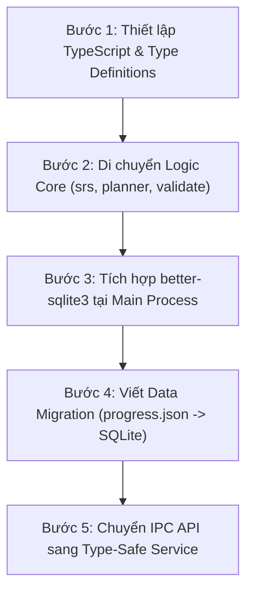

# Kiến trúc Đề xuất: TypeScript hoá Module Nhạy cảm & Tích hợp SQLite Quản lý Dữ liệu

> **Tài liệu phân tích và thiết kế kiến trúc (Architecture RFC)**  
> **Mục tiêu:**  
> 1. Chuyển đổi các module lõi, nhạy cảm về logic và dữ liệu sang TypeScript có type-safety nghiêm ngặt.  
> 2. Tích hợp SQLite (`better-sqlite3`) tại Main process để quản lý tiến trình SRS, nhật ký ôn tập và lưu trữ/truy vấn câu hỏi hiệu năng cao.  
> 3. Bảo toàn nguyên tắc bảo mật (contextIsolation, sandbox IPC), tính thuần của `src/core/`, và định dạng xuất bản `.sdeck`.

---

## 1. Phân tích hiện trạng & Lý do chuyển đổi

### 1.1 Điểm nghẽn của kiến trúc hiện tại
1. **Kiểu dữ liệu ngầm định (Implicit typing) ở tầng Core:**
   - Dạng câu hỏi (`Item`) là một union đa hình (`single`, `multi`, `fill`, `command`, `card`, `vocab`) nhưng kiểm tra bằng JavaScript runtime qua các hàm `detectItemType`, `validateItem`. Khi thêm trường hoặc refactor, rủi ro sót trường (như lỗi `q.answers` vs `q.answer`, `q.kind` vs `q.type`) rất dễ xảy ra nếu không có type checker tĩnh.
   - Hợp đồng IPC (`preload.js` ↔ `main.js` ↔ `renderer`) hiện hoàn toàn dùng `invoke/handle` không có type signature, dễ gây lệch format tham số giữa các phía.
2. **Lưu trữ JSON phẳng (`progress.json`, `deck.json` trong RAM):**
   - Hiện tại toàn bộ `progress.cards` và mảng `progress.log` được ghi đè atomic mỗi khi cập nhật. Khi log tích luỹ hàng chục nghìn lượt ôn tập (sau vài tháng học), việc parse và serialize JSON kích thước nhiều MB sẽ gây nghẽn I/O và giật lag giao diện (jank).
   - Truy vấn thống kê (`deckStats`, tính leech `lapses ≥ 8`, streak, lịch sử ôn tập) đang phải duyệt tuyến tính $O(N)$ trong bộ nhớ RAM mỗi lần mở màn hình Home/Deck.
3. **Quản lý câu hỏi phân tán:**
   - Mỗi file `.sdeck` chứa `deck.json` độc lập. Việc tìm kiếm từ khoá xuyên suốt các bộ thẻ, hoặc lọc các câu hỏi sai nhiều từ nhiều bộ thẻ cùng lúc là bất khả thi nếu không mở và giải nén toàn bộ các file `.sdeck` vào RAM.

---

## 2. Xác định các "Module Nhạy Cảm" cần chuyển đổi sang TypeScript

"Module nhạy cảm" là các module phụ trách tính toàn vẹn dữ liệu, giải thuật cốt lõi và giao tiếp ranh giới:

```
┌────────────────────────────────────────────────────────────────────────┐
│                        TẦNG TYPE-SAFETY (TS)                           │
│                                                                        │
│  [1. Domain Types]          [2. Thuật toán Lõi]      [3. Dữ liệu & I/O]│
│  - item.types.ts            - srs.ts                 - sdeck.ts        │
│  - deck.types.ts            - grader.ts              - validate.ts     │
│  - srs.types.ts             - learnplanner.ts        - parser.ts       │
│  - ipc.types.ts             - matchgame.ts                             │
│                             - exam.ts                                  │
│                                                                        │
│  [4. Ranh giới Main / IPC]  [5. Tầng Database SQLite]                  │
│  - preload.ts (API Bridge)  - db/schema.ts                             │
│  - main/ipc-handlers.ts     - db/repository.ts                         │
└────────────────────────────────────────────────────────────────────────┘
```

### 2.1 Danh mục chi tiết các module ưu tiên TypeScript hoá

| Thứ tự | Module | Trách nhiệm | Rủi ro nếu không có Type |
|---|---|---|---|
| **P0** | `types/*.ts` | Định nghĩa toàn bộ schema: `DeckItem`, `DeckMeta`, `SrsCard`, `ReviewLog`, `ExamState`, `MatchGame` | Lệch kiểu dữ liệu giữa các module |
| **P0** | `srs.ts` & `learnplanner.ts` | Thuật toán SM-2, learning steps, state machine mastery 0→4 | Sai sót trạng thái thẻ (`learning` vs `review`), hỏng lịch ôn |
| **P0** | `sdeck.ts` & `validate.ts` | Đọc/ghi ZIP, kiểm tra giới hạn buffer, chống path traversal | Lỗ hổng bảo mật tệp tin, hỏng dữ liệu gói `.sdeck` |
| **P1** | `grader.ts` & `exam.ts` | Chấm điểm văn bản, Levenshtein, regex, đồng hồ thi | Chấm sai kết quả của thí sinh |
| **P1** | `ipc.types.ts` & `preload.ts` | Ranh giới giao tiếp IPC giữa Main và Renderer | Gửi nhầm payload qua kênh IPC |
| **P2** | `database/*.ts` | SQLite Repository, ORM thuần / typed query | SQL injection, sai kiểu cột dữ liệu |

---

## 3. Chiến lược Tích hợp TypeScript (Không làm nặng app)

### 3.1 Yêu cầu kiến trúc
- **Không dùng framework UI nặng:** Giữ nguyên renderer DOM thuần (`h(...)`, `src/views/`).
- **Giữ khả năng chạy test nhanh:** `node --test` của Node 20+ hỗ trợ chạy trực tiếp hoặc chạy qua TypeScript strip types / `tsc` biên dịch cực nhanh.
- **Biên dịch In-Place hoặc Dual Output:**
  - Cấu hình `tsconfig.json` biên dịch các file `.ts` trong `src/core/` thành `.js` + `.d.ts` giữ nguyên ES module để renderer và test import như bình thường.

### 3.2 Hệ thống Type định danh chặt (Discriminated Union)

```typescript
// src/core/types/item.types.ts

export type ItemType = 'single' | 'multi' | 'fill' | 'command' | 'card' | 'vocab';

export interface BaseItem {
  id: string;
  topic?: string;
  tags?: string[];
  explanation?: string;
  image?: string;
  answerImage?: string;
  starred?: boolean;
}

export interface SingleChoiceItem extends BaseItem {
  type: 'single';
  question: string;
  choices: (string | { text: string; image?: string })[];
  answer: [number];
}

export interface MultiChoiceItem extends BaseItem {
  type: 'multi';
  question: string;
  choices: (string | { text: string; image?: string })[];
  answer: number[];
}

export interface FillItem extends BaseItem {
  type: 'fill';
  question: string;
  answers: string[];
  match?: 'exact' | 'normalized' | 'regex' | 'number';
  tolerance?: number;
  answerDisplay?: string;
}

export interface CommandItem extends BaseItem {
  type: 'command';
  question: string;
  answers: string[];
  match?: 'exact' | 'regex';
}

export interface FlashcardItem extends BaseItem {
  type: 'card';
  front: string;
  back: string;
}

export interface VocabItem extends BaseItem {
  type: 'vocab';
  term: string;
  definition: string;
  phonetic?: string;
  pos?: string;
  example?: string;
  forms?: string[];
  synonyms?: string[];
  audio?: string;
}

export type DeckItem =
  | SingleChoiceItem
  | MultiChoiceItem
  | FillItem
  | CommandItem
  | FlashcardItem
  | VocabItem;
```

---

## 4. Kiến trúc Tích hợp SQLite (`better-sqlite3`)

### 4.1 Vai trò phân định giữa `.sdeck` và `SQLite`
- **File `.sdeck`:** Vẫn là **định dạng phân phối và lưu trữ độc lập** (Portable Container). Người dùng sao lưu, chia sẻ, đồng bộ đám mây qua file `.sdeck`.
- **SQLite Database (`userData/studyapp.db`):** Đóng vai trò là **Engine Cục bộ (Local Data Warehouse)**:
  1. Quản lý trạng thái SRS của toàn bộ thẻ (`cards`).
  2. Lưu toàn bộ lịch sử ôn tập (`reviews` log) không giới hạn dung lượng.
  3. Caching nội dung câu hỏi từ các file `.sdeck` đã nạp để tìm kiếm toàn văn (FTS5) và thống kê chéo giữa các deck.
  4. Quản lý kỷ lục Match (`match_records`), cài đặt người dùng, ghi chú và danh sách sao.

```
                           ┌────────────────────────┐
                           │      File .sdeck       │
                           │ (deck.json + img/ ZIP) │
                           └───────────┬────────────┘
                                       │ Mở / Lưu gói
                                       ▼
┌────────────────────────────────────────────────────────────────────────┐
│                              MAIN PROCESS                              │
│                                                                        │
│    ┌──────────────────┐               ┌───────────────────────────┐    │
│    │     sdeck.ts     │               │   Database (better-sqlite3) │
│    │ (Zip Reader/Writ)│               │   studyapp.db             │    │
│    └────────┬─────────┘               └─────────────┬─────────────┘    │
│             │ Parse/Validate                        │                  │
│             ▼                                       ▼                  │
│    ┌──────────────────────────────────────────────────────────────┐    │
│    │               IPC Dispatcher / Type-Safe Handlers            │    │
│    └──────────────────────────────┬───────────────────────────────┘    │
└───────────────────────────────────┼────────────────────────────────────┘
                                    │ window.api (preload.ts)
                                    ▼
┌────────────────────────────────────────────────────────────────────────┐
│                            RENDERER PROCESS                            │
│                                                                        │
│   views/home.js     views/deck.js     views/session.js    views/exam.js│
│   (Chỉ hiển thị, nhận dữ liệu đã tính toán từ IPC hoặc Core thuần)     │
└────────────────────────────────────────────────────────────────────────┘
```

### 4.2 Thiết kế Schema Cơ sở Dữ liệu (DDL)

```sql
-- Bảng bộ thẻ đã biết
CREATE TABLE IF NOT EXISTS decks (
  id TEXT PRIMARY KEY,
  file_path TEXT UNIQUE,
  title TEXT NOT NULL,
  kind TEXT NOT NULL CHECK(kind IN ('qa', 'quiz', 'vocab')),
  lang TEXT DEFAULT 'vi',
  description TEXT,
  version INTEGER DEFAULT 1,
  created_at INTEGER NOT NULL,
  updated_at INTEGER NOT NULL
);

-- Bảng câu hỏi (Cache nội dung phục vụ tìm kiếm & thống kê chéo)
CREATE TABLE IF NOT EXISTS items (
  id TEXT NOT NULL,
  deck_id TEXT NOT NULL,
  type TEXT NOT NULL,
  topic TEXT,
  tags_json TEXT,         -- JSON array: ["linux", "network"]
  content_json TEXT NOT NULL, -- Dữ liệu đầy đủ của item
  search_text TEXT,       -- Văn bản thô không dấu phục vụ tìm kiếm nhanh
  starred INTEGER DEFAULT 0,
  created_at INTEGER NOT NULL,
  PRIMARY KEY (deck_id, id),
  FOREIGN KEY (deck_id) REFERENCES decks(id) ON DELETE CASCADE
);

CREATE INDEX IF NOT EXISTS idx_items_topic ON items(deck_id, topic);
CREATE INDEX IF NOT EXISTS idx_items_starred ON items(deck_id, starred);

-- Bảng trạng thái SRS cho từng thẻ học (direction: fwd | rev)
CREATE TABLE IF NOT EXISTS srs_cards (
  deck_id TEXT NOT NULL,
  item_id TEXT NOT NULL,
  direction TEXT NOT NULL DEFAULT 'fwd',
  state TEXT NOT NULL CHECK(state IN ('new', 'learning', 'review', 'relearning')),
  step INTEGER DEFAULT 0,
  ease REAL DEFAULT 2.5,
  interval INTEGER DEFAULT 0,
  due INTEGER NOT NULL DEFAULT 0,
  reps INTEGER DEFAULT 0,
  lapses INTEGER DEFAULT 0,
  updated_at INTEGER NOT NULL,
  PRIMARY KEY (deck_id, item_id, direction),
  FOREIGN KEY (deck_id, item_id) REFERENCES items(deck_id, id) ON DELETE CASCADE
);

CREATE INDEX IF NOT EXISTS idx_srs_due ON srs_cards(deck_id, state, due);

-- Bảng nhật ký ôn tập (Append-only log, phục vụ streak, heatmap, leech analysis)
CREATE TABLE IF NOT EXISTS review_logs (
  id INTEGER PRIMARY KEY AUTOINCREMENT,
  deck_id TEXT NOT NULL,
  item_id TEXT NOT NULL,
  direction TEXT NOT NULL DEFAULT 'fwd',
  rating INTEGER NOT NULL CHECK(rating BETWEEN 1 AND 4),
  review_time INTEGER NOT NULL,
  elapsed_ms INTEGER DEFAULT 0,
  is_new INTEGER DEFAULT 0
);

CREATE INDEX IF NOT EXISTS idx_review_logs_deck_time ON review_logs(deck_id, review_time);
CREATE INDEX IF NOT EXISTS idx_review_logs_item ON review_logs(deck_id, item_id);

-- Bảng kỷ lục chế độ Match
CREATE TABLE IF NOT EXISTS match_records (
  deck_id TEXT PRIMARY KEY,
  best_time_ms INTEGER NOT NULL,
  achieved_at INTEGER NOT NULL,
  pairs_count INTEGER NOT NULL,
  FOREIGN KEY (deck_id) REFERENCES decks(id) ON DELETE CASCADE
);
```

### 4.3 So sánh Hiệu năng & Khả năng chịu tải

| Tiêu chí | Lưu trữ hiện tại (`progress.json`) | Khi có SQLite (`better-sqlite3`) |
|---|---|---|
| **Lưu 1 lượt ôn tập** | Đọc toàn bộ file $\to$ gộp $\to$ ghi `.tmp` $\to$ `rename` ($O(N)$ dung lượng) | `INSERT INTO review_logs ...` ($O(1)$, thực thi trong < 1ms với WAL) |
| **Tính số thẻ Due hôm nay** | Quét toàn bộ object `cards` trong RAM | `SELECT COUNT(*) FROM srs_cards WHERE due <= ?` (Chỉ mục B-Tree, < 0.2ms) |
| **Thống kê Leech (`lapses ≥ 8`)** | Duyệt log/card tính nhẩm lại | `SELECT * FROM srs_cards WHERE lapses >= 8` |
| **An toàn trước sự cố (Crash safety)** | Phụ thuộc atomic rename; nếu kill app lúc RAM chưa sync log thì mất log | Chuẩn ACID, WAL mode tự phục hồi khi crash mà không hỏng database |
| **Dung lượng chịu tải** | Chậm khi log > 10.000 dòng (~2MB JSON) | Hoạt động mượt mà với > 1.000.000 dòng log |

---

## 5. Lộ trình Triển khai Đề xuất (Phân kỳ an toàn)

Quá trình nâng cấp cần tuân thủ nguyên tắc không làm gián đoạn các tính năng hiện có:



### Bước 1: Thiết lập hạ tầng TypeScript nhẹ
- Thêm `typescript` và `@types/node` vào `devDependencies`.
- Cấu hình `tsconfig.json` xuất thẳng ES module tương thích với runtime hiện tại.
- Tạo thư mục `src/core/types/` chứa các interface và discriminated unions.

### Bước 2: Chuyển đổi các module lõi sang `.ts`
- Đổi đuôi `srs.js`, `learnplanner.js`, `grader.js`, `validate.js`, `sdeck.js` sang `.ts`.
- Bổ sung strict typing cho các hàm tính toán SM-2, Levenshtein, và xác thực cấu trúc ZIP.
- Giữ nguyên toàn bộ 145 unit test hiện tại, cấu hình test runner chạy trực tiếp.

### Bước 3: Tích hợp `better-sqlite3` và Migration tự động
- Cài đặt `better-sqlite3` (compile native binary tương thích với Electron ABI).
- Khi app khởi động ở `main.js`:
  - Khởi tạo file database `studyapp.db` trong `app.getPath('userData')`.
  - Kiểm tra nếu còn tồn tại `progress.json`: tự động chạy migration nạp toàn bộ `cards`, `log` cũ vào SQLite trong một transaction duy nhất, sau đó đổi tên thành `progress.json.migrated`.

### Bước 4: Refactor IPC và Store
- Cung cấp Typed Database Client tại Main Process.
- Thay thế các lời gọi `api.saveProgress(...)` bằng các IPC calls nghiệp vụ gọn nhẹ:
  - `srs:recordReview({ deckId, itemId, direction, rating, elapsedMs })`
  - `srs:getDueCounts(deckId, now)`
  - `deck:queryItems(criteria)`
- Phục vụ sẵn sàng cho **Giai đoạn 6 (Thống kê chuyên sâu: heatmap, streak, leech)** với các câu truy vấn SQL tổng hợp cực nhanh.

---

## 6. Đánh giá Rủi ro & Giải pháp Phòng ngừa

1. **Rủi ro Native Module (`better-sqlite3`):**
   - *Vấn đề:* Node.js và Electron có thể lệch ABI khiến binary native bị crash khi chạy `npm start`.
   - *Giải pháp:* Sử dụng script `electron-rebuild` hoặc cài đặt `better-sqlite3` với flag Electron build chuẩn; hoặc cân nhắc `sql.js` (WebAssembly SQLite) nếu muốn thuần 100% JS, nhưng `better-sqlite3` tối ưu tốc độ I/O hơn nhiều cho desktop app.
2. **Rủi ro phân mảnh dữ liệu giữa `.sdeck` và `SQLite`:**
   - *Vấn đề:* Người dùng sao chép file `.sdeck` sửa nội dung ngoài máy khác rồi đem về mở lại.
   - *Giải pháp:* Khởi tạo mã băm nội dung `deck_hash` (SHA-1) trong bảng `decks`. Khi mở file `.sdeck`, nếu hash thay đổi thì đồng bộ lại bảng `items` dựa trên `item.id`, giữ nguyên tiến trình `srs_cards` theo `item.id`.
3. **Giữ nguyên trải nghiệm Người dùng:**
   - Người dùng vẫn hoàn toàn tương tác thông qua Editor, mở gói `.sdeck` không cần biết đến sự tồn tại của database ngầm bên dưới.

