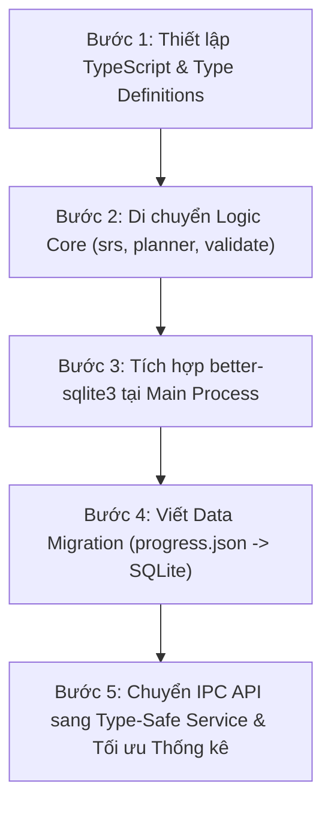

# Kiến trúc Đề xuất: TypeScript hoá Module Nhạy cảm & Tích hợp SQLite Quản lý Dữ liệu

> **Tài liệu phân tích và thiết kế kiến trúc (Architecture RFC)**  
> **Mục tiêu:**  
> 1. Chuyển đổi các module lõi, nhạy cảm về logic và dữ liệu sang TypeScript có type-safety nghiêm ngặt.  
> 2. Tích hợp SQLite (`better-sqlite3`) tại Main process để quản lý tiến trình SRS, nhật ký ôn tập và lưu trữ/truy vấn câu hỏi hiệu năng cao.  
> 3. Bảo toàn nguyên tắc bảo mật (contextIsolation, sandbox IPC), tính thuần của `src/core/`, và định dạng xuất bản `.sdeck`.

---

## 1. Phân tích hiện trạng & Lý do chuyển đổi

### 1.1 Điểm nghẽn của kiến trúc hiện tại
1. **Kiểu dữ liệu ngầm định (Implicit typing) ở tầng Core:**
   - Dạng câu hỏi (`Item`) là một union đa hình (`single`, `multi`, `fill`, `command`, `card`, `vocab`) nhưng kiểm tra bằng JavaScript runtime qua các hàm `detectItemType`, `validateItem`. Khi thêm trường hoặc refactor, rủi ro sót trường (như lỗi `q.answers` vs `q.answer`, `q.kind` vs `q.type`) rất dễ xảy ra nếu không có type checker tĩnh.
   - Hợp đồng IPC (`preload.js` ↔ `main.js` ↔ `renderer`) hiện hoàn toàn dùng `invoke/handle` không có type signature, dễ gây lệch format tham số giữa các phía.
2. **Lưu trữ JSON phẳng (`progress.json`, `deck.json` trong RAM):**
   - Hiện tại toàn bộ `progress.cards` và mảng `progress.log` được ghi đè atomic mỗi khi cập nhật. Khi log tích luỹ hàng chục nghìn lượt ôn tập (sau vài tháng học), việc parse và serialize JSON kích thước nhiều MB sẽ gây nghẽn I/O và giật lag giao diện (jank).
   - Truy vấn thống kê (`deckStats`, tính leech `lapses ≥ 8`, streak, lịch sử ôn tập) đang phải duyệt tuyến tính $O(N)$ trong bộ nhớ RAM mỗi lần mở màn hình Home/Deck.
3. **Quản lý câu hỏi phân tán:**
   - Mỗi file `.sdeck` chứa `deck.json` độc lập. Việc tìm kiếm từ khoá xuyên suốt các bộ thẻ, hoặc lọc các câu hỏi sai nhiều từ nhiều bộ thẻ cùng lúc là bất khả thi nếu không mở và giải nén toàn bộ các file `.sdeck` vào RAM.

---

## 2. Xác định các "Module Nhạy Cảm" cần chuyển đổi sang TypeScript

"Module nhạy cảm" là các module phụ trách tính toàn vẹn dữ liệu, giải thuật cốt lõi và giao tiếp ranh giới:

```
┌────────────────────────────────────────────────────────────────────────┐
│                        TẦNG TYPE-SAFETY (TS)                           │
│                                                                        │
│  [1. Domain Types]          [2. Thuật toán Lõi]      [3. Dữ liệu & I/O]│
│  - item.types.ts            - srs.ts                 - sdeck.ts        │
│  - deck.types.ts            - grader.ts              - validate.ts     │
│  - srs.types.ts             - learnplanner.ts        - parser.ts       │
│  - ipc.types.ts             - matchgame.ts                             │
│                             - exam.ts                                  │
│                                                                        │
│  [4. Ranh giới Main / IPC]  [5. Tầng Database SQLite]                  │
│  - preload.ts (API Bridge)  - db/schema.ts                             │
│  - main/ipc-handlers.ts     - db/repository.ts                         │
└────────────────────────────────────────────────────────────────────────┘
```

### 2.1 Danh mục chi tiết các module ưu tiên TypeScript hoá

| Thứ tự | Module | Trách nhiệm | Rủi ro nếu không có Type |
|---|---|---|---|
| **P0** | `types/*.ts` | Định nghĩa toàn bộ schema: `DeckItem`, `DeckMeta`, `SrsCard`, `ReviewLog`, `ExamState`, `MatchGame` | Lệch kiểu dữ liệu giữa các module |
| **P0** | `srs.ts` & `learnplanner.ts` | Thuật toán SM-2, learning steps, state machine mastery 0→4 | Sai sót trạng thái thẻ (`learning` vs `review`), hỏng lịch ôn |
| **P0** | `sdeck.ts` & `validate.ts` | Đọc/ghi ZIP, kiểm tra giới hạn buffer, chống path traversal | Lỗ hổng bảo mật tệp tin, hỏng dữ liệu gói `.sdeck` |
| **P1** | `grader.ts` & `exam.ts` | Chấm điểm văn bản, Levenshtein, regex, đồng hồ thi | Chấm sai kết quả của thí sinh |
| **P1** | `ipc.types.ts` & `preload.ts` | Ranh giới giao tiếp IPC giữa Main và Renderer | Gửi nhầm payload qua kênh IPC |
| **P2** | `database/*.ts` | SQLite Repository, ORM thuần / typed query | SQL injection, sai kiểu cột dữ liệu |

---

## 3. Chiến lược Tích hợp TypeScript (Không làm nặng app)

### 3.1 Yêu cầu kiến trúc
- **Không dùng framework UI nặng:** Giữ nguyên renderer DOM thuần (`h(...)`, `src/views/`).
- **Giữ khả năng chạy test nhanh:** `node --test` của Node 20+ hỗ trợ chạy trực tiếp hoặc chạy qua TypeScript strip types / `tsc` biên dịch cực nhanh.
- **Biên dịch In-Place hoặc Dual Output:**
  - Cấu hình `tsconfig.json` biên dịch các file `.ts` trong `src/core/` thành `.js` + `.d.ts` giữ nguyên ES module để renderer và test import như bình thường.

### 3.2 Hệ thống Type định danh chặt (Discriminated Union)

```typescript
// src/core/types/item.types.ts

export type ItemType = 'single' | 'multi' | 'fill' | 'command' | 'card' | 'vocab';

export interface BaseItem {
  id: string;
  topic?: string;
  tags?: string[];
  explanation?: string;
  image?: string;
  answerImage?: string;
  starred?: boolean;
}

export interface SingleChoiceItem extends BaseItem {
  type: 'single';
  question: string;
  choices: (string | { text: string; image?: string })[];
  answer: [number];
}

export interface MultiChoiceItem extends BaseItem {
  type: 'multi';
  question: string;
  choices: (string | { text: string; image?: string })[];
  answer: number[];
}

export interface FillItem extends BaseItem {
  type: 'fill';
  question: string;
  answers: string[];
  match?: 'exact' | 'normalized' | 'regex' | 'number';
  tolerance?: number;
  answerDisplay?: string;
}

export interface CommandItem extends BaseItem {
  type: 'command';
  question: string;
  answers: string[];
  match?: 'exact' | 'regex';
}

export interface FlashcardItem extends BaseItem {
  type: 'card';
  front: string;
  back: string;
}

export interface VocabItem extends BaseItem {
  type: 'vocab';
  term: string;
  definition: string;
  phonetic?: string;
  pos?: string;
  example?: string;
  forms?: string[];
  synonyms?: string[];
  audio?: string;
}

export type DeckItem =
  | SingleChoiceItem
  | MultiChoiceItem
  | FillItem
  | CommandItem
  | FlashcardItem
  | VocabItem;
```

### 3.3 Định nghĩa kiểu thuật toán SRS (`src/core/types/srs.types.ts`)

```typescript
// src/core/types/srs.types.ts

export type SrsRating = 1 | 2 | 3 | 4; // 1: Again, 2: Hard, 3: Good, 4: Easy
export type SrsDirection = 'fwd' | 'rev';
export type SrsCardState = 'new' | 'learning' | 'review' | 'relearning';

export interface SrsCard {
  deckId: string;
  itemId: string;
  direction: SrsDirection;
  state: SrsCardState;
  step: number;        // Chỉ số bước học (learning/relearning steps)
  ease: number;        // Hệ số SM-2 (mặc định 2.5)
  interval: number;    // Khoảng cách ngày ôn kế tiếp
  due: number;         // Timestamp (ms) hoặc ngày hết hạn ôn
  reps: number;        // Tổng số lượt ôn
  lapses: number;      // Số lần bấm Again khi đang ở trạng thái review
  updatedAt: number;   // Timestamp cập nhật gần nhất
}

export interface ReviewLogEntry {
  id?: number;
  deckId: string;
  itemId: string;
  direction: SrsDirection;
  rating: SrsRating;
  reviewTime: number;  // Timestamp (ms)
  elapsedMs: number;   // Thời gian trả lời (ms)
  isNew: boolean;      // Lần đầu ôn hay thẻ cũ
}

export interface SrsReviewResult {
  card: SrsCard;
  log: ReviewLogEntry;
  nextIntervalText: string; // Chuỗi hiển thị ("10 phút", "1 ngày", "4 ngày")
}

export interface SrsDeckSummary {
  newCount: number;
  learningCount: number;
  dueCount: number;
  totalCards: number;
}
```

### 3.4 Định nghĩa kiểu dữ liệu Thống kê & Báo cáo (`src/core/types/stats.types.ts`)

```typescript
// src/core/types/stats.types.ts

export interface DailyReviewStat {
  date: string;        // Định dạng YYYY-MM-DD
  count: number;
  retentionRate: number; // Tỷ lệ đánh giá Good/Easy (0 - 100%)
  timeSpentMs: number;
}

export interface HeatmapCell {
  date: string;
  count: number;
  level: 0 | 1 | 2 | 3 | 4; // Cường độ hoạt động từ 0 (không ôn) đến 4 (rất nhiều)
}

export interface LeechItemInfo {
  deckId: string;
  itemId: string;
  direction: SrsDirection;
  lapses: number;
  prompt: string;
  lastRating: SrsRating;
  lastReviewTime: number;
}

export interface RetentionBreakdown {
  again: number;
  hard: number;
  good: number;
  easy: number;
  total: number;
  retentionPercentage: number;
}

export interface DeckStatsReport {
  deckId: string;
  totalItems: number;
  learnedItems: number;
  matureItems: number;
  currentStreak: number;
  longestStreak: number;
  retention: RetentionBreakdown;
  leeches: LeechItemInfo[];
  dailyHistory: DailyReviewStat[];
}
```

### 3.5 Hợp đồng Giao tiếp Type-Safe IPC (`src/core/types/ipc.types.ts`)

```typescript
// src/core/types/ipc.types.ts
import { DeckItem } from './item.types.js';
import { SrsCard, SrsDeckSummary, SrsRating, SrsDirection } from './srs.types.js';
import { DeckStatsReport } from './stats.types.js';

export interface IpcContracts {
  // Quản lý gói thẻ .sdeck
  'deck:open': {
    request: { filePath?: string };
    response: { ok: boolean; deckKey?: string; deck?: any; error?: string };
  };
  'deck:save': {
    request: { deckKey: string; filePath?: string };
    response: { ok: boolean; filePath?: string; error?: string };
  };
  'deck:queryItems': {
    request: { deckId: string; query?: string; type?: string; starredOnly?: boolean; limit?: number; offset?: number };
    response: { items: DeckItem[]; total: number };
  };

  // Tiến trình SRS & Đánh giá
  'srs:getDeckSummary': {
    request: { deckId: string; now?: number };
    response: SrsDeckSummary;
  };
  'srs:getDueItems': {
    request: { deckId: string; limit?: number; now?: number };
    response: { item: DeckItem; card: SrsCard }[];
  };
  'srs:recordReview': {
    request: { deckId: string; itemId: string; direction: SrsDirection; rating: SrsRating; elapsedMs: number };
    response: { ok: boolean; card: SrsCard };
  };

  // Thống kê & Phân tích chuyên sâu
  'stats:getDeckReport': {
    request: { deckId: string; days?: number };
    response: DeckStatsReport;
  };
  'stats:getOverallStreak': {
    request: void;
    response: { currentStreak: number; longestStreak: number; totalReviews: number };
  };
}

export type IpcChannel = keyof IpcContracts;
export type IpcRequest<C extends IpcChannel> = IpcContracts[C]['request'];
export type IpcResponse<C extends IpcChannel> = IpcContracts[C]['response'];
```

---

## 4. Kiến trúc Tích hợp SQLite (`better-sqlite3`)

### 4.1 Vai trò phân định giữa `.sdeck` và `SQLite`
- **File `.sdeck`:** Vẫn là **định dạng phân phối và lưu trữ độc lập** (Portable Container). Người dùng sao lưu, chia sẻ, đồng bộ đám mây qua file `.sdeck`.
- **SQLite Database (`userData/studyapp.db`):** Đóng vai trò là **Engine Cục bộ (Local Data Warehouse)**:
  1. Quản lý trạng thái SRS của toàn bộ thẻ (`cards`).
  2. Lưu toàn bộ lịch sử ôn tập (`reviews` log) không giới hạn dung lượng.
  3. Caching nội dung câu hỏi từ các file `.sdeck` đã nạp để tìm kiếm toàn văn (FTS5) và thống kê chéo giữa các deck.
  4. Quản lý kỷ lục Match (`match_records`), cài đặt người dùng, ghi chú và danh sách sao.

```
                           ┌────────────────────────┐
                           │      File .sdeck       │
                           │ (deck.json + img/ ZIP) │
                           └───────────┬────────────┘
                                       │ Mở / Lưu gói
                                       ▼
┌────────────────────────────────────────────────────────────────────────┐
│                              MAIN PROCESS                              │
│                                                                        │
│    ┌──────────────────┐               ┌───────────────────────────┐    │
│    │     sdeck.ts     │               │   Database (better-sqlite3) │
│    │ (Zip Reader/Writ)│               │   studyapp.db             │    │
│    └────────┬─────────┘               └─────────────┬─────────────┘    │
│             │ Parse/Validate                        │                  │
│             ▼                                       ▼                  │
│    ┌──────────────────────────────────────────────────────────────┐    │
│    │               IPC Dispatcher / Type-Safe Handlers            │    │
│    └──────────────────────────────┬───────────────────────────────┘    │
└───────────────────────────────────┼────────────────────────────────────┘
                                    │ window.api (preload.ts)
                                    ▼
┌────────────────────────────────────────────────────────────────────────┐
│                            RENDERER PROCESS                            │
│                                                                        │
│   views/home.js     views/deck.js     views/session.js    views/exam.js│
│   (Chỉ hiển thị, nhận dữ liệu đã tính toán từ IPC hoặc Core thuần)     │
└────────────────────────────────────────────────────────────────────────┘
```

### 4.2 Thiết kế Schema Cơ sở Dữ liệu (DDL)

```sql
-- Bảng bộ thẻ đã biết
CREATE TABLE IF NOT EXISTS decks (
  id TEXT PRIMARY KEY,
  file_path TEXT UNIQUE,
  title TEXT NOT NULL,
  kind TEXT NOT NULL CHECK(kind IN ('qa', 'quiz', 'vocab')),
  lang TEXT DEFAULT 'vi',
  description TEXT,
  version INTEGER DEFAULT 1,
  created_at INTEGER NOT NULL,
  updated_at INTEGER NOT NULL
);

-- Bảng câu hỏi (Cache nội dung phục vụ tìm kiếm & thống kê chéo)
CREATE TABLE IF NOT EXISTS items (
  id TEXT NOT NULL,
  deck_id TEXT NOT NULL,
  type TEXT NOT NULL,
  topic TEXT,
  tags_json TEXT,         -- JSON array: ["linux", "network"]
  content_json TEXT NOT NULL, -- Dữ liệu đầy đủ của item
  search_text TEXT,       -- Văn bản thô không dấu phục vụ tìm kiếm nhanh
  starred INTEGER DEFAULT 0,
  created_at INTEGER NOT NULL,
  PRIMARY KEY (deck_id, id),
  FOREIGN KEY (deck_id) REFERENCES decks(id) ON DELETE CASCADE
);

CREATE INDEX IF NOT EXISTS idx_items_topic ON items(deck_id, topic);
CREATE INDEX IF NOT EXISTS idx_items_starred ON items(deck_id, starred);

-- Bảng trạng thái SRS cho từng thẻ học (direction: fwd | rev)
CREATE TABLE IF NOT EXISTS srs_cards (
  deck_id TEXT NOT NULL,
  item_id TEXT NOT NULL,
  direction TEXT NOT NULL DEFAULT 'fwd',
  state TEXT NOT NULL CHECK(state IN ('new', 'learning', 'review', 'relearning')),
  step INTEGER DEFAULT 0,
  ease REAL DEFAULT 2.5,
  interval INTEGER DEFAULT 0,
  due INTEGER NOT NULL DEFAULT 0,
  reps INTEGER DEFAULT 0,
  lapses INTEGER DEFAULT 0,
  updated_at INTEGER NOT NULL,
  PRIMARY KEY (deck_id, item_id, direction),
  FOREIGN KEY (deck_id, item_id) REFERENCES items(deck_id, id) ON DELETE CASCADE
);

CREATE INDEX IF NOT EXISTS idx_srs_due ON srs_cards(deck_id, state, due);

-- Bảng nhật ký ôn tập (Append-only log, phục vụ streak, heatmap, leech analysis)
CREATE TABLE IF NOT EXISTS review_logs (
  id INTEGER PRIMARY KEY AUTOINCREMENT,
  deck_id TEXT NOT NULL,
  item_id TEXT NOT NULL,
  direction TEXT NOT NULL DEFAULT 'fwd',
  rating INTEGER NOT NULL CHECK(rating BETWEEN 1 AND 4),
  review_time INTEGER NOT NULL,
  elapsed_ms INTEGER DEFAULT 0,
  is_new INTEGER DEFAULT 0
);

CREATE INDEX IF NOT EXISTS idx_review_logs_deck_time ON review_logs(deck_id, review_time);
CREATE INDEX IF NOT EXISTS idx_review_logs_item ON review_logs(deck_id, item_id);

-- Bảng kỷ lục chế độ Match
CREATE TABLE IF NOT EXISTS match_records (
  deck_id TEXT PRIMARY KEY,
  best_time_ms INTEGER NOT NULL,
  achieved_at INTEGER NOT NULL,
  pairs_count INTEGER NOT NULL,
  FOREIGN KEY (deck_id) REFERENCES decks(id) ON DELETE CASCADE
);

-- Bảng tìm kiếm toàn văn FTS5 cho câu hỏi / từ vựng
CREATE VIRTUAL TABLE IF NOT EXISTS items_fts USING fts5(
  deck_id UNINDEXED,
  item_id UNINDEXED,
  search_text,
  tokenize = 'unicode61 remove_diacritics 2'
);

-- Triggers tự động duy trì chỉ mục FTS5 khi bảng items thay đổi
CREATE TRIGGER IF NOT EXISTS trg_items_ai AFTER INSERT ON items BEGIN
  INSERT INTO items_fts(deck_id, item_id, search_text)
  VALUES (new.deck_id, new.id, new.search_text);
END;

CREATE TRIGGER IF NOT EXISTS trg_items_ad AFTER DELETE ON items BEGIN
  DELETE FROM items_fts WHERE deck_id = old.deck_id AND item_id = old.id;
END;

CREATE TRIGGER IF NOT EXISTS trg_items_au AFTER UPDATE ON items BEGIN
  DELETE FROM items_fts WHERE deck_id = old.deck_id AND item_id = old.id;
  INSERT INTO items_fts(deck_id, item_id, search_text)
  VALUES (new.deck_id, new.id, new.search_text);
END;
```

#### 4.2.1 Cấu hình Tối ưu Hiệu năng SQLite (PRAGMAs)
Khi khởi tạo kết nối `better-sqlite3`, bắt buộc áp dụng các thiết lập sau để đạt hiệu năng tối đa:

```sql
-- Kích hoạt Write-Ahead Logging: Cho phép đọc ghi đồng thời không khóa lẫn nhau
PRAGMA journal_mode = WAL;

-- Đồng bộ đĩa mức NORMAL: Cân bằng an toàn và tốc độ, ghi đĩa cực nhanh
PRAGMA synchronous = NORMAL;

-- Bật toàn vẹn khoá ngoại
PRAGMA foreign_keys = ON;

-- Lưu trữ bảng tạm và chỉ mục tạm trong RAM
PRAGMA temp_store = MEMORY;

-- Phân bổ bộ đệm trang ~32MB trong RAM (giá trị âm tính theo KiB)
PRAGMA cache_size = -32000;

-- Bật cơ chế tự động dọn dẹp phân mảnh không gian trống
PRAGMA auto_vacuum = INCREMENTAL;
```

### 4.3 So sánh Hiệu năng & Khả năng chịu tải

| Tiêu chí | Lưu trữ hiện tại (`progress.json`) | Khi có SQLite (`better-sqlite3`) |
|---|---|---|
| **Lưu 1 lượt ôn tập** | Đọc toàn bộ file $\to$ gộp $\to$ ghi `.tmp` $\to$ `rename` ($O(N)$ dung lượng) | `INSERT INTO review_logs ...` ($O(1)$, thực thi trong < 1ms với WAL) |
| **Tính số thẻ Due hôm nay** | Quét toàn bộ object `cards` trong RAM | `SELECT COUNT(*) FROM srs_cards WHERE due <= ?` (Chỉ mục B-Tree, < 0.2ms) |
| **Thống kê Leech (`lapses ≥ 8`)** | Duyệt log/card tính nhẩm lại | `SELECT * FROM srs_cards WHERE lapses >= 8` |
| **Tìm kiếm từ khoá xuyên deck** | Phải giải nén toàn bộ `.sdeck` vào RAM | `SELECT item_id FROM items_fts WHERE items_fts MATCH ?` (< 2ms) |
| **An toàn trước sự cố (Crash safety)** | Phụ thuộc atomic rename; nếu kill app lúc RAM chưa sync log thì mất log | Chuẩn ACID, WAL mode tự phục hồi khi crash mà không hỏng database |
| **Dung lượng chịu tải** | Chậm khi log > 10.000 dòng (~2MB JSON) | Hoạt động mượt mà với > 1.000.000 dòng log |

---

## 5. Lộ trình Triển khai Đề xuất (Phân kỳ an toàn)

Quá trình nâng cấp tuân thủ nguyên tắc không làm gián đoạn các tính năng hiện có:



### Bước 1: Thiết lập hạ tầng TypeScript nhẹ
- Thêm `typescript` và `@types/node` vào `devDependencies`.
- Cấu hình `tsconfig.json` xuất thẳng ES module tương thích với runtime hiện tại.
- Tạo thư mục `src/core/types/` chứa các interface và discriminated unions.

### Bước 2: Chuyển đổi các module lõi sang `.ts`
- Đổi đuôi `srs.js`, `learnplanner.js`, `grader.js`, `validate.js`, `sdeck.js` sang `.ts`.
- Bổ sung strict typing cho các hàm tính toán SM-2, Levenshtein, và xác thực cấu trúc ZIP.
- Giữ nguyên toàn bộ 145+ unit test hiện tại, cấu hình test runner chạy trực tiếp.

### Bước 3: Tích hợp `better-sqlite3` và Migration tự động
- Cài đặt `better-sqlite3` (compile native binary tương thích với Electron ABI).
- Khi app khởi động ở `main.js`:
  - Khởi tạo file database `studyapp.db` trong `app.getPath('userData')`.
  - Kiểm tra nếu còn tồn tại `progress.json`: tự động chạy migration nạp toàn bộ `cards`, `log` cũ vào SQLite trong một transaction duy nhất, sau đó đổi tên thành `progress.json.migrated`.

### Bước 4: Refactor IPC và Tối ưu Thống kê (Tích hợp Giai đoạn 6)
- Cung cấp Typed Database Client tại Main Process.
- Thay thế các lời gọi ghi đè `api.saveProgress(...)` bằng các IPC calls nghiệp vụ gọn nhẹ:
  - `srs:recordReview({ deckId, itemId, direction, rating, elapsedMs })`
  - `srs:getDeckSummary(deckId, now)`
  - `deck:queryItems(criteria)`
- Nâng cấp màn hình **Thống kê chuyên sâu (Heatmap, Streak, Leech, Forecast)**: chuyển từ việc duyệt mảng JSON trong `src/core/stats.js` sang các câu truy vấn SQL tổng hợp `GROUP BY` cực nhanh (< 5ms).

---

## 6. Đánh giá Rủi ro & Giải pháp Phòng ngừa

1. **Rủi ro Native Module (`better-sqlite3`):**
   - *Vấn đề:* Node.js và Electron có thể lệch ABI khiến binary native bị crash khi chạy `npm start`.
   - *Giải pháp:* Sử dụng script `electron-rebuild` hoặc cấu hình `postinstall` với `electron-builder install-app-deps`. Trong trường hợp môi trường đóng gói phân phối khó khăn trên Linux Flatpak/Snap, có phương án dự phòng dùng `sql.js` (WebAssembly) với cùng SQLite schema.
2. **Rủi ro phân mảnh dữ liệu giữa `.sdeck` và `SQLite`:**
   - *Vấn đề:* Người dùng sao chép file `.sdeck` sửa nội dung ngoài máy khác rồi đem về mở lại.
   - *Giải pháp:* Khởi tạo mã băm nội dung `deck_hash` (SHA-1) trong bảng `decks`. Khi mở file `.sdeck`, nếu hash thay đổi thì đồng bộ lại bảng `items` dựa trên `item.id`, giữ nguyên tiến trình `srs_cards` theo `item.id`.
3. **Rủi ro khóa Cơ sở Dữ liệu (Database Lock) trong Electron:**
   - *Vấn đề:* Electron có nhiều process (Main, Renderers). Nếu mở nhiều kết nối SQLite ghi đồng thời có thể gây lỗi `SQLITE_BUSY`.
   - *Giải pháp:* **Duy nhất Main Process** được quyền mở và sở hữu kết nối SQLite (`DatabaseManager` Singleton). Mọi Renderer chỉ đọc/ghi qua kênh IPC.
4. **Giữ nguyên trải nghiệm Người dùng:**
   - Người dùng vẫn hoàn toàn tương tác thông qua Editor, mở gói `.sdeck` không cần biết đến sự tồn tại của database ngầm bên dưới.

---

## 7. Thiết kế Chi tiết Tầng Truy xuất Dữ liệu (SQLite Repository Layer)

Cấu trúc module quản lý cơ sở dữ liệu đặt tại `src/main/db/`:

```
src/main/db/
├── index.ts               # DatabaseManager: Quản lý vòng đời kết nối SQLite, PRAGMAs
├── schema.ts              # Định nghĩa DDL, kiểm tra version và chạy schema migration
├── migration.ts           # Chuyển đổi dữ liệu tự động từ progress.json sang SQLite
└── repositories/
    ├── srs.repo.ts        # Lưu lượt ôn, truy vấn thẻ due, cập nhật trạng thái SM-2
    ├── deck.repo.ts       # Lưu thông tin deck đã biết, cache items, FTS search
    ├── stats.repo.ts      # Tính toán heatmap, streak, leech, tỉ lệ ghi nhớ bằng SQL
    └── match.repo.ts      # Quản lý kỷ lục Match game
```

### 7.1 DatabaseManager (`src/main/db/index.ts`)

```typescript
// src/main/db/index.ts
import Database from 'better-sqlite3';
import path from 'node:path';
import fs from 'node:fs';
import { initSchema } from './schema.js';
import { migrateLegacyProgress } from './migration.js';

export class DatabaseManager {
  private static instance: DatabaseManager | null = null;
  public db: Database.Database;

  private constructor(userDataPath: string) {
    const dbPath = path.join(userDataPath, 'studyapp.db');
    this.db = new Database(dbPath, { timeout: 5000 });

    // Áp dụng cấu hình PRAGMA tối ưu
    this.db.pragma('journal_mode = WAL');
    this.db.pragma('synchronous = NORMAL');
    this.db.pragma('foreign_keys = ON');
    this.db.pragma('temp_store = MEMORY');
    this.db.pragma('cache_size = -32000');

    // Khởi tạo bảng và chạy migration nếu có
    initSchema(this.db);
    migrateLegacyProgress(this.db, userDataPath);
  }

  public static getInstance(userDataPath?: string): DatabaseManager {
    if (!DatabaseManager.instance) {
      if (!userDataPath) throw new Error('DatabaseManager requires userDataPath on initial call');
      DatabaseManager.instance = new DatabaseManager(userDataPath);
    }
    return DatabaseManager.instance;
  }

  public close(): void {
    if (this.db && this.db.open) {
      this.db.pragma('wal_checkpoint(TRUNCATE)');
      this.db.close();
    }
    DatabaseManager.instance = null;
  }
}
```

### 7.2 SRS Repository (`src/main/db/repositories/srs.repo.ts`)

```typescript
// src/main/db/repositories/srs.repo.ts
import Database from 'better-sqlite3';
import { SrsCard, ReviewLogEntry, SrsRating, SrsDirection } from '../../core/types/srs.types.js';

export class SrsRepository {
  private stmtGetCard: Database.Statement;
  private stmtUpsertCard: Database.Statement;
  private stmtInsertLog: Database.Statement;
  private stmtGetDueCards: Database.Statement;
  private stmtGetSummary: Database.Statement;

  constructor(private db: Database.Database) {
    this.stmtGetCard = db.prepare(`
      SELECT * FROM srs_cards 
      WHERE deck_id = ? AND item_id = ? AND direction = ?
    `);

    this.stmtUpsertCard = db.prepare(`
      INSERT INTO srs_cards (deck_id, item_id, direction, state, step, ease, interval, due, reps, lapses, updated_at)
      VALUES (@deckId, @itemId, @direction, @state, @step, @ease, @interval, @due, @reps, @lapses, @updatedAt)
      ON CONFLICT(deck_id, item_id, direction) DO UPDATE SET
        state = excluded.state,
        step = excluded.step,
        ease = excluded.ease,
        interval = excluded.interval,
        due = excluded.due,
        reps = excluded.reps,
        lapses = excluded.lapses,
        updated_at = excluded.updated_at
    `);

    this.stmtInsertLog = db.prepare(`
      INSERT INTO review_logs (deck_id, item_id, direction, rating, review_time, elapsed_ms, is_new)
      VALUES (@deckId, @itemId, @direction, @rating, @reviewTime, @elapsedMs, @isNew)
    `);

    this.stmtGetDueCards = db.prepare(`
      SELECT * FROM srs_cards
      WHERE deck_id = ? AND (state IN ('learning', 'relearning') OR due <= ?)
      ORDER BY due ASC
      LIMIT ?
    `);

    this.stmtGetSummary = db.prepare(`
      SELECT 
        COUNT(CASE WHEN state = 'new' THEN 1 END) as newCount,
        COUNT(CASE WHEN state IN ('learning', 'relearning') THEN 1 END) as learningCount,
        COUNT(CASE WHEN state = 'review' AND due <= ? THEN 1 END) as dueCount,
        COUNT(*) as totalCards
      FROM srs_cards
      WHERE deck_id = ?
    `);
  }

  /**
   * Lưu kết quả một lượt ôn tập một cách nguyên tử (Atomic Transaction)
   */
  public recordReview(card: SrsCard, log: ReviewLogEntry): void {
    const recordTx = this.db.transaction(() => {
      this.stmtUpsertCard.run({
        deckId: card.deckId,
        itemId: card.itemId,
        direction: card.direction,
        state: card.state,
        step: card.step,
        ease: card.ease,
        interval: card.interval,
        due: card.due,
        reps: card.reps,
        lapses: card.lapses,
        updatedAt: card.updatedAt
      });

      this.stmtInsertLog.run({
        deckId: log.deckId,
        itemId: log.itemId,
        direction: log.direction,
        rating: log.rating,
        reviewTime: log.reviewTime,
        elapsedMs: log.elapsedMs,
        isNew: log.isNew ? 1 : 0
      });
    });

    recordTx();
  }

  public getDueCards(deckId: string, now: number, limit = 50): any[] {
    return this.stmtGetDueCards.all(deckId, now, limit);
  }

  public getSummary(deckId: string, now: number) {
    return this.stmtGetSummary.get(now, deckId);
  }
}
```

### 7.3 Stats Repository (`src/main/db/repositories/stats.repo.ts`)

```typescript
// src/main/db/repositories/stats.repo.ts
import Database from 'better-sqlite3';
import { DailyReviewStat, LeechItemInfo, RetentionBreakdown } from '../../core/types/stats.types.js';

export class StatsRepository {
  constructor(private db: Database.Database) {}

  /**
   * Lấy lịch sử ôn tập theo ngày cho biểu đồ Activity / Heatmap
   */
  public getDailyActivity(deckId?: string, limitDays = 365): DailyReviewStat[] {
    const sql = `
      SELECT 
        strftime('%Y-%m-%d', datetime(review_time / 1000, 'unixepoch', 'localtime')) as date,
        COUNT(*) as count,
        ROUND(AVG(CASE WHEN rating >= 3 THEN 1.0 ELSE 0.0 END) * 100, 1) as retentionRate,
        SUM(elapsed_ms) as timeSpentMs
      FROM review_logs
      ${deckId ? 'WHERE deck_id = ?' : ''}
      GROUP BY date
      ORDER BY date DESC
      LIMIT ?
    `;

    const stmt = this.db.prepare(sql);
    const rows = deckId ? stmt.all(deckId, limitDays) : stmt.all(limitDays);
    return rows as DailyReviewStat[];
  }

  /**
   * Tính toán tỉ lệ ghi nhớ tổng quan (Retention Breakdown)
   */
  public getRetentionBreakdown(deckId?: string): RetentionBreakdown {
    const sql = `
      SELECT
        COUNT(CASE WHEN rating = 1 THEN 1 END) as again,
        COUNT(CASE WHEN rating = 2 THEN 1 END) as hard,
        COUNT(CASE WHEN rating = 3 THEN 1 END) as good,
        COUNT(CASE WHEN rating = 4 THEN 1 END) as easy,
        COUNT(*) as total
      FROM review_logs
      ${deckId ? 'WHERE deck_id = ?' : ''}
    `;

    const stmt = this.db.prepare(sql);
    const row: any = deckId ? stmt.get(deckId) : stmt.get();
    const goodOrEasy = (row.good || 0) + (row.easy || 0);
    const percentage = row.total > 0 ? Math.round((goodOrEasy / row.total) * 100) : 0;

    return {
      again: row.again || 0,
      hard: row.hard || 0,
      good: row.good || 0,
      easy: row.easy || 0,
      total: row.total || 0,
      retentionPercentage: percentage
    };
  }

  /**
   * Truy vấn danh sách thẻ Leech (lapses >= 8) kèm nội dung câu hỏi
   */
  public getLeechCards(deckId: string, threshold = 8): LeechItemInfo[] {
    const stmt = this.db.prepare(`
      SELECT 
        c.deck_id as deckId,
        c.item_id as itemId,
        c.direction,
        c.lapses,
        i.search_text as prompt,
        COALESCE(
          (SELECT rating FROM review_logs WHERE deck_id = c.deck_id AND item_id = c.item_id ORDER BY review_time DESC LIMIT 1),
          1
        ) as lastRating,
        c.updated_at as lastReviewTime
      FROM srs_cards c
      LEFT JOIN items i ON c.deck_id = i.deck_id AND c.item_id = i.id
      WHERE c.deck_id = ? AND c.lapses >= ?
      ORDER BY c.lapses DESC
    `);

    return stmt.all(deckId, threshold) as LeechItemInfo[];
  }
}
```

---

## 8. Kịch bản & Mã nguồn Chuyển đổi Dữ liệu Tự động (Migration Strategy)

### 8.1 Thuật toán di chuyển `progress.json` sang SQLite
Nhằm đảm bảo tương thích ngược 100%, khi ứng dụng khởi động, nếu phát hiện file `progress.json` cũ tại thư mục `userData`, hệ thống sẽ tự động thực thi quá trình chuyển đổi trong **một transaction duy nhất**:

```typescript
// src/main/db/migration.ts
import Database from 'better-sqlite3';
import path from 'node:path';
import fs from 'node:fs';

interface LegacyCard {
  deckId: string;
  itemId: string;
  direction?: 'fwd' | 'rev';
  state?: string;
  step?: number;
  ease?: number;
  interval?: number;
  due?: number;
  reps?: number;
  lapses?: number;
  updatedAt?: number;
}

interface LegacyLog {
  deckId: string;
  itemId: string;
  direction?: 'fwd' | 'rev';
  rating: number;
  reviewTime: number;
  elapsedMs?: number;
  isNew?: boolean;
}

export function migrateLegacyProgress(db: Database.Database, userDataPath: string): void {
  const legacyPath = path.join(userDataPath, 'progress.json');
  if (!fs.existsSync(legacyPath)) return;

  try {
    const content = fs.readFileSync(legacyPath, 'utf8');
    const legacy = JSON.parse(content);
    if (!legacy || (typeof legacy !== 'object')) return;

    console.log('[Migration] Bắt đầu chuyển đổi progress.json sang SQLite...');

    const insertCard = db.prepare(`
      INSERT OR REPLACE INTO srs_cards (deck_id, item_id, direction, state, step, ease, interval, due, reps, lapses, updated_at)
      VALUES (?, ?, ?, ?, ?, ?, ?, ?, ?, ?, ?)
    `);

    const insertLog = db.prepare(`
      INSERT INTO review_logs (deck_id, item_id, direction, rating, review_time, elapsed_ms, is_new)
      VALUES (?, ?, ?, ?, ?, ?, ?)
    `);

    const migrateTx = db.transaction(() => {
      // 1. Chuyển đổi bảng cards
      if (legacy.cards && typeof legacy.cards === 'object') {
        for (const [key, card] of Object.entries<LegacyCard>(legacy.cards)) {
          if (!card || !card.deckId || !card.itemId) continue;
          insertCard.run(
            card.deckId,
            card.itemId,
            card.direction || 'fwd',
            card.state || 'new',
            card.step || 0,
            card.ease || 2.5,
            card.interval || 0,
            card.due || 0,
            card.reps || 0,
            card.lapses || 0,
            card.updatedAt || Date.now()
          );
        }
      }

      // 2. Chuyển đổi mảng log
      if (Array.isArray(legacy.log)) {
        for (const entry of legacy.log as LegacyLog[]) {
          if (!entry || !entry.deckId || !entry.itemId) continue;
          insertLog.run(
            entry.deckId,
            entry.itemId,
            entry.direction || 'fwd',
            entry.rating,
            entry.reviewTime,
            entry.elapsedMs || 0,
            entry.isNew ? 1 : 0
          );
        }
      }
    });

    migrateTx();

    // 3. Đổi tên file an toàn sau khi transaction commit thành công
    const backupPath = path.join(userDataPath, 'progress.json.migrated');
    fs.renameSync(legacyPath, backupPath);
    console.log('[Migration] Chuyển đổi thành công! Đã sao lưu thành progress.json.migrated');
  } catch (err) {
    console.error('[Migration] Lỗi khi chuyển đổi progress.json sang SQLite:', err);
    // Giữ nguyên file progress.json cũ để không mất dữ liệu người dùng
  }
}
```

---

## 9. Ranh giới Type-Safe IPC Bridge & Preload

### 9.1 Generic Typed IPC Caller trong `preload.ts`

```typescript
// src/preload.ts
import { contextBridge, ipcRenderer } from 'electron';
import { IpcContracts, IpcChannel, IpcRequest, IpcResponse } from './core/types/ipc.types.js';

function invokeTyped<C extends IpcChannel>(
  channel: C,
  data?: IpcRequest<C>
): Promise<IpcResponse<C>> {
  return ipcRenderer.invoke(channel, data);
}

const api = {
  // Gói thẻ
  openDeck: (filePath?: string) => invokeTyped('deck:open', { filePath }),
  saveDeck: (deckKey: string, filePath?: string) => invokeTyped('deck:save', { deckKey, filePath }),
  queryItems: (params: IpcRequest<'deck:queryItems'>) => invokeTyped('deck:queryItems', params),

  // SRS
  getDeckSummary: (deckId: string, now?: number) => invokeTyped('srs:getDeckSummary', { deckId, now }),
  getDueItems: (deckId: string, limit?: number, now?: number) => invokeTyped('srs:getDueItems', { deckId, limit, now }),
  recordReview: (params: IpcRequest<'srs:recordReview'>) => invokeTyped('srs:recordReview', params),

  // Thống kê
  getDeckReport: (deckId: string, days?: number) => invokeTyped('stats:getDeckReport', { deckId, days }),
  getOverallStreak: () => invokeTyped('stats:getOverallStreak', undefined)
};

export type WindowApi = typeof api;
contextBridge.exposeInMainWorld('api', api);
```

### 9.2 Dispatcher đăng ký an toàn tại Main Process (`src/main/ipc-handlers.ts`)

```typescript
// src/main/ipc-handlers.ts
import { ipcMain } from 'electron';
import { DatabaseManager } from './db/index.js';
import { SrsRepository } from './db/repositories/srs.repo.js';
import { StatsRepository } from './db/repositories/stats.repo.js';
import { calculateNextState } from '../core/srs.js';

export function registerIpcHandlers(dbManager: DatabaseManager) {
  const srsRepo = new SrsRepository(dbManager.db);
  const statsRepo = new StatsRepository(dbManager.db);

  ipcMain.handle('srs:getDeckSummary', async (_event, req) => {
    const now = req?.now || Date.now();
    return srsRepo.getSummary(req.deckId, now);
  });

  ipcMain.handle('srs:recordReview', async (_event, req) => {
    const { deckId, itemId, direction, rating, elapsedMs } = req;
    const now = Date.now();

    // 1. Tính toán trạng thái SRS tiếp theo bằng thuật toán thuần trong core/srs.ts
    const currentCard = srsRepo.stmtGetCard.get(deckId, itemId, direction) || {
      deckId, itemId, direction, state: 'new', step: 0, ease: 2.5, interval: 0, due: 0, reps: 0, lapses: 0, updatedAt: now
    };

    const nextResult = calculateNextState(currentCard, rating, now);

    // 2. Lưu vào SQLite
    srsRepo.recordReview(nextResult.card, {
      deckId,
      itemId,
      direction,
      rating,
      reviewTime: now,
      elapsedMs,
      isNew: currentCard.reps === 0
    });

    return { ok: true, card: nextResult.card };
  });

  ipcMain.handle('stats:getDeckReport', async (_event, req) => {
    const dailyHistory = statsRepo.getDailyActivity(req.deckId, req.days || 30);
    const retention = statsRepo.getRetentionBreakdown(req.deckId);
    const leeches = statsRepo.getLeechCards(req.deckId);

    return {
      deckId: req.deckId,
      retention,
      leeches,
      dailyHistory
    };
  });
}
```

---

## 10. Chiến lược Xây dựng, Biên dịch & Kiểm thử (Build & Test Pipeline)

### 10.1 Cấu hình `tsconfig.json` Siêu Nhẹ (Zero-Bundle Overhead)
Không dùng webpack hay vite phức tạp. Tận dụng trực tiếp trình biên dịch của TypeScript để xuất file JS sạch giữ nguyên cấu trúc ES Module:

```json
{
  "compilerOptions": {
    "target": "ES2022",
    "module": "NodeNext",
    "moduleResolution": "NodeNext",
    "lib": ["ES2022", "DOM"],
    "declaration": true,
    "declarationMap": true,
    "sourceMap": true,
    "strict": true,
    "noImplicitAny": true,
    "strictNullChecks": true,
    "esModuleInterop": true,
    "skipLibCheck": true,
    "forceConsistentCasingInFileNames": true,
    "outDir": "./dist"
  },
  "include": ["src/**/*", "test/**/*"],
  "exclude": ["node_modules", "data", "dist"]
}
```

### 10.2 Quy trình Test song song với `node --test`
Node.js 20+ hỗ trợ chạy test nhanh. Ta có 2 lựa chọn tích hợp kiểm thử:
1. **Lựa chọn A (Hiện đại, không cần build step):** Dùng `tsx` trong lệnh test:
   ```json
   "scripts": {
     "test": "node --import tsx test/srs.test.ts test/stats.test.ts",
     "typecheck": "tsc --noEmit"
   }
   ```
2. **Lựa chọn B (Build-first truyền thống):** `tsc` biên dịch ra `dist/`, chạy `node --test dist/test/*.js`.

---

## 11. Bảng Phân rã Công việc Triển khai (Actionable Checklist)

| Phase | Hạng mục công việc | Output cụ thể | Nghiệm thu (Acceptance Criteria) |
|---|---|---|---|
| **Phase 1** | Cài đặt TypeScript & Type Definitions | `tsconfig.json`, `src/core/types/*.ts` | `npm run typecheck` chạy không lỗi, types bao phủ toàn bộ data model |
| **Phase 2** | TypeScript hoá Core Algorithms | `srs.ts`, `grader.ts`, `validate.ts`, `stats.ts` | Toàn bộ 146+ unit tests hiện tại chạy pass 100% |
| **Phase 3** | Cài đặt `better-sqlite3` & Database Layer | `src/main/db/` (Manager, Repos, Schema) | Tạo và kết nối thành công file `studyapp.db`, WAL mode bật |
| **Phase 4** | Data Migration từ `progress.json` | `src/main/db/migration.ts` | Nạp đúng 100% card và log cũ sang SQLite, tạo file `.migrated` |
| **Phase 5** | Nối Type-Safe IPC & Tối ưu Giao diện Stats | `preload.ts`, `ipc-handlers.ts`, `views/stats.js` | Tốc độ mở màn hình Stats < 50ms khi có 50.000 logs; tính năng học SRS hoạt động trơn tru |

---

## 12. Hồ sơ Quyết định Kiến trúc (Architectural Decision Records - ADR)

### ADR-01: Lựa chọn `better-sqlite3` thay cho ORM (TypeORM, Prisma) hoặc WebAssembly (sql.js)
- **Bối cảnh:** Ứng dụng Desktop chạy Electron cần lưu trữ hàng trăm nghìn dòng log ôn tập và truy vấn aggregation tức thì mà không giật lag giao diện.
- **Quyết định:** Sử dụng `better-sqlite3` kết hợp Prepared Statements trực tiếp, không sử dụng ORM nặng.
- **Lý do:**
  - `better-sqlite3` là thư viện SQLite đồng bộ nhanh nhất cho Node.js / Electron (nhanh hơn sqlite3 gốc từ 3–5 lần).
  - Không cần chi phí runtime mapping nặng nề của ORM.
  - Tối ưu bộ nhớ RAM: chỉ nạp vào RAM các bản ghi được truy vấn qua LIMIT/OFFSET.

### ADR-02: Kiến trúc Hybrid: `.sdeck` làm Portable Document, SQLite làm Local Warehouse
- **Bối cảnh:** Cần duy trì tính chia sẻ, sao lưu độc lập của người học giữa nhiều máy mà vẫn có khả năng tìm kiếm chéo và lưu trữ lịch sử lớn.
- **Quyết định:** File `.sdeck` (ZIP) tiếp tục là file gốc chứa bộ thẻ. Khi mở, câu hỏi được cache vào SQLite bảng `items` kèm chỉ mục FTS5. Trạng thái học SRS và nhật ký ôn tập lưu cố định trong SQLite `studyapp.db`.

### ADR-03: Zero-Bundle Overhead TypeScript
- **Bối cảnh:** Tránh làm phức tạp hoá chuỗi build, không đưa Webpack/Vite vào app vì app đang chạy DOM thuần rất nhẹ.
- **Quyết định:** Giữ nguyên các tệp script view nhẹ nhàng (`src/views/`), chỉ áp dụng TypeScript cho các module nhạy cảm logic (`src/core/`, `src/main/db/`, `preload.ts`).

